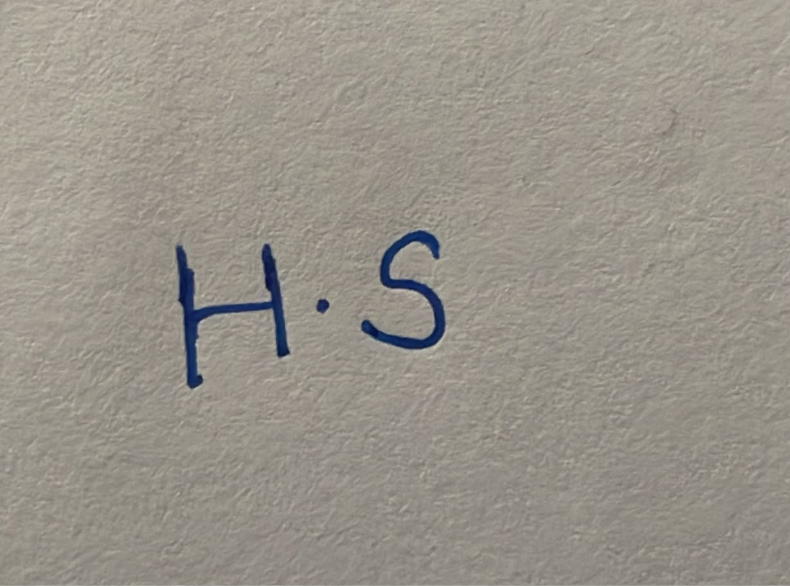
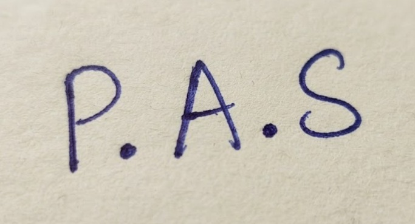
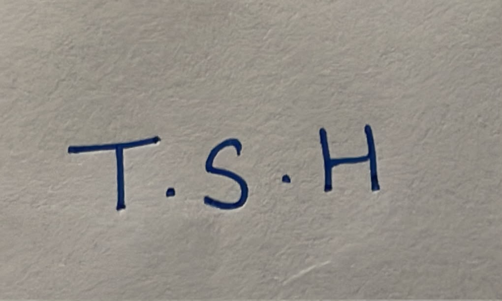

# Deepfake Voice Detection for Indian Languages

A deep learning model that tells whether a speech clip is spoken by a **real person** or **generated by AI**, in **English, Hindi, Tamil and Telugu**.

> DSAI Lab Project · IIT Madras BS Degree

## Why

AI tools can now copy a voice from a few seconds of audio, and cloned voices are used in scam calls. Most existing detectors are trained and tested only on English speech. We test how well detection works for Indian languages, new voice-generation tools and phone-quality audio.

## Approach

- **Data:** Real speech from Kathbath and ASVspoof 2019; fake speech from IndicSynth plus our own clips generated with Indic Parler-TTS, IndicF5 and MMS-TTS.
- **Model:** Fine-tuned XLS-R 300M speech encoder with a small classification head, compared against a spectrogram CNN and AASIST-L.
- **Evaluation:** Equal Error Rate (EER) on in-domain, cross-language, unseen-generator, In-the-Wild and phone-channel tests.
- **Demo:** Gradio web app on Hugging Face Spaces and a Telegram bot, returning a real / AI verdict, a confidence score and a saliency view.

## Repository Structure

```
├── README.md
├── LICENSE                  # MIT licence
├── acknowledgement.md       # Signed acknowledgement of contributions
├── assets/
│   ├── infographics/        # Figures used in the milestone reports
│   └── signatures/          # Member signatures (<roll no>.jpg)
├── milestones/
│   ├── Milestone-1/
│   │   ├── Milestone-1.md   # Problem definition & literature review
│   │   └── worklog.md       # Contributions of each member
│   ├── Milestone-2/
│   │   ├── Milestone-2.md   # Dataset identification & preparation
│   │   ├── worklog.md
│   │   └── ...              # Presentation
│   └── Milestone-3/
│       ├── Milestone-3.md   # Model architecture & end-to-end pipeline check
│       ├── worklog.md
│       └── Milestone-3-presentation.pdf
├── notebooks/
│   ├── Milestone-2/         # EDA notebooks, generation pipeline
│   └── Milestone-3/         # Data preparation and pipeline-check notebooks, run outputs
├── data/README.md           # Layout of the (uncommitted) data folder and how to get it
├── requirements.txt         # Python dependencies
└── scratchpad/              # Personal working notes of each member
```

## Milestones

| # | Milestone | Due | Status |
| --- | --- | --- | --- |
| 1 | [Problem definition & literature review](milestones/Milestone-1/Milestone-1.md) | 22 Oct | Done |
| 2 | [Dataset preparation](milestones/Milestone-2/Milestone-2.md) | 29 Oct | Done |
| 3 | [Model architecture](milestones/Milestone-3/Milestone-3.md) | 5 Nov | Done |
| 4 | Model training | 19 Nov | Planned |
| 5 | Evaluation & analysis | 26 Nov | Planned |
| 6 | Deployment & documentation | 10 Dec | Planned |

## Milestone 3: Model Architecture and Pipeline Check

- **Report:** [Milestone-3.md](milestones/Milestone-3/Milestone-3.md) · [Presentation](milestones/Milestone-3/Milestone-3-presentation.pdf) · [Worklog](milestones/Milestone-3/worklog.md)
- **Notebooks** (saved with their outputs):
  - [`01_data_preparation.ipynb`](notebooks/Milestone-3/01_data_preparation.ipynb): builds the seeded 3,018-clip subset, preprocessing, manifest and leakage checks
  - [`02_pipeline_check.ipynb`](notebooks/Milestone-3/02_pipeline_check.ipynb): XLS-R 300M + classification head, one training epoch, inference and evaluation; outputs in [`run_outputs/`](notebooks/Milestone-3/run_outputs/)

**To reproduce the run:**

1. `pip install -r requirements.txt`
2. Optional: rebuild the subset by running `01_data_preparation.ipynb` (needs access to the gated `ai4bharat/Kathbath` on Hugging Face; about 40 minutes).
3. Run `02_pipeline_check.ipynb` on Kaggle with a T4 GPU and internet on, with the subset dataset attached as input. The audio isn't stored in this repository; see [`data/README.md`](data/README.md) for access.

## Team

| # | Member | Roll No. | Signature |
| --- | --- | --- | --- |
| 1 | Himanshu Saini | 22f3002094 |  |
| 2 | Pal Amitkumar Shish | 21f1006870 |  |
| 3 | Tarika Subhash Hedaoo | 22f3002758 |  |
| 4 | Vikram Singh Negi | 22f3001905 |  |

## Licences

All datasets and models are used for academic research only. MMS-TTS (CC-BY-NC 4.0) and some datasets carry non-commercial terms.
