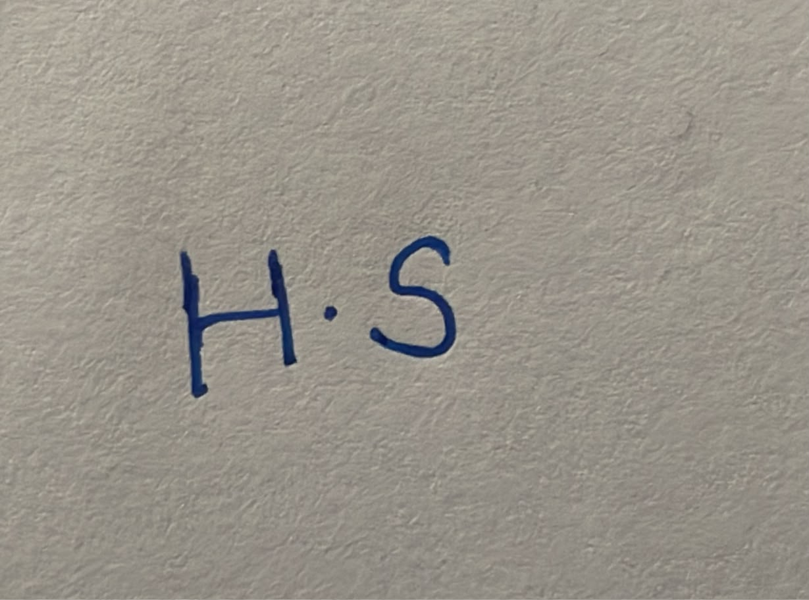
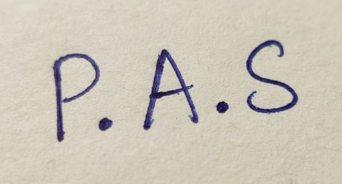
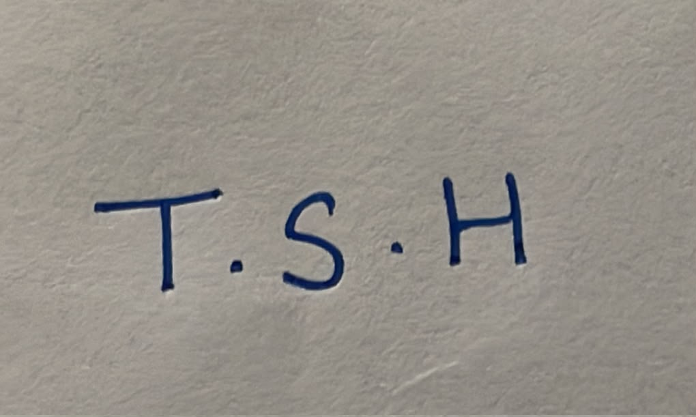
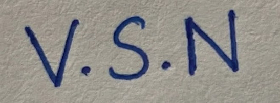

# Deepfake Voice Detection for Indian Languages

A deep learning model that tells whether a speech clip is spoken by a **real person** or **generated by AI**, in **English, Hindi, Tamil and Telugu**.

> DSAI Lab Project · IIT Madras BS Degree

## Why

AI tools can now copy a voice from a few seconds of audio, and cloned voices are used in scam calls. Most existing detectors are trained and tested only on English speech. We test how well detection works for Indian languages, new voice-generation tools and phone-quality audio.

## Approach

- **Data:** Real speech from Kathbath and ASVspoof 2019; fake speech from IndicSynth plus our own clips generated with Indic Parler-TTS, IndicF5 and MMS-TTS.
- **Model:** Fine-tuned XLS-R 300M speech encoder with a small classification head, compared against a spectrogram CNN and AASIST-L.
- **Evaluation:** Equal Error Rate (EER) on in-domain, cross-language, unseen-generator, In-the-Wild and phone-channel tests.
- **Demo:** Gradio web app on Hugging Face Spaces and a Telegram bot, returning a real / AI verdict, a confidence score and a saliency view.

## Repository Structure

```
├── README.md
├── docs/               # Project documentation
├── milestones/
│   └── milestone-1/
│       ├── milestone-1.md   # Problem definition & literature review
│       └── worklog.md       # Contributions of each member
├── data/               # Data scripts (download, generation, splits)
├── notebooks/          # Training and inference notebooks
├── src/                # Model, training and evaluation code
└── app/                # Gradio app and Telegram bot
```

## Milestones

| # | Milestone | Due | Status |
| --- | --- | --- | --- |
| 1 | Problem definition & literature review | 22 Oct | In progress |
| 2 | Dataset preparation | 29 Oct | Planned |
| 3 | Model architecture | 5 Nov | Planned |
| 4 | Model training | 19 Nov | Planned |
| 5 | Evaluation & analysis | 26 Nov | Planned |
| 6 | Deployment & documentation | 10 Dec | Planned |

## Team

| # | Member | Roll No. | Signature |
| --- | --- | --- | --- |
| 1 | Himanshu Saini | 22f3002094 |  |
| 2 | Pal Amitkumar Shish | 21f1006870 |  |
| 3 | Tarika Subhash Hedaoo | 22f3002758 |  |
| 4 | Vikram Singh Negi | 22f3001905 |  |

## Licences

All datasets and models are used for academic research only. MMS-TTS (CC-BY-NC 4.0) and some datasets carry non-commercial terms.
