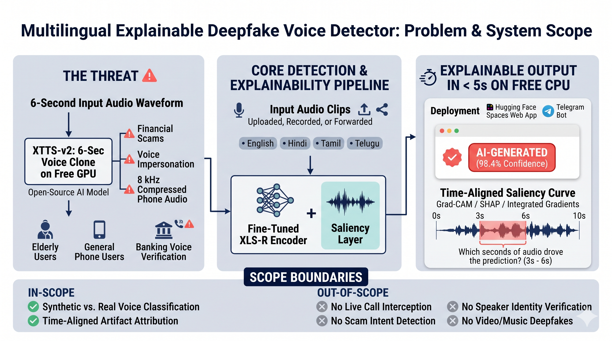
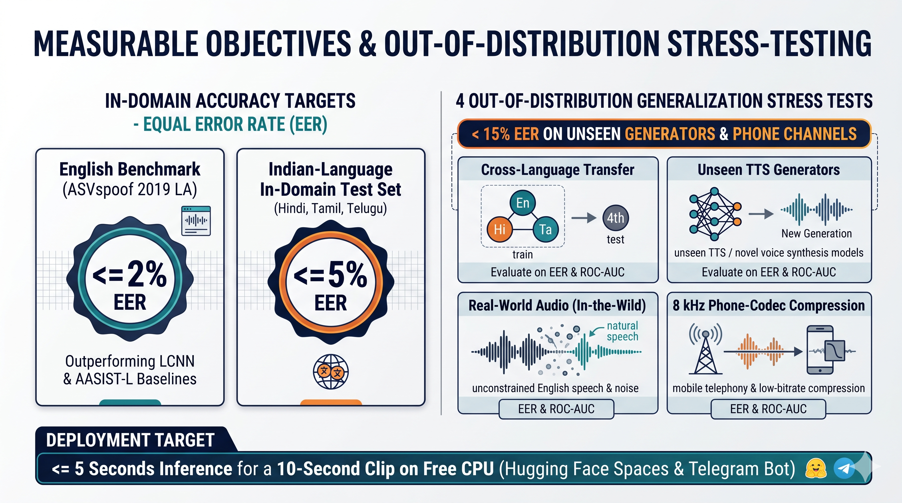
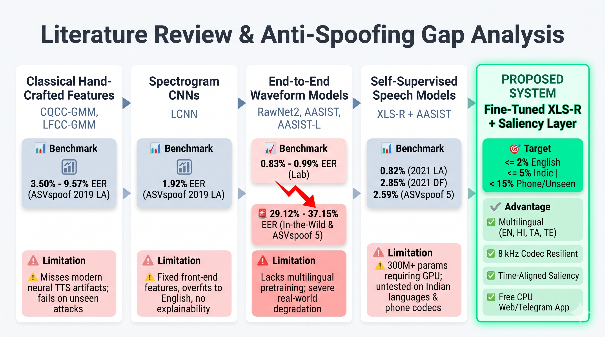
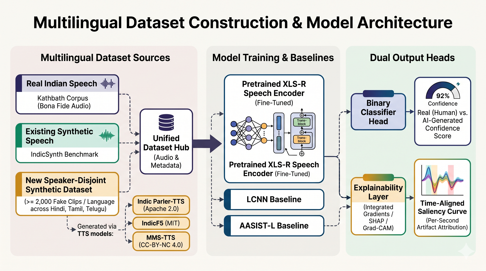

# Deepfake Voice Detection for Indian Languages using Deep Learning and Generative AI

**Milestone 1: Problem Definition & Literature Review**

---

## 1. Problem Statement

Generative AI can now copy a human voice from a few seconds of audio. Open-source voice-cloning models such as XTTS-v2 (Casanova et al., 2024) advertise cloning a voice from "just a 6-second audio clip", and they run on a free GPU. The resulting speech sounds natural, carries the speaker's accent and tone, and is very hard for a listener to tell apart from the real person.

This technology has useful applications, but it is also being misused. Cloned voices are used to:

- Impersonate family members in "emergency" calls asking for money
- Pose as bank officials, police officers or company executives
- Spread fake audio clips of public figures
- Bypass voice-based identity checks

In India, these calls and voice notes arrive in Hindi, Tamil, Telugu and many other languages, not only English. However, almost all published deepfake voice detectors are trained and tested on English speech. Their reliability on Indian languages, on newer voice-generation systems and on low-quality phone audio is largely unknown.

There is a strong need for an accurate, multilingual and explainable AI system that can tell whether a voice is real or AI-generated.

### 1.1 Clear Problem Definition

The problem is:

> How can we accurately detect whether a speech clip is spoken by a real human or generated by AI, in English and Indian languages, and how well does this detection hold up on languages, voice generators and audio conditions it was not trained on?

The system must:

- Take a short speech clip as input (uploaded, recorded or forwarded)
- Predict whether the voice is **real (human)** or **AI-generated**, with a confidence score
- Show which parts of the clip influenced the decision
- Work across English, Hindi, Tamil and Telugu

**Primary objective.** The project is a **real vs AI-generated voice classifier**. It does **not** try to decide whether a call is a scam. Deciding that would require understanding the content and intent of a conversation, which is a separate problem. Voice-cloning scams are the **motivation** for the project, as a real-world case where knowing that a voice is synthetic is valuable. The detector itself judges only the voice, not what is being said.

### 1.2 Current Status of Deepfake Voice Scams

Here are the cases and reports we found, newest first, followed by the surveys and trend reports.

#### 1.2.1 Individual case reports

- Mumbai senior citizen, 69, loses ₹50 lakh in an AI voice-cloning scam where the caller mimicked a respected community figure (Oct 2026) [[Report](https://www.freepressjournal.in/mumbai/mumbai-cyber-fraud-69-year-old-senior-citizen-loses-50-lakh-in-ai-voice-cloning-scam)]
- Indore resident loses ₹1.83 lakh after an AI-generated voice posed as his brother-in-law in Sydney, claiming he faced jail over an expired visa (Jul 2026) [[Report](https://incidentdatabase.ai/cite/1566/)]
- Indore play school owner loses ₹97,500, her savings and teachers' salary money, to a cloned voice of her police-officer cousin; police call it Madhya Pradesh's first such case (Jan 2026) [[Report](https://incidentdatabase.ai/reports/7000/)]
- Powai businessman loses ₹80,000 after fraudsters played his son's cloned voice pleading for bail, posing as the Indian Embassy in Dubai (2024) [[Report](https://incidentdatabase.ai/reports/5140)]
- Delhi and Noida parents get calls with cloned "child's voice" crying for help, one threatening a false rape case against an MBA student [[Report](https://www.tabla.com.sg/news/india/scammers-use-ai-to-clone-kids-voices)]

#### 1.2.2 Surveys and trend reports

- McAfee report finds 83% of Indian AI voice-scam victims lost money, and 69% of Indians can't tell a cloned voice from a real one [[Report](https://www.boomlive.in/amp/explainers/ai-voice-scam-voice-cloning-mcafee-report-21851)]
- About 47% of Indian adults have experienced or know someone who experienced an AI voice scam; tools can clone a voice from three seconds of audio [[Report](https://businessworld.in/article/ai-voice-scams-more-prevalent-in-india-affects-almost-50-indians-mcafee-report-475192)]
- Aggregator summary reports a 450% rise in voice-cloning fraud complaints to Haryana's cyber cell in Q4 2025, and ₹22,846 crore in cyber-fraud losses in 2024 [[Report](https://threatcluster.io/cluster/ai-voice-cloning-scams-surge-in-india-124ab5b6)]

## 2. Scope and Boundaries

### What This Project Covers

- Classifying **short speech clips** as real (human) or AI-generated.
- Four languages: **English, Hindi, Tamil and Telugu**.
- Building a **multilingual evaluation dataset** that combines existing real and fake speech—Kathbath (Javed et al., 2023) and IndicSynth (Sharma et al., 2025)—with **our own generator-labelled fakes** from open-source text-to-speech (TTS) and voice-cloning models.
- **Fine-tuning a pretrained multilingual speech model** (XLS-R; Babu et al., 2021) and comparing it with established baselines.
- Testing how well detection **transfers to unseen languages, unseen voice generators, real-world audio and phone-quality audio**.
- An **explanation view** showing which parts of the clip drove the decision.
- A **demo prototype**: a web app on Hugging Face Spaces and a Telegram bot.

### What This Project Does NOT Cover

- **Scam or intent detection.** The system does not analyse what is said or decide whether a call is fraudulent.
- **Speaker verification.** The system does not check _who_ is speaking, only whether the voice is human or synthetic.
- Real-time interception of live phone calls.
- Languages beyond the four listed above.
- Video deepfakes or music generated by AI.
- Full production deployment for a telecom operator or bank.

---

## 3. Stakeholders

| Stakeholder                           | How They Are Affected                                                                                  |
| ------------------------------------- | ------------------------------------------------------------------------------------------------------ |
| **General Public / Phone Users**      | Primary targets of cloned-voice calls and voice notes; risk financial loss and emotional distress.     |
| **Elderly and Less Tech-Savvy Users** | Especially vulnerable to "family emergency" calls; need a simple way to check a suspicious voice note. |
| **Banks and Financial Institutions**  | Face fraud losses and use voice-based customer verification that cloning can bypass.                   |

---

## 4. Project Objectives

The following objectives are measurable and directly aligned with the problem described above:

1. **Build a multilingual evaluation dataset** for Hindi, Tamil and Telugu. Real speech comes from Kathbath (Javed et al., 2023), and fake speech from IndicSynth (Sharma et al., 2025) plus our own generated set: at least **2,000 fake clips per language** across **3 recent TTS / voice-cloning models**—Indic Parler-TTS (Sankar et al., 2024), IndicF5 (Praveen et al., 2025) and MMS-TTS (Pratap et al., 2023)—each labelled with its generator. All splits will be speaker-disjoint.

2. **Fine-tune a deepfake voice detector** based on a pretrained XLS-R speech encoder (Babu et al., 2021) that achieves:
   - an **Equal Error Rate (EER) of 2% or below** on the ASVspoof 2019 LA evaluation set (English), and
   - an **EER of 5% or below** on our in-domain Indian-language test set.

3. **Outperform baseline models.** The fine-tuned model should achieve a lower EER than a spectrogram-CNN (LCNN) baseline and AASIST-L on every test protocol.

4. **Measure generalisation** using four stress tests, reporting EER for each:
   - **Cross-language:** train on three languages, test on the fourth.
   - **Unseen generator:** hold out one TTS model entirely from training.
   - **Real-world audio:** the In-the-Wild dataset (Müller et al., 2022).
   - **Phone channel:** test audio passed through 8 kHz phone-codec compression.

   Target: keep the unseen-generator and phone-channel EER **below 15%**, compared with the 29–37% EER that standard baselines show on unseen real-world data (Section 5.1.5).

5. **Provide explainable output.** For every prediction, produce a time-aligned saliency curve showing which seconds of the audio drove the decision.

6. **Deliver a working prototype** that accepts an audio clip and returns (a) a real / AI-generated verdict, (b) a confidence score and (c) the saliency view, within **5 seconds for a 10-second clip** on a free CPU instance. It should be accessible through a web app and a Telegram bot.

---

## 5. Literature Review and Existing Solutions

This section reviews academic research, benchmarks and tools for detecting AI-generated speech (also called **spoofing countermeasures** or **anti-spoofing**), highlighting their strengths and weaknesses.

### 5.1 Existing Approaches

Current deepfake voice detection systems mainly rely on:

#### 5.1.1 Hand-Crafted Features with Classical Classifiers

**How they work:** Acoustic features are extracted from the audio, such as Constant-Q Cepstral Coefficients (CQCC) or Linear Frequency Cepstral Coefficients (LFCC). These features are then modelled with Gaussian Mixture Models (GMMs), one for real speech and one for fake speech. CQCC-GMM (B1) and LFCC-GMM (B2) were the official baselines of the ASVspoof 2019 challenge (Todisco et al., 2019; Wang et al., 2020), while subsequent work showed that higher-resolution LFCC features substantially reduce the GMM error rate (Tak et al., 2020).

| Model                           | Dataset          | EER (%) | min t-DCF |
| ------------------------------- | ---------------- | ------- | --------- |
| CQCC-GMM (official baseline B1) | ASVspoof 2019 LA | 9.57    | 0.2366    |
| LFCC-GMM (official baseline B2) | ASVspoof 2019 LA | 8.09    | 0.2116    |
| LFCC-GMM (high-resolution)      | ASVspoof 2019 LA | 3.50    | 0.0904    |

**Strengths:**

- Simple, fast and well understood.
- Low computational cost; no GPU needed.
- Features have a clear signal-processing meaning.

**Weaknesses:**

- Hand-designed features miss many artefacts of modern neural voice generators.
- Error rates are high compared with deep learning methods.
- Generalise poorly to attacks not seen during training.

---

#### 5.1.2 CNN-Based Approaches on Spectrograms (LCNN)

**How they work:** The audio is converted into a time-frequency image (spectrogram or LFCC features), and a Convolutional Neural Network learns to find patterns that distinguish real and fake speech. The **Light CNN (LCNN)**, which uses a "max-feature-map" activation, became a standard architecture after it performed strongly in ASVspoof 2019 (Lavrentyeva et al., 2019).

Wang & Yamagishi (2021) compared several recent neural countermeasures and reported a best single-model **EER of 1.92%** on ASVspoof 2019 LA.

**Strengths:**

- Large improvement over GMM baselines.
- Spectrograms are easy to visualise and interpret.
- Relatively light models that train on a single GPU.

**Weaknesses:**

- Depend on the choice of front-end features (fixed spectrogram settings).
- Still trained on a single English dataset, so they overfit to its attacks.
- Operate as black boxes with no explanation of the decision.

---

#### 5.1.3 End-to-End Raw Waveform Models (RawNet2, AASIST)

**How they work:** Instead of hand-designed features, these models read the raw audio waveform directly and learn their own features. **RawNet2** (Tak et al., 2021) uses learnable sinc filters followed by residual blocks. **AASIST** (Jung et al., 2022) adds graph attention networks that model relationships across both time and frequency.

| Model                  | Dataset          | EER (%) | min t-DCF | Parameters |
| ---------------------- | ---------------- | ------- | --------- | ---------- |
| RawNet2                | ASVspoof 2019 LA | 4.66    | 0.1294    | ~25M       |
| AASIST                 | ASVspoof 2019 LA | 0.83    | 0.0275    | ~297K      |
| AASIST-L (lightweight) | ASVspoof 2019 LA | 0.99    | 0.0309    | ~85K       |

**Strengths:**

- State-of-the-art accuracy among models trained from scratch.
- AASIST-L is extremely small (~85K parameters), so it is easy to train and deploy.
- No manual feature engineering.

**Weaknesses:**

- Trained only on English ASVspoof data; performance drops sharply on new data (see Section 5.1.5).
- Learn from limited training data, with no prior knowledge of speech from other languages.
- No explanation layer.

---

#### 5.1.4 Self-Supervised Speech Models (wav2vec 2.0 / XLS-R)

**How they work:** Self-supervised models are pretrained on very large amounts of unlabelled speech and learn general representations of speech. **XLS-R** (Babu et al., 2021) was pretrained on about **436,000 hours** of speech in **128 languages**, including Indian languages, and comes in 300M, 1B and 2B parameter versions. For deepfake detection, the pretrained encoder is fine-tuned together with a small classification head.

Tak et al. (2022) fine-tuned wav2vec 2.0 XLS-R (300M) with an AASIST back-end and RawBoost data augmentation, reporting the lowest EERs at the time on the harder ASVspoof 2021 datasets:

| Model                                     | ASVspoof 2021 LA EER (%) | ASVspoof 2021 DF EER (%) |
| ----------------------------------------- | ------------------------ | ------------------------ |
| Sinc-layer AASIST (baseline)              | 11.47                    | 21.06                    |
| wav2vec 2.0 XLS-R + AASIST                | 6.15                     | 7.69                     |
| wav2vec 2.0 XLS-R + AASIST + augmentation | **0.82**                 | **2.85**                 |

**Strengths:**

- Best published accuracy, with up to ~93% relative reduction in EER compared with the baseline.
- Multilingual pretraining gives a strong starting point for non-English speech.
- Needs less task-specific labelled data than training from scratch.

**Weaknesses:**

- Computationally heavier (300M+ parameters; needs a GPU for fine-tuning).
- Published results are still evaluated only on English benchmarks.
- Behaviour on Indian languages is largely untested.

---

#### 5.1.5 Generalisation Studies: Do Detectors Work Outside the Lab?

Several studies show that detectors trained on lab benchmarks fail on new data.

**In-the-Wild (Müller et al., 2022)** collected 37.9 hours of real and fake audio of 58 politicians and celebrities from the internet and evaluated re-implemented models trained on ASVspoof 2019 LA:

| Model                  | ASVspoof 2019 EER (%) | In-the-Wild EER (%) |
| ---------------------- | --------------------- | ------------------- |
| RawGAT-ST (full input) | 1.23                  | 37.15               |
| RawNet2 (4 s input)    | 4.35                  | 33.94               |

Error rates increased about **8 to 30 times** on real-world audio.

**ASVspoof 5 (Wang et al., 2024)**, the latest challenge, uses crowdsourced English data with 32 spoofing and adversarial attacks (16 unseen attacks in the evaluation set). In Track 1, the official baselines reached evaluation EERs of **36.04% (RawNet2, B01)** and **29.12% (AASIST, B02)**, while the best open-condition system using a self-supervised model reached **2.59%**. This again shows the advantage of self-supervised pretraining. All ASVspoof editions are **English only**.

**IndicSynth (Sharma et al., 2025)** released 4,000 hours of synthetic speech in 12 low-resource Indian languages from 989 target speakers. The authors note that anti-spoofing models are **linguistically biased** and perform poorly on languages they were not trained on. Most existing synthetic speech datasets are in English or Chinese.

**Strengths:**

- Expose the real-world weakness of lab-trained detectors.
- Provide new test data for evaluating generalisation.

**Weaknesses:**

- In-the-Wild and ASVspoof 5 are English only.
- Few studies measure transfer across Indian languages or to the newest Indic TTS and voice-cloning models.
- Phone-channel robustness for Indian-language speech is rarely reported.

---

#### 5.1.6 Explainable AI (XAI) for Audio

A few studies apply explanation methods such as **Integrated Gradients** (Sundararajan et al., 2017), **SHAP** and **Grad-CAM** to anti-spoofing models to show which parts of the audio matter for the decision.

**Strengths:**

- Show where in the clip the model "heard" the fake.
- Help researchers detect shortcut learning (e.g., a model relying on silence instead of the voice).

**Weaknesses:**

- Rarely included in user-facing tools.
- Explanations are often technical heatmaps that non-technical users find hard to read.

---

#### 5.1.7 Commercial and Industry Tools

Some companies offer AI voice detection services (for example, voice-security vendors for call centres, and TTS providers that detect audio from their own models).

**Strengths:**

- Production-ready and integrated into business workflows.

**Weaknesses:**

- Closed source, with no published benchmarks on Indian languages.
- Some only detect audio produced by the vendor's own generator.
- Not freely available to the general public.

---

### 5.2 Industry Standards & Evaluation Metrics

Deepfake voice detection is evaluated using standard metrics from the ASVspoof challenges:

- **Equal Error Rate (EER):** The error rate at the threshold where the false acceptance rate (fake accepted as real) equals the false rejection rate (real rejected as fake). Lower is better. **This is the primary standalone countermeasure metric across the literature.**
- **Minimum tandem Detection Cost Function (min t-DCF):** The primary ASV-centric metric in ASVspoof 2019 and 2021, which measures the combined impact of the spoofing detector and an automatic speaker verification (ASV) system (supplemented by minDCF and min a-DCF in ASVspoof 5).
- **ROC-AUC:** The area under the ROC curve; measures how well the model ranks fake clips above real ones.
- **Accuracy, Precision, Recall and F1-Score:** Reported at the chosen operating threshold for the demo.

Because the decision threshold may change between datasets, the most important metrics for this project are:

- **EER** (threshold-independent comparison with published work)
- **ROC-AUC** (overall ranking quality)
- **EER change under cross-language, unseen-generator and phone-channel tests** (generalisation)

### 5.3 Benchmark Datasets

| Dataset                              | Language             | Content                                                                                                                                    | Use in our project                                                                                                 |
| ------------------------------------ | -------------------- | ------------------------------------------------------------------------------------------------------------------------------------------ | ------------------------------------------------------------------------------------------------------------------ |
| ASVspoof 2019 LA (Wang et al., 2020) | English              | Real + fake speech across 19 TTS / voice-conversion attack conditions (A01–A19)                                                            | English training and benchmark comparison                                                                          |
| In-the-Wild (Müller et al., 2022)    | English              | 37.9 h real + fake audio of 58 public figures                                                                                              | Real-world test only                                                                                               |
| Kathbath (Javed et al., 2023)        | 12 Indian languages  | 1,684 h of real read speech from 1,218 speakers                                                                                            | Real Hindi, Tamil and Telugu speech                                                                                |
| IndicSynth (Sharma et al., 2025)     | 12 Indian languages  | 4,000 h of synthetic speech, 989 target speakers                                                                                           | Main source of Indian-language fakes                                                                               |
| **Our generated set**                | Hindi, Tamil, Telugu | At least 2,000 fake clips per language across 3 recent models, each labelled with its generator, made from Kathbath sentences and speakers | **New contribution**: unseen-generator tests and a check that the model learns real vs AI, not dataset differences |

**Generators planned for our dataset:**

| Model                                  | Type                          | Languages                            | Licence      |
| -------------------------------------- | ----------------------------- | ------------------------------------ | ------------ |
| Indic Parler-TTS (Sankar et al., 2024) | Prompt-guided text-to-speech  | Hindi, Tamil, Telugu + 18 others     | Apache 2.0   |
| IndicF5 (Praveen et al., 2025)         | Zero-shot voice cloning / TTS | Hindi, Tamil, Telugu + 8 others      | MIT (gated)  |
| MMS-TTS (Pratap et al., 2023)          | Text-to-speech (VITS)         | Hindi, Tamil, Telugu + 1,100+ others | CC-BY-NC 4.0 |

All licences permit academic use. Non-commercial terms will be stated in the dataset card.

---

## 6. Gap Analysis and Our Approach

Based on the literature review, the following key gaps exist in current solutions:

### 6.1 Gaps in Existing Work

| Gap                              | Description                                                                                                                               |
| -------------------------------- | ----------------------------------------------------------------------------------------------------------------------------------------- |
| **English-only benchmarks**      | ASVspoof 2019, 2021, 5 and In-the-Wild are all English. Detector performance on Hindi, Tamil and Telugu is largely unknown.               |
| **Poor generalisation**          | Lab-trained detectors show EERs of 29–37% on unseen real-world data, compared with about 1% on their own benchmark.                       |
| **Outdated attacks**             | Benchmarks use older TTS systems. Newer Indic models (Indic Parler-TTS, IndicF5) are not covered by the detection benchmarks we reviewed. |
| **No phone-channel testing**     | Scam audio arrives through compressed calls and voice notes, but most results are reported on clean audio.                                |
| **Black-box predictions**        | Most detectors output only a score, with no indication of which part of the audio is suspicious.                                          |
| **Not accessible to the public** | Research models stay in papers; commercial tools are closed and not freely available.                                                     |

### 6.2 How Our Approach Addresses These Gaps

| Our Component                                                | Gap Addressed                                                                                                                              |
| ------------------------------------------------------------ | ------------------------------------------------------------------------------------------------------------------------------------------ |
| **Generator-labelled Indic fake speech set (Generative AI)** | Adds the newest open Indic TTS and voice-cloning models to existing data, so detection can be tested on generators held out from training. |
| **Fine-tuned XLS-R detector (Deep Learning)**                | Multilingual pretraining on 128 languages gives a strong base for Indian-language speech.                                                  |
| **Cross-language and unseen-generator tests**                | Directly measure generalisation instead of only in-domain accuracy.                                                                        |
| **Phone-codec augmentation and testing**                     | Trains and tests the model under realistic call conditions.                                                                                |
| **Saliency explanation**                                     | Shows which seconds of the clip drove the decision.                                                                                        |
| **Web app + Telegram bot**                                   | Makes detection available in a messaging app, where users can simply forward a suspicious voice note.                                      |

### 6.3 Key Differences from Existing Systems

| Feature                                 | Classical (GMM) | CNN / End-to-End (LCNN, AASIST) | SSL Models (XLS-R + AASIST) | Proposed System |
| --------------------------------------- | --------------- | ------------------------------- | --------------------------- | --------------- |
| Learned features                        | No              | Yes                             | Yes                         | Yes             |
| Multilingual pretraining                | No              | No                              | Yes                         | Yes             |
| Tested on Indian languages              | No              | No                              | Limited                     | **Yes**         |
| Cross-language / unseen-generator tests | No              | Limited                         | Limited                     | **Yes**         |
| Phone-channel robustness                | No              | No                              | Limited                     | **Yes**         |
| Explanation of decision                 | No              | No                              | No                          | **Yes**         |
| Public demo (web + Telegram)            | No              | No                              | No                          | **Yes**         |

### 6.4 Opportunities

This project creates major opportunities:

1. Protect people from voice-cloning fraud in their own language
2. Provide the first open benchmark of detectors on recent Indic TTS and voice-cloning models
3. Give fact-checkers and cyber cells a free tool to verify suspicious audio
4. Show how multilingual self-supervised models transfer to low-resource languages
5. Extend the framework to:
   - More Indian languages (e.g., Bengali, Marathi, Kannada, Malayalam)
   - Detection of AI-generated audio in videos
   - Integration with telecom or messaging platforms as a warning feature

---

## 7. References

1. Wang, X., Yamagishi, J., Todisco, M., et al. (2020). _ASVspoof 2019: A large-scale public database of synthesized, converted and replayed speech_. Computer Speech & Language, 64. <https://arxiv.org/abs/1911.01601>
2. Todisco, M., Wang, X., Vestman, V., et al. (2019). _ASVspoof 2019: Future Horizons in Spoofed and Fake Audio Detection_. Interspeech 2019. <https://arxiv.org/abs/1904.05441>
3. Tak, H., Patino, J., Nautsch, A., et al. (2020). _Spoofing Attack Detection using the Non-linear Fusion of Sub-band Classifiers_. Interspeech 2020. <https://arxiv.org/abs/2005.10393>
4. Lavrentyeva, G., Novoselov, S., Tseren, A., et al. (2019). _STC Antispoofing Systems for the ASVspoof2019 Challenge_. Interspeech 2019. <https://arxiv.org/abs/1904.05576>
5. Wang, X., & Yamagishi, J. (2021). _A Comparative Study on Recent Neural Spoofing Countermeasures for Synthetic Speech Detection_. Interspeech 2021. <https://arxiv.org/abs/2103.11326>
6. Tak, H., Patino, J., Todisco, M., et al. (2021). _End-to-End Anti-Spoofing with RawNet2_. ICASSP 2021. <https://arxiv.org/abs/2011.01108>
7. Jung, J., Heo, H. S., Tak, H., et al. (2022). _AASIST: Audio Anti-Spoofing using Integrated Spectro-Temporal Graph Attention Networks_. ICASSP 2022. <https://arxiv.org/abs/2110.01200>
8. Babu, A., Wang, C., Tjandra, A., et al. (2021). _XLS-R: Self-supervised Cross-lingual Speech Representation Learning at Scale_. arXiv. <https://arxiv.org/abs/2111.09296>
9. Tak, H., Todisco, M., Wang, X., et al. (2022). _Automatic Speaker Verification Spoofing and Deepfake Detection using wav2vec 2.0 and Data Augmentation_. Odyssey 2022. <https://arxiv.org/abs/2202.12233>
10. Müller, N. M., Czempin, P., Dieckmann, F., et al. (2022). _Does Audio Deepfake Detection Generalize?_. Interspeech 2022. <https://arxiv.org/abs/2203.16263>
11. Wang, X., Delgado, H., Tak, H., et al. (2024). _ASVspoof 5: Crowdsourced Speech Data, Deepfakes, and Adversarial Attacks at Scale_. ASVspoof Workshop 2024. <https://arxiv.org/abs/2408.08739>
12. Sharma, D. V., Ekbote, V., & Gupta, A. (2025). _IndicSynth: A Large-Scale Multilingual Synthetic Speech Dataset for Low-Resource Indian Languages_. ACL 2025. <https://aclanthology.org/2025.acl-long.1070>
13. Javed, T., Bhogale, K. S., Raman, A., et al. (2023). _IndicSUPERB: A Speech Processing Universal Performance Benchmark for Indian Languages_. AAAI 2023. <https://arxiv.org/abs/2208.11761>
14. Sundararajan, M., Taly, A., & Yan, Q. (2017). _Axiomatic Attribution for Deep Networks_. ICML 2017. <https://arxiv.org/abs/1703.01365>
15. Sankar, A., Lacombe, Y., Thomas, S., et al. (2024). _Indic Parler-TTS: Multilingual Text-to-Speech for Indian Languages_. Hugging Face. <https://huggingface.co/ai4bharat/indic-parler-tts>
16. Praveen, S. V., Anand, S., Siddhartha, S., et al. (2025). _IndicF5: High-Quality Text-to-Speech for Indian Languages_. Hugging Face. <https://huggingface.co/ai4bharat/IndicF5>
17. Casanova, E., Davis, K., Gölge, E., et al. (2024). _XTTS: A Massively Multilingual Zero-Shot Text-to-Speech Model_. Interspeech 2024. <https://arxiv.org/abs/2406.04904>
18. Pratap, V., Tjandra, A., Shi, B., et al. (2023). _Scaling Speech Technology to 1,000+ Languages_. arXiv. <https://arxiv.org/abs/2305.13516>
