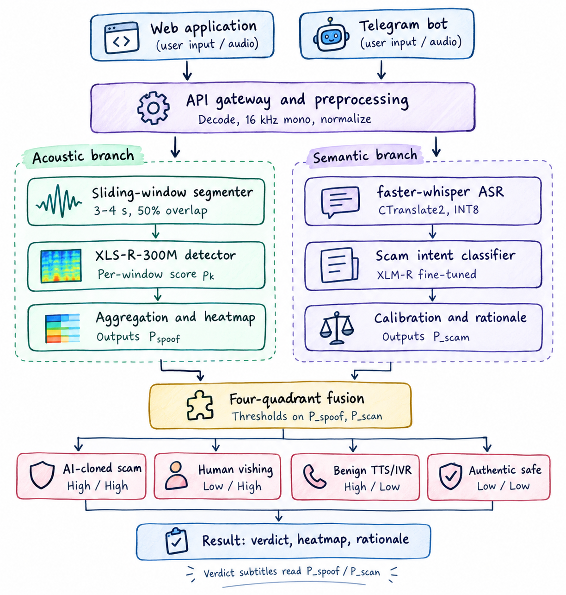

# Deepfake Voice and Scam Detection Using Deep Learning

  
   
  <em>Figure 1: High-level architecture of the proposed deepfake voice and scam detection system.</em>

## 1. Problem Statement

AI-generated voices are making phone and voice-message scams harder to spot, especially in multilingual regions like India. Most people cannot tell a cloned voice from a real one, and manual verification is unreliable.

This project aims to build an end-to-end system that detects AI-generated speech and flags likely scams by analyzing both the audio and its spoken content.

Given an audio clip with:

- Speech in English, Hindi, Tamil or Telugu
- Any length, recorded or uploaded
- Clean or phone-quality sound

The system must:

- Predict the probability that the clip is AI-generated
- Highlight the audio segments that influenced the decision
- Stay reliable on languages and voice generators not seen during training

The system also gives a scam verdict, and users can check suspicious calls and voice messages through a simple web app and Telegram bot. Beyond binary classification, it tests how well detection holds up across languages, unseen generators and real-world conditions.

## 2. Current Status of Deepfake Voice Scams

Here are the cases and reports we found, newest first, followed by the surveys and trend reports.

### 2.1 Individual case reports

- Mumbai senior citizen, 69, loses ₹50 lakh in an AI voice-cloning scam where the caller mimicked a respected community figure (Oct 2026) [[Report](https://www.freepressjournal.in/mumbai/mumbai-cyber-fraud-69-year-old-senior-citizen-loses-50-lakh-in-ai-voice-cloning-scam)]
- Indore resident loses ₹1.83 lakh after an AI-generated voice posed as his brother-in-law in Sydney, claiming he faced jail over an expired visa (Jul 2026) [[Report](https://incidentdatabase.ai/cite/1566/)]
- Indore play school owner loses ₹97,500, her savings and teachers' salary money, to a cloned voice of her police-officer cousin; police call it Madhya Pradesh's first such case (Jan 2026) [[Report](https://incidentdatabase.ai/reports/7000/)]
- Powai businessman loses ₹80,000 after fraudsters played his son's cloned voice pleading for bail, posing as the Indian Embassy in Dubai (2024) [[Report](https://incidentdatabase.ai/reports/5140)]
- Delhi and Noida parents get calls with cloned "child's voice" crying for help, one threatening a false rape case against an MBA student [[Report](https://www.tabla.com.sg/news/india/scammers-use-ai-to-clone-kids-voices)]

### 2.2 Surveys and trend reports

- McAfee report finds 83% of Indian AI voice-scam victims lost money, and 69% of Indians can't tell a cloned voice from a real one [[Report](https://www.boomlive.in/amp/explainers/ai-voice-scam-voice-cloning-mcafee-report-21851)]
- About 47% of Indian adults have experienced or know someone who experienced an AI voice scam; tools can clone a voice from three seconds of audio [[Report](https://businessworld.in/article/ai-voice-scams-more-prevalent-in-india-affects-almost-50-indians-mcafee-report-475192)]
- Aggregator summary reports a 450% rise in voice-cloning fraud complaints to Haryana's cyber cell in Q4 2025, and ₹22,846 crore in cyber-fraud losses in 2024 [[Report](https://threatcluster.io/cluster/ai-voice-cloning-scams-surge-in-india-124ab5b6)]

## 3. Scope and Boundaries

### 3.1 In Scope

- Detecting AI-generated (deepfake) speech in English, Hindi, Tamil and Telugu
- Building a dataset of real speech and AI-generated voices from multiple generators, including clean and phone-quality audio
- Training deep learning models for real vs. fake classification with a probability score
- Highlighting the audio segments that most influenced the prediction
- Evaluating generalization to unseen languages, unseen voice generators and noisy or compressed audio
- Delivering a simple web application and Telegram bot for uploading audio and viewing results (fake probability, highlighted segments, scam verdict)
- Transcribing speech and using NLP to flag scam patterns (requests for money, OTPs, personal information, urgent payments)

### 3.2 Out of Scope

- Languages beyond English, Hindi, Tamil and Telugu
- Real-time detection during live phone calls, and integration with telecom networks or dialer apps
- Video deepfakes and lip-sync analysis
- Identifying or verifying a specific speaker, or tracing which generator produced a clip
- Blocking calls, reporting scammers or taking any automated action against them
- Production-grade deployment, large-scale infrastructure and mobile apps
- Legal or forensic certification of results

## 4. Stakeholders

| Stakeholder                                                  | How They Are Affected                                                                                        |
| ------------------------------------------------------------ | ------------------------------------------------------------------------------------------------------------ |
| **General public / phone users**                             | Main targets of voice-cloning scams; risk financial loss and need a simple way to verify calls and messages. |
| **Elderly and non-technical users**                          | Most vulnerable to impersonation scams; need clear, simple verdicts.                                         |
| **Multilingual communities (English, Hindi, Tamil, Telugu)** | Often underserved by English-centric detectors; poor accuracy leaves them exposed.                           |
| **Banks and fintech providers**                              | Face fraud losses from voice-based social engineering; can use detection to protect customers.               |
| **Telecom operators**                                        | Their networks carry scam calls; need detection that works on phone-quality audio.                           |
| **Law enforcement**                                          | Need reliable, explainable evidence to triage and investigate cases.                                         |
| **Regulators and policymakers**                              | Need evidence of detector robustness across languages and generators to shape policy.                        |
| **Journalists and fact-checkers**                            | Must verify audio authenticity; segment highlights support their work.                                       |
| **People whose voices are cloned**                           | Risk misuse of their voice and reputational harm from false "AI-generated" flags.                            |
| **TTS developers and platforms**                             | Their generators are detection targets; detectors must keep pace with new models.                            |
| **Researchers and ML community**                             | Gain benchmarks for cross-lingual, cross-generator deepfake detection.                                       |
| **Project developers**                                       | Build and maintain the system, including model updates and privacy handling of user audio.                   |

## 5. Project Objectives

- **Detect AI-generated speech:** Output a probability that a clip is AI-generated, with an Equal Error Rate (EER) ≤ 10% on test data in English, Hindi, Tamil and Telugu.
- **Generalize to unseen generators:** Keep EER ≤ 20% on held-out voice generators not seen in training, evaluated with leave-one-generator-out testing.
- **Generalize across languages:** Keep the EER gap between each language and the best-performing language ≤ 10 percentage points, with per-language results reported.
- **Explain decisions:** Highlight the audio segments that influenced each prediction, and verify that removing them lowers the AI-generated score in at least 80% of correctly flagged clips.
- **Flag scams from audio and content:** Transcribe speech and combine content analysis with the detection score to give a scam verdict, targeting F1 ≥ 0.85 on a labelled scam/non-scam test set across all four languages.
- **Deliver accessible tools:** Provide a web app and Telegram bot that return a verdict, probability and highlighted segments within 30 seconds for a 1-minute clip.

## 6. Literature Review

### 6.1 Evolution of Acoustic Deepfake Detection

- **Accessibility of Voice Cloning:** Recent advancements in zero-shot text-to-speech (TTS), neural voice conversion (VC), and flow-matching vocoders have democratized high-fidelity voice cloning.
- **Impact on Human Perception:**
  - Average listener detection accuracy drops to **73.00%** (Zhang et al., 2025; Li et al., 2025).
  - Under mobile compression, human detection degrades to **near-chance levels**.
- **Evolution of Defenses:** Acoustic countermeasures have advanced across three distinct generations to address these emerging threats (Yi et al., 2023; Zhang et al., 2025).

| Approach                                                          | Models / Frontend                                                                                                                                          | Performance (EER)                                                                                          | Limitations / Advantages                                                                                                                     |
| ----------------------------------------------------------------- | ---------------------------------------------------------------------------------------------------------------------------------------------------------- | ---------------------------------------------------------------------------------------------------------- | -------------------------------------------------------------------------------------------------------------------------------------------- |
| Handcrafted Spectral Frontends                                    | Constant-Q Cepstral Coefficients (`CQCC`), Linear Frequency Cepstral Coefficients (`LFCC`), Log-Mel spectrograms with `GMM`, `LCNN`, or `LSTM` classifiers | 5.06%–9.57% on clean studio speech (ASVspoof 2019 LA); 15.62%–25.56% under telephony and codec compression | Discard phase information, reducing robustness to channel distortions and codec compression.                                                 |
| End-to-End Waveform and Graph Networks                            | `RawNet2` with learnable `SincNet` filterbanks; `AASIST` with spectro-temporal graph attention                                                             | 0.83% on clean English; 29.12% on crowdsourced ASVspoof 5; 43.32% on multilingual Asian speech             | Learn directly from raw waveforms, but unaugmented models overfit to training codecs and languages, limiting cross-domain generalization.    |
| Self-Supervised Cross-Lingual Frontends with Channel Augmentation | `wav2vec 2.0 XLS-R-300M`, pretrained on 436,000 hours across 128 languages, combined with `RawBoost` noise augmentation and codec simulation               | 0.82%–1.00% on ASVspoof 2021 LA (telephony); 2.85% on ASVspoof 2021 DF (compressed speech)                 | Captures language-invariant vocal-tract dynamics. Channel augmentation and codec simulation improve robustness to telephony and compression. |

### 6.2 Cross-Lingual Generalization and Telephony Robustness

- **Domain Shift Drivers:** Recent multilingual corpora (MLAAD, SpeechFake, IndicFake, SEA-Spoof, IndicSynth, and LRLspoof) show that language mismatch and commercial synthesis APIs cause severe domain shift.
- **Monolingual Degradation:** English-trained detectors suffer steep performance drops on Indic speech:
- **SpeechFake:** Degrades to **20.25% EER** on unseen Hindi.
- **SEA-Spoof:** Degrades to **64.50%–68.60% EER** on commercial Hindi and Tamil synthesis.

- **Mitigation via Representation & Fine-Tuning:**
- Swapping scratch encoders for `XLS-R` cuts unseen Hindi EER by **95% relative** (down to **0.98%**).
- Fine-tuning on regional Indic data drives both Hindi and Tamil EER below **0.10%**.

- **Telephony Channel Challenges:** Common codecs across PSTN, VoIP, and messaging (8 kHz A-law, μ-law, AMR-WB, Opus) cut off frequencies above 3.4–4.0 kHz—masking key neural vocoder artifacts and making explicit telephony augmentation during training essential.

### 6.3 Conversational Scam Detection and Commercial Defenses

- **Siloed Defenses:** Current fraud protection tools operate in isolated modalities rather than assessing threat vectors holistically.
- **Acoustic & Metadata Gaps:** Enterprise telecom suites and consumer call apps focus on caller-ID reputation or synthetic voice liveness, but overlook scam semantics and intent in Indian vernacular languages.
- **Semantic Gaps:** Text-based fraud detectors trained on datasets like ICFD-31k use fine-tuned transformers (`BERT`, `RoBERTa`, `XLM-R`) to effectively spot coercive scam intent (**99.40%** in-domain F1; **92.97%** unseen-fraud F1), but cannot verify if the incoming voice is an AI-generated clone.

### 6.4 Comparison of Existing Literature

| Study                                                                  | Approach                                                                                                    | Data Used                                                                                   | Metrics Reported                                                                                                          | Limitations                                                                                                                                  |
| :--------------------------------------------------------------------- | :---------------------------------------------------------------------------------------------------------- | :------------------------------------------------------------------------------------------ | :------------------------------------------------------------------------------------------------------------------------ | :------------------------------------------------------------------------------------------------------------------------------------------- |
| Jung et al. (2022)                                                     | `AASIST`: SincNet frontend with spectro-temporal graph attention                                            | ASVspoof 2019 LA (clean English TTS & VC)                                                   | 0.83% EER, 0.0275 min t-DCF (ASV19 LA)                                                                                    | Degrades to 20.25%–43.32% EER on unseen Indic languages and 29.12% EER on crowdsourced audio                                                 |
| Tak et al. (2022a, 2022b)                                              | `XLS-R-300M` + self-attention pooling with `RawBoost` & codec augmentation                                  | ASVspoof 2019 LA (train); ASVspoof 2021 LA & DF (eval)                                      | 0.82%–1.00% EER (2021 LA), 2.85% EER (2021 DF); `RawBoost` cuts `RawNet2` EER from 9.50% to 5.31%                         | Utterance-level acoustic scoring only; no Indic fine-tuning or semantic scam analysis                                                        |
| Yi et al. (2023)                                                       | Benchmark survey comparing handcrafted (`LFCC`/`CQCC`) vs. SSL (`Wav2Vec 2.0`) detectors                    | ASVspoof 2021, ADD 2023, In-the-Wild (ITW)                                                  | `LFCC-LCNN` >22% EER (2021 DF) and 66.72% WEER (ADD 2023) vs. `Wav2Vec 2.0` 30.05% WEER                                   | Lacks Indic language evaluation, streaming segment localization, and scam intent detection                                                   |
| Müller et al. (2024)                                                   | Cross-dataset generalization benchmark using the `MLAAD` training corpus                                    | MLAAD (1,153.6 h, 23–54 languages, 26–205 TTS models)                                       | Outperforms ASVspoof 2019 training on 4 of 8 unseen deepfake benchmarks                                                   | TTS-only (no VC or telephony codecs); sparse Dravidian coverage; no fraud transcripts                                                        |
| Zhang et al. (2025)                                                    | Survey and evaluation of SSL frontends (`XLS-R + SLS`) with data augmentation                               | 100+ studies; ASVspoof 2019/2021/5, ADD 2022/2023, ITW                                      | Human accuracy 73.00%; `XLS-R + SLS` achieves 2.09% EER (2021 DF) and 8.87% EER (ITW)                                     | Lacks segment-level user explainability and joint acoustic-semantic scam detection                                                           |
| Li et al. (2025)                                                       | Systematic review of feature pipelines, loss functions, and partial spoofing                                | 200+ papers across ASVspoof, WaveFake, and partial-spoof corpora                            | Documents severe EER degradation of global pooling models under codec compression and partial edits                       | Survey study; highlights vulnerability of fixed-length global pooling to variable-duration calls                                             |
| Huang et al. (2025)                                                    | `SpeechFake` benchmark evaluating `AASIST` vs. `XLS-R + AASIST` cross-lingually                             | SpeechFake (>3,000 h, 3.34M fake clips, 46 languages, 40 generators)                        | `XLS-R + AASIST`: 3.54% EER (overall), 0.98% EER (unseen Hindi vs. 20.25% for `AASIST`), 0.23% EER (37 unseen langs)      | Clean 16 kHz studio audio without PSTN/VoIP codec degradation or conversational scam labels                                                  |
| Ranjan et al. (2025)                                                   | `SAFARI-LLM`: Whisper + m-HuBERT fused via AFUM and LoRA-tuned LLaMA-7B                                     | IndicFake (7,350 h, >4.2M samples across English + 17 Indian languages)                     | 94.21% Acc (WaveFake), 84.48% Acc (DECRO), outperforming 14 SOTA baselines                                                | 7B-parameter LLM incurs high GPU latency; classifies audio authenticity rather than scam intent                                              |
| Wu et al. (2025)                                                       | `SEA-Spoof` benchmark with fine-tuned `MoLEx` (WavLM mixture-of-experts)                                    | SEA-Spoof (711.1 h, 554k clips, 6 languages including Hindi & Tamil, 14 TTS/APIs)           | Zero-shot `MoLEx` 64.50% EER (HI) & 68.60% (TA) on commercial TTS; fine-tuned `MoLEx` reaches 0.06% (HI) & 0.08% (TA) EER | Excludes Telugu; clean 16 kHz FLAC without narrowband telephony compression or scam NLP                                                      |
| Sharma et al. (2025)                                                   | `IndicSynth` corpus construction and bias-mitigation benchmark                                              | IndicSynth (4,000+ h, 1.91M synthetic clips, 12 Indian languages including HI, TA, TE)      | Reduces cross-lingual and speaker-gender EER disparities when used as an Indic training anchor                            | Limited to 3 generators (`XTTS-v2`, `VITS`, `FreeVC24`); clean studio audio without phone channel noise                                      |
| Ghotekar et al. (2025)                                                 | 128x63 Log-Mel spectrogram frontend with 2-layer `LSTM` (64/32 units)                                       | 400 clips (200 real, 200 fake; 100 clips each in Hindi, Marathi, Bengali, Punjabi)          | 90.00% Acc, 88.10% Precision, 92.50% Recall, 90.24% F1 ($N = 80$ validation split)                                        | Tiny sample size ($N = 400$); hard-truncates audio to 2.0 s; lacks English, Tamil, Telugu, and scam detection                                |
| Maltby et al. (2026)                                                   | Empirical failure-mode analysis of SSL encoders (`Wav2Vec2`, `HuBERT`, `WavLM`, `Whisper`)                  | ASVspoof 2019 LA (train) to ASVspoof 2021 DF (compressed eval)                              | Shows severe out-of-domain EER rise caused by MP3/codec high-frequency masking (>3.4 kHz)                                 | Diagnostic study; does not propose a joint multilingual acoustic-semantic fraud pipeline                                                     |
| Borodin et al. (2026)                                                  | `LRLspoof` threshold-transfer evaluation across 11 public anti-spoofing models                              | LRLspoof (2,732 h, 1.30M spoof clips, 66 languages including EN, HI, TA, TE, 24 TTS models) | Demonstrates via Spoof Rejection Rate (SRR) that language shift independently degrades fixed thresholds                   | Spoof-only release (requires external bona fide speech for binary training); no scam intent analysis                                         |
| Ahuja et al. (2026)                                                    | `ICFD-31k` streaming conversational fraud benchmark with fine-tuned `RoBERTa` and LLMs                      | ICFD-31k (>31,000 Indian English & Hinglish conversations across 10 fraud categories)       | `RoBERTa` achieves 99.40% F1 (in-domain full call) and 92.97% F1 (unseen fraud categories)                                | Text-only benchmark; blind to acoustic voice cloning; excludes Tamil and Telugu scripts                                                      |
| Commercial Suites (Pindrop, 2026; Resemble AI, 2026; Truecaller, 2026) | Proprietary acoustic liveness (`Pindrop Pulse`, `Resemble DETECT`) and mobile call screening (`Truecaller`) | Enterprise contact-center trunks and cellular call streams                                  | 98.05%–99.47% reported accuracy at 0.12–0.40 s latency (enterprise APIs)                                                  | Closed-source or paid apps; binary alerts without segment timestamps; cannot analyze forwarded messaging voice notes or Indic scam semantics |

## 7. Gap Analysis and Proposed Methodology

### 7.1 Research Gaps in Existing Work

1. **Orthogonality of Voice Authenticity and Scam Intent:** Acoustic deepfake models detect whether a voice is synthetic, causing false alarms on legitimate automated speech (e.g., banking IVR reminders, transit alerts, and accessibility TTS) while missing scams conducted by real humans. Conversely, text-only fraud detectors (Ahuja et al., 2026) cannot identify whether an impersonated family member or official is using an AI voice clone.

2. **Cross-Lingual and Telephony Degradation in Indian Languages:** Detectors trained on clean English studio recordings often fail on code-switched Indian languages (English, Hindi, Tamil, and Telugu) and narrowband 8 kHz PSTN/VoIP or messaging codecs (Opus, AMR-WB), which can remove high-frequency vocoder artifacts (Maltby et al., 2026; Wu et al., 2025).

3. **Lack of Segment-Level Localization for Variable-Length Audio:** Existing regional models often truncate recordings to fixed 2–4-second windows (Ghotekar et al., 2025; Tak et al., 2022b), losing context from longer calls and producing opaque clip-level scores instead of highlighting suspicious segments.

### 7.2 How the Proposed Approach Addresses These Gaps

The proposed system introduces a decoupled, end-to-end multimodal pipeline for English, Hindi, Tamil, and Telugu, accessible through a web application and a Telegram bot.

1. **Cross-Lingual Acoustic Detector with Telephony Augmentation:** Fine-tunes `wav2vec 2.0 XLS-R-300M` (Babu et al., 2022) using on-the-fly `RawBoost` noise injection (Tak et al., 2022b) and narrowband 8 kHz PSTN/VoIP and Opus codec simulation to improve robustness under mobile compression.

2. **Sliding-Window Temporal Localization:** Divides arbitrary-length audio into 3–4-second windows with 50% overlap and a stride of 1.5–2.0 seconds. The system aggregates window scores ($p_k$) to produce a global spoofing probability ($P_{\text{spoof}}$) and a timestamped heatmap identifying the windows that triggered an alert.

3. **Low-Latency Multilingual ASR and Scam Classification:** Transcribes audio using CTranslate2-accelerated `faster-whisper` (Radford et al., 2023; SYSTRAN, 2023) with INT8 quantization, targeting approximately 4× speedup over standard Whisper. Transcript semantics are then analyzed to produce a calibrated scam probability ($P_{\text{scam}}$) and a textual rationale.

4. **Four-Quadrant Multimodal Decision Fusion:** Combines ($P_{\text{spoof}}$) and ($P_{\text{scam}}$) to distinguish four categories:

| Category                       | $P_{\text{spoof}}$ | $P_{\text{scam}}$ | Description / Typical Source                                           |
| ------------------------------ | ------------------ | ----------------- | ---------------------------------------------------------------------- |
| **AI-Cloned Voice Scams**      | High               | High              | Deepfake / synthetic speech combined with malicious intent             |
| **Human Vishing Scams**        | Low                | High              | Authentic human caller executing social engineering / fraud            |
| **Benign Automated TTS / IVR** | High               | Low               | Legitimate synthesized voice (customer service, appointment reminders) |
| **Authentic Safe Speech**      | Low                | Low               | Legitimate, human-to-human benign communication                        |

A compact 2×2 matrix layout:

|                             | **High $P_{\text{scam}}$** | **Low $P_{\text{scam}}$**      |
| --------------------------- | -------------------------- | ------------------------------ |
| **High $P_{\text{spoof}}$** | **AI-Cloned Voice Scams**  | **Benign Automated TTS / IVR** |
| **Low $P_{\text{spoof}}$**  | **Human Vishing Scams**    | **Authentic Safe Speech**      |

### 7.3 Provisional Datasets and Baselines for Evaluation

#### 7.3.1 Provisional Datasets

- **Acoustic Anti-Spoofing:**
  - **IndicSynth** (Sharma et al., 2025): Hindi, Tamil, and Telugu.
  - **SEA-Spoof** (Wu et al., 2025): Hindi, Tamil, and commercial/open-source TTS.
  - **SpeechFake** (Huang et al., 2025): English, Hindi, Tamil, and Telugu.
  - **ASVspoof 2019/2021 LA & DF:** English anti-spoofing benchmarks.
  - **LRLspoof** (Borodin et al., 2026): Zero-shot out-of-domain evaluation.

  The datasets will be combined into stratified multilingual subsets, with telephony and codec conditions included where supported.

- **Conversational Scam Intent:**
  - **ICFD-31k** (Ahuja et al., 2026): More than 31,000 annotated Indian English and Hinglish fraud/benign conversations across 10 scam categories.
  - Tamil and Telugu scam transcripts will be supplemented with translated and synthetic examples.

#### 7.3.2 Provisional Baselines and Metrics

- **Acoustic Baselines:** The proposed model will be evaluated against:
  - `LFCC-LCNN`: Classical spectral-feature baseline.
  - `RawNet2` (Tak et al., 2022b): End-to-end waveform baseline.
  - `AASIST` (Jung et al., 2022): Graph-attention baseline.

  **Evaluation metrics:** Equal Error Rate (EER %), minimum normalized tandem Detection Cost Function ($\min\text{-tDCF}$), Spoof Rejection Rate (SRR %), window-level F1, and temporal Intersection over Union (IoU).

- **Semantic and Fusion Baselines:** Three NLP approaches will be compared:
  - `TF-IDF + Linear SVM`: Lexical baseline.
  - `BERT` and `XLM-R-Base` (Devlin et al., 2019; Conneau et al., 2020): Fine-tuned transformer baselines.
  - `Zero-Shot LLM`: Large language model classification baseline.

  These approaches will be compared with unimodal acoustic-only and text-only pipelines using **Precision, Recall, Macro-F1, and AUROC**. ASR performance and efficiency will be measured using **Word Error Rate (WER %)** and **Real-Time Factor (RTF)**.

## 8. References

- Ahuja, R., Prateek, K., & Singh, S. (2026). ICFD-31k: A large-scale dataset and benchmark for real-time conversational fraud detection. In _Proceedings of the Thirty-Fifth International Joint Conference on Artificial Intelligence (IJCAI-26)_ (pp. 7065–7073). International Joint Conferences on Artificial Intelligence Organization. https://rishia.in/pub/ahuja2026icfd31k
- Babu, A., Wang, C., Tjandra, A., Lakhotia, K., Xu, Q., Goyal, N., Singh, K., von Platen, P., Saraf, Y., Pino, J., Baevski, A., Conneau, A., & Auli, M. (2022). XLS-R: Self-supervised cross-lingual speech representation learning at scale. In _Proceedings of INTERSPEECH 2022_ (pp. 2278–2282). ISCA. https://arxiv.org/abs/2111.09296
- Borodin, K., Kudryavtsev, V., Maslov, M., Gorodnichev, M., & Mkrtchian, G. (2026). When spoof detectors travel: Evaluation across 66 languages in the Low-Resource Language Spoofing Corpus. In _Proceedings of INTERSPEECH 2026_. ISCA. https://arxiv.org/abs/2603.02364
- Conneau, A., Khandelwal, K., Goyal, N., Chaudhary, V., Wenzek, G., Guzmán, F., Grave, E., Ott, M., Zettlemoyer, L., & Stoyanov, V. (2020). Unsupervised cross-lingual representation learning at scale. In _Proceedings of the 58th Annual Meeting of the Association for Computational Linguistics (ACL 2020)_ (pp. 8440–8451). Association for Computational Linguistics. https://aclanthology.org/2020.acl-main.747/
- Devlin, J., Chang, M.-W., Lee, K., & Toutanova, K. (2019). BERT: Pre-training of deep bidirectional transformers for language understanding. In _Proceedings of the 2019 Conference of the North American Chapter of the Association for Computational Linguistics: Human Language Technologies (NAACL-HLT 2019)_ (pp. 4171–4186). Association for Computational Linguistics. https://aclanthology.org/N19-1423/
- Ghotekar, Y. A., Fulzele, D. V., Channe, S. V., Kumbhare, G. P., Guglot, V. V., & Pise, M. (2025). Deepfake-audio detection for Indian language. _International Journal of Engineering Research & Technology (IJERT)_, _14_(12), IJERTV14IS120304. https://www.ijert.org/deepfake-audio-detection-for-indian-language
- Huang, W., Gu, Y., Wang, Z., Zhu, H., & Qian, Y. (2025). SpeechFake: A large-scale multilingual speech deepfake dataset incorporating cutting-edge generation methods. In _Proceedings of the 63rd Annual Meeting of the Association for Computational Linguistics (Volume 1: Long Papers)_ (pp. 9985–9998). Association for Computational Linguistics. https://aclanthology.org/2025.acl-long.493/
- Jung, J.-W., Heo, H.-S., Tak, H., Shim, H.-J., Chung, J. S., Lee, B.-J., Yu, H.-J., & Evans, N. (2022). AASIST: Audio anti-spoofing using integrated spectro-temporal graph attention networks. In _Proceedings of the IEEE International Conference on Acoustics, Speech and Signal Processing (ICASSP 2022)_ (pp. 6367–6371). IEEE. https://github.com/clovaai/aasist
- Li, M., Ahmadiadli, Y., & Zhang, X.-P. (2025). A survey on speech deepfake detection. _ACM Computing Surveys_, _57_(7), 1–38. https://arxiv.org/abs/2404.13914
- Maltby, H., Wall, J., Glackin, C., Moniri, M., Salami, I., Li, L., & Cannings, N. (2026). Robustness in deepfake speech detection: A survey of failure mechanisms including an experimental case study. _Computer Speech & Language_, _102_, 102037. https://repository.uwl.ac.uk/id/eprint/15273/
- Müller, N. M., Kawa, P., Choong, W. H., Casanova, E., Gölge, E., Müller, T., Syga, P., Sperl, P., & Böttinger, K. (2024). MLAAD: The Multi-Language Audio Anti-Spoofing Dataset. In _Proceedings of the 2024 International Joint Conference on Neural Networks (IJCNN)_ (pp. 1–7). IEEE. https://arxiv.org/abs/2401.09512
- Pindrop. (2026). _Audio deepfake detection and Pindrop Pulse liveness verification_. Pindrop Security. https://www.pindrop.com/use-cases/audio-deepfake-detection
- Radford, A., Kim, J. W., Xu, T., Brockman, G., McLeavey, C., & Sutskever, I. (2023). Robust speech recognition via large-scale weak supervision. In _Proceedings of the 40th International Conference on Machine Learning (ICML 2023)_ (Vol. 202, pp. 28492–28518). PMLR. https://arxiv.org/abs/2212.04356
- Ranjan, R., Vatsa, M., & Singh, R. (2025). IndicFake meets SAFARI-LLM: Unifying semantic and acoustic intelligence for multilingual deepfake detection. _Transactions on Machine Learning Research (TMLR)_. https://openreview.net/forum?id=s8pPYRVVTU
- Resemble AI. (2026). _Resemble DETECT: Multimodal deepfake audio detection for telecom fraud prevention_. Resemble AI. https://www.resemble.ai/resources/deepfake-detection-for-telecom-fraud-prevention
- Sharma, D. V., Ekbote, V., & Gupta, A. (2025). IndicSynth: A large-scale multilingual synthetic speech dataset for low-resource Indian languages. In _Proceedings of the 63rd Annual Meeting of the Association for Computational Linguistics (Volume 1: Long Papers)_ (pp. 22037–22060). Association for Computational Linguistics. https://aclanthology.org/2025.acl-long.1070/
- SYSTRAN. (2023). _faster-whisper: Faster Whisper transcription with CTranslate2_. GitHub. https://github.com/SYSTRAN/faster-whisper
- Tak, H., Todisco, M., Wang, X., Jung, J.-W., Yamagishi, J., & Evans, N. (2022a). Automatic speaker verification spoofing and deepfake detection using wav2vec 2.0 and data augmentation. In _Proceedings of The Speaker and Language Recognition Workshop (Odyssey 2022)_ (pp. 112–119). ISCA. https://arxiv.org/abs/2202.12233
- Tak, H., Kamble, M., Patino, J., Todisco, M., & Evans, N. (2022b). RawBoost: A raw data boosting and augmentation method applied to automatic speaker verification anti-spoofing. In _Proceedings of the IEEE International Conference on Acoustics, Speech and Signal Processing (ICASSP 2022)_ (pp. 6382–6386). IEEE. https://arxiv.org/html/2111.04433v2
- Truecaller. (2026). _What is an AI voice scam and how to spot it: Truecaller AI Call Scanner_. Truecaller Scam Alerts. https://www.truecaller.com/scam-alert/ai-voice-cloning-scams
- Wu, J., Hou, N., Pan, Z., Zhang, Q., Bhupendra, S. H., & Mondal, S. (2025). SEA-Spoof: Bridging the gap in multilingual audio deepfake detection for South-East Asia. _arXiv preprint arXiv:2509.19865_. https://arxiv.org/abs/2509.19865
- Yi, J., Wang, C., Tao, J., Zhang, X., Zhang, C. Y., & Zhao, Y. (2023). Audio deepfake detection: A survey. _arXiv preprint arXiv:2308.14970_. https://arxiv.org/abs/2308.14970
- Zhang, B., Cui, H., Nguyen, V., & Whitty, M. (2025). Audio deepfake detection: What has been achieved and what lies ahead. _Sensors_, _25_(7), 1989. https://www.mdpi.com/1424-8220/25/7/1989
