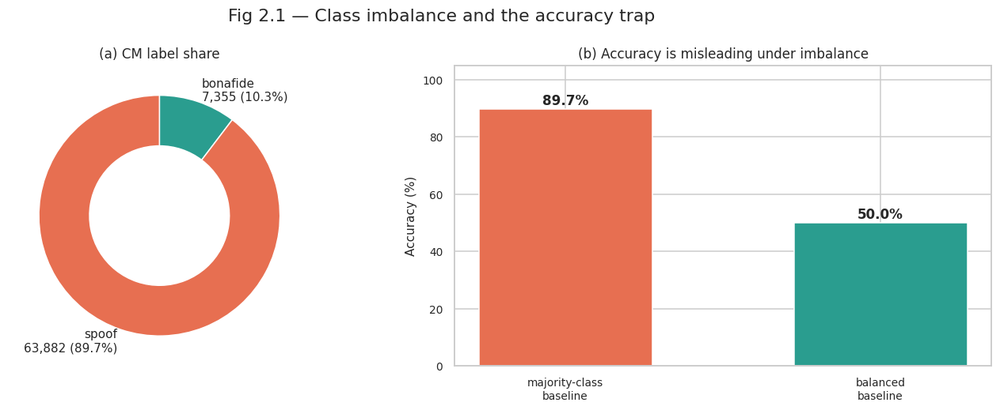
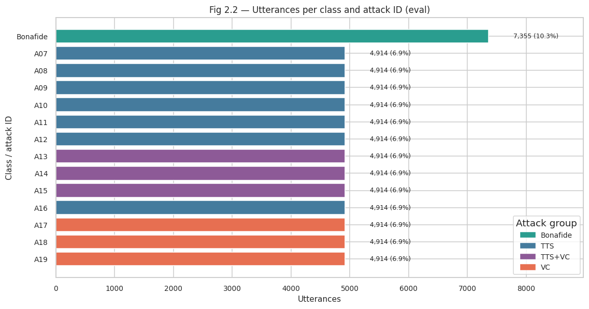
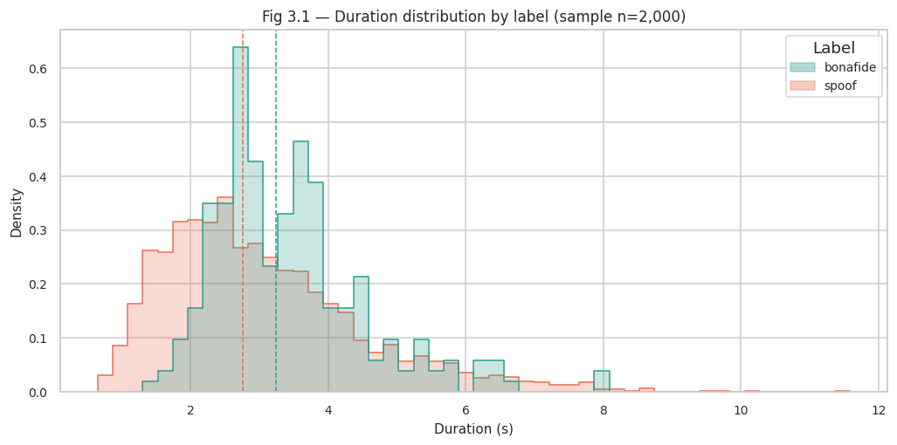
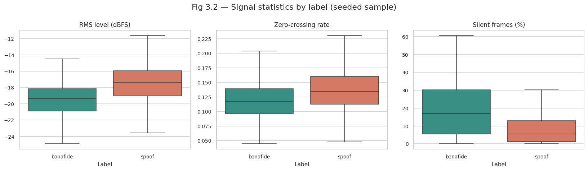
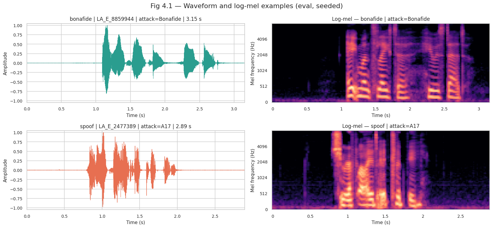

# Milestone 2 Report: ASVspoof 2019 LA Dataset Audit

## Project: Deepfake Voice Detection for Indian Languages

**Scope:** English Logical Access (LA) audio from the official ASVspoof 2019 evaluation protocol — synthesized and converted speech paired with real speech, used as the benchmark reference for real-versus-AI-generated voice detection.

## 1. Objective

This report documents the data source, dataset structure, protocol and metadata checks, audio-quality checks, suitability for the project, and the augmentation recommendation for the ASVspoof 2019 LA dataset. ASVspoof directly supplies the bonafide-versus-spoof labels required to train and evaluate a deepfake countermeasure: every spoofed utterance is a synthesized (TTS) or converted (voice conversion) rendering of the same English speaker population as the bonafide utterances.

## 2. Dataset Access and Licensing

- **Source:** [SpeechAntiSpoofingBenchmarks/ASVspoof2019_LA on Hugging Face](https://huggingface.co/datasets/SpeechAntiSpoofingBenchmarks/ASVspoof2019_LA), pinned to revision `401e90d3efddb3a2b2ee5f3ee53b737b603d7eae` for reproducibility.
- **Package contents:** the 71,237-utterance official LA evaluation set with attacks A07–A19. Audio ships as streamed parquet shards (~4.4 GB); train/dev audio is not part of this package.
- **Reference files:** `data/labels.parquet` (utterance ID + integer label) and the official protocol `protocols/ASVspoof2019.LA.cm.eval.trl.txt`.
- **Licensing:** the official ASVspoof 2019 corpus is distributed for research under the organisers' license agreement. The Hugging Face mirror used here was accessed without authentication (an HF token is recommended to raise rate limits). No audio was fully downloaded — the notebook streams only the rows it analyses.
- **Project use:** English real-versus-spoof pairs for countermeasure benchmarking, complementing the self-generated Indian-language synthetic data from IndicSynth and Indic TTS tools.

## 3. Dataset Size and Distribution

The notebook analyses the full **71,237-utterance** LA evaluation partition. All metadata tables in this section are computed from the complete manifest, not a sample.

| Metric                   |                      Value |
| ------------------------ | -------------------------: |
| Utterances               |                     71,237 |
| Bonafide                 |              7,355 (10.3%) |
| Spoof                    |             63,882 (89.7%) |
| Speakers                 |                         67 |
| Speakers with spoof data |                         48 |
| Bonafide-only speakers   |                         19 |
| Spoof attack IDs         |               13 (A07–A19) |
| Utterances per attack    | 4,914 (perfectly balanced) |
| Majority-class accuracy  |                      89.7% |

**Fig 2.1 — Class imbalance and the accuracy trap**

The eval set is strongly imbalanced: 89.7% spoof versus 10.3% bonafide. As panel (b) shows, a majority-class classifier that always predicts "spoof" already scores 89.7% accuracy against a 50% balanced baseline. Accuracy is therefore not a meaningful headline metric for this dataset; EER, min-tDCF and per-class recall should be reported instead.

## 3.1 Attack-wise Distribution

Each of the 13 attack algorithms contributes exactly 4,914 utterances (7.7% of the spoof set) and 48 speakers, which makes per-attack error analysis clean.

| Attack | Group  | Utterances | % of Spoof | Speakers | Reference algorithm |
| ------ | ------ | ---------: | ---------: | -------: | ------------------- |
| A07    | TTS    |      4,914 |       7.7% |       48 |                     |
| A08    | TTS    |      4,914 |       7.7% |       48 |                     |
| A09    | TTS    |      4,914 |       7.7% |       48 |                     |
| A10    | TTS    |      4,914 |       7.7% |       48 |                     |
| A11    | TTS    |      4,914 |       7.7% |       48 |                     |
| A12    | TTS    |      4,914 |       7.7% |       48 |                     |
| A13    | TTS+VC |      4,914 |       7.7% |       48 |                     |
| A14    | TTS+VC |      4,914 |       7.7% |       48 |                     |
| A15    | TTS+VC |      4,914 |       7.7% |       48 |                     |
| A16    | TTS    |      4,914 |       7.7% |       48 | A04 (TTS)           |
| A17    | VC     |      4,914 |       7.7% |       48 |                     |
| A18    | VC     |      4,914 |       7.7% |       48 | A06 (VC)            |
| A19    | VC     |      4,914 |       7.7% |       48 |                     |

Attack A16 reuses the A04 TTS algorithm and A19 reuses the A06 VC algorithm, so A07–A19 represent 11 distinct underlying algorithms across three generation strategies.

**Fig 2.2 — Utterances per class and attack ID (eval)**

| Attack group | Attack IDs   | Attacks | Utterances | % of Spoof |
| ------------ | ------------ | ------: | ---------: | ---------: |
| TTS          | A07–A12, A16 |       7 |     34,398 |      53.8% |
| TTS+VC       | A13–A15      |       3 |     14,742 |      23.1% |
| VC           | A17–A19      |       3 |     14,742 |      23.1% |

TTS attacks dominate the spoof set (53.8%), while TTS+VC (text-to-speech plus voice conversion) and pure voice conversion account for 23.1% each. Within the spoof label, per-speaker counts range from 936 to 1,638 utterances (median 1,638), so the spoof class is concentrated in its 48 speakers rather than being spread thinly.

## 3.2 Speaker Coverage

| Label    | Speakers | Utterances/Speaker (min) | Median |   Max |  Total |
| -------- | -------: | -----------------------: | -----: | ----: | -----: |
| Bonafide |       67 |                       68 |    113 |   146 |  7,355 |
| Spoof    |       48 |                      936 |  1,638 | 1,638 | 63,882 |

Bonafide utterances are spread evenly across all 67 speakers (68–146 each). Spoof data covers 48 of the same LA speakers with far higher volume per speaker — expected, because each speaker is replayed through 13 attack systems.

## 4. Metadata and Protocol Integrity

The official five-column protocol — `speaker_id utterance_id unused('-') attack_id label` — was parsed with strict validation: exact column counts, `LA_\d{4}` speaker IDs, `LA_E_*` utterance prefixes, and a consistency check that `-` implies bonafide while every `Axx` implies spoof. The independent `labels.parquet` file was then used to cross-check the protocol's labels.

**Table 1.1 — Data integrity checks**

| Check                                | Observed        | Status |
| ------------------------------------ | --------------- | ------ |
| Protocol rows parsed                 | 71,237          | PASS   |
| Rows in labels.parquet               | 71,237          | PASS   |
| Labels present in labels.parquet     | 71,237 / 71,237 | PASS   |
| Protocol vs. parquet label agreement | 71,237 / 71,237 | PASS   |
| Unique utterance IDs                 | 71,237          | PASS   |
| Eval-only utterance prefixes         | LA_E_*          | PASS   |
| Attack IDs (protocol)                | A07–A19         | PASS   |

## 5. Duration Analysis

The package does not include durations in its metadata, so durations were measured from a seeded sample of **2,000 streamed utterances** (1,764 spoof / 236 bonafide, matching the global ≈89.7% / 10.3% mix). All numbers in this section are sample estimates, not full-corpus totals.

**Table 3.1 — Duration and signal statistics (seeded sample, n=2,000)**

| Statistic                 |   Bonafide |      Spoof |
| ------------------------- | ---------: | ---------: |
| Sample size               |        236 |      1,764 |
| Mean duration             |     3.43 s |     3.06 s |
| Median duration           |     3.24 s |     2.75 s |
| 95th percentile duration  |     5.66 s |     5.91 s |
| Maximum duration          |     8.02 s |    11.59 s |
| Median RMS level          | −19.4 dBFS | −17.4 dBFS |
| Median zero-crossing rate |      0.118 |      0.134 |
| Median silent frames      |      17.0% |       5.5% |
| Mean clipped samples      |     0.002% |     0.003% |

Scaling the sample mean duration by 71,237 utterances estimates the full eval audio at **≈61.4 h**.

**Fig 3.1 — Duration distribution by label (sample n=2,000)**

Bonafide clips skew considerably longer than spoof clips (median 3.24 s vs 2.75 s), a distributional side effect of the attack pipeline rather than a quality issue. Utterances are short overall, so training will need fixed-length cropping or padding together with a consistent normalisation policy.

## 6. Audio Technical Audit

**Fig 3.2 — Signal statistics by label (seeded sample)**

The spoofed clips are slightly louder (RMS median −17.4 vs −19.4 dBFS) and have more high-frequency energy (higher zero-crossing rate), while the most striking class skew is silence: bonafide clips carry about three times more pause time (median 17.0% of frames vs 5.5%), and 16 of the 2,000 sampled files exceed 50% silent frames. Leading/trailing silence therefore has to be trimmed or handled identically in preprocessing so the model does not learn a trivial silence shortcut.

**Table 3.2 — Sample format and quality checks**

| Check                                 |     Value | Status |
| ------------------------------------- | --------: | ------ |
| Utterances decoded                    |     2,000 | INFO   |
| Decode errors                         |         0 | PASS   |
| Sample rates observed                 | 16,000 Hz | PASS   |
| Channels observed                     |         1 | PASS   |
| 16 kHz share                          |    100.0% | PASS   |
| Mono share                            |    100.0% | PASS   |
| Files with clipping > 0.1% of samples |         0 | PASS   |
| Files silent > 50% of frames          |        16 | REVIEW |

All sampled audio is uniformly 16 kHz mono with zero decode errors and no clipping flags. These checks cover 2,000 of 71,237 utterances, so the format conclusions are strong while the level statistics remain estimates.

## 7. Spectral Examples: Waveform and Log-Mel

One seeded bonafide and one seeded spoof utterance from the sample were rendered as a waveform and an 80-band log-mel spectrogram (n_fft 1024, hop 256, fmin 20 Hz).

**Fig 4.1 — Waveform and log-mel examples (eval, seeded)**

The bonafide example (`LA_E_8859944`) and the spoof example (`LA_E_2477389`, attack A17) share the same 16 kHz band and a broadly similar time-frequency structure. This is the qualitative core finding of the EDA: spoofed speech can look perfectly plausible in both the time and spectral domains, so the discriminative cues are subtle artefacts that a model must learn rather than something visible to the eye. Evaluation should consequently track per-attack behaviour instead of only an aggregate score.

## 8. Augmentation Decision Table

Augmentation is a training-pipeline concern rather than an EDA deliverable, so no demo transformations were applied. The table records the recommended menu, settings and their risks.

**Table 5.1 — Augmentation menu, setting and priority**

| Augmentation       | Domain   | Setting               | Priority | Risk                                   |
| ------------------ | -------- | --------------------- | -------- | -------------------------------------- |
| AWGN               | waveform | SNR 15 dB             | high     | can erase low-energy spoof cues        |
| SpecAugment        | log-mel  | 2 time + 2 freq masks | high     | can hide the artefacts a CM relies on  |
| Time shift         | waveform | ±0.15 s               | medium   | circular wrap boundary                 |
| Speed perturbation | waveform | 0.90×                 | medium   | changes duration and vocoder artefacts |
| Pitch perturbation | waveform | +2 semitones          | medium   | moves formants; keep small             |
| µ-law companding   | waveform | μ = 255               | medium   | proxy, not a real codec                |
| Synthetic reverb   | waveform | RT60 ≈ 0.30 s         | low      | eval is clean; heavy reverb may hurt   |

Mild noise and SpecAugment come first, followed by cheap time/speed/pitch perturbations. Waveform augmentations should be applied before log-mel extraction (SpecAugment directly on the log-mel), labels must never change, and the actual implementation belongs to the PyTorch milestone.

## 9. Dataset Split and Leakage Assessment

The HF package ships **only the official LA eval partition**; there is no train/dev audio. Consequently:

- The official eval protocol is used as-is — no re-splitting is performed and none is feasible from this package.
- No cross-split leakage analysis is applicable; within the single partition, all 71,237 utterance IDs are unique, and protocol labels are fully consistent with the independent labels file.
- For training, the model needs the train/dev audio from the official ASVspoof 2019 distribution or another licensed mirror, with the standard speaker-disjoint train/dev/eval organisation of the original corpus.

## 10. Suitability for the Project

**Strengths**

- Directly provides the real-versus-AI-generated labels the project needs, with spoofed and bonafide utterances drawn from the same speaker population.
- Established public benchmark with an official protocol and fixed trial list, enabling comparison with published countermeasure results using EER and min-tDCF.
- All 13 attacks contribute identical, balanced quotas (4,914 utterances, 48 speakers each), enabling clean per-attack and per-generation-strategy error analysis.
- Format-uniform audio: 16 kHz, mono, no decode errors or clipping in the sample — minimal ingestion risk.

**Limitations**

- Severe imbalance (89.7% spoof) makes accuracy misleading as a metric; class-balanced or EER-based reporting is required.
- English-only, clean-channel construction — no Indian languages and no phone-channel variation, so cross-language and channel robustness must be evaluated on the project's own data and the In-the-Wild set.
- The attack algorithms (A07–A19) date from 2019; the newest generators are not represented. Coverage of modern attacks comes from the project's self-generated clips (Indic Parler-TTS, IndicF5, MMS-TTS) and the In-the-Wild corpus.
- The HF package contains only the eval audio, so it cannot by itself supply training data.

## 11. Milestone Requirement Checklist

**Table 6.1 — Requirement coverage checklist** (section numbers refer to this report)

| Requirement                            | Section | Evidence                                                            | Verdict           |
| -------------------------------------- | ------- | ------------------------------------------------------------------- | ----------------- |
| Detailed dataset description           | §2–3    | Tables 1.1, 2.1–2.4; Figs 2.1–2.2                                   | PASS              |
| Dataset quality assessment             | §4, 6   | Label cross-check (Table 1.1); format/clipping/silence (Table 3.2)  | PASS (sampled)    |
| Adequacy for the chosen problem        | §3, 10  | 13 balanced eval attacks, 71,237 trials; 89.7% imbalance documented | PASS with caveats |
| Data augmentation options              | §8      | Prioritised decision table (Table 5.1)                              | PASS              |
| Training / validation / test strategy  | §2, 9   | Official eval protocol used as-is; eval-only package noted          | PASS (scope note) |
| No data leakage across splits          | §9      | Single partition; unique utterance IDs                              | PASS (scope note) |
| Audio quality and sampling consistency | §6–7    | 16 kHz mono checks (Table 3.2); level/silence and spectral examples | PASS              |

## 12. Reproducibility

The notebook uses Hugging Face datasets (streaming mode — only analysed rows are downloaded from the ~4.4 GB parquet store), SoundFile for decoding, librosa for the log-mel spectrograms, pandas, NumPy, Matplotlib and Seaborn. The seed is fixed at 42 and the HF dataset revision is pinned (`401e90d3efddb3a2b2ee5f3ee53b737b603d7eae`), so results are consistent across runs. Total notebook runtime is about one minute.

## 13. References

1. Wang, X., Yamagishi, J., Todisco, M., Delgado, H., Nautsch, A., Evans, N., et al. (2020). _ASVspoof 2019: A large-scale public database of synthesized, converted and replayed speech_. Computer Speech & Language: https://arxiv.org/abs/1911.01601
2. SpeechAntiSpoofingBenchmarks, _ASVspoof2019_LA dataset card_, Hugging Face: https://huggingface.co/datasets/SpeechAntiSpoofingBenchmarks/ASVspoof2019_LA
3. ASVspoof Challenge organisers, _ASVspoof official website and 2019 protocols_: https://www.asvspoof.org
