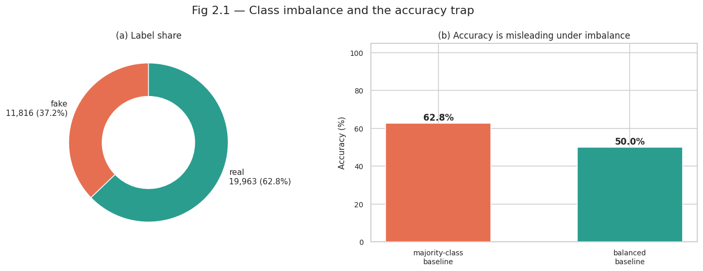
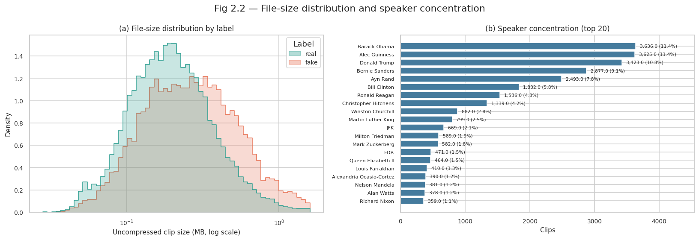
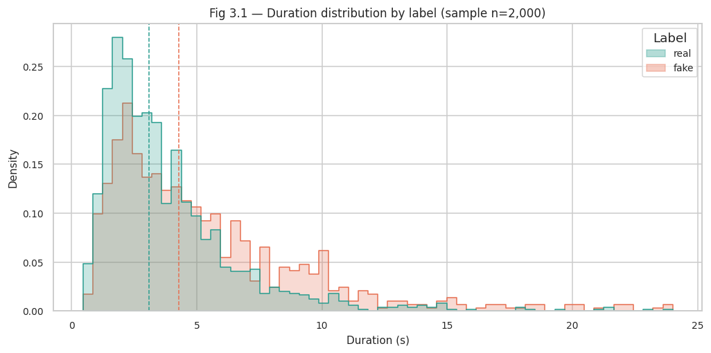
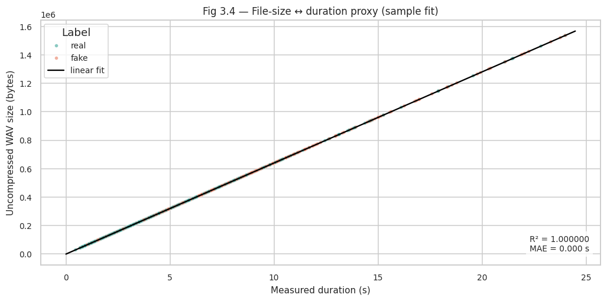
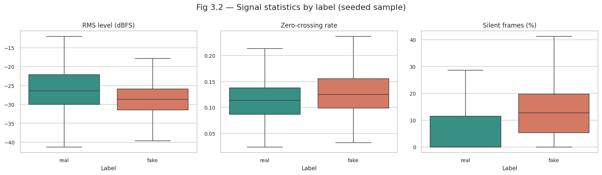
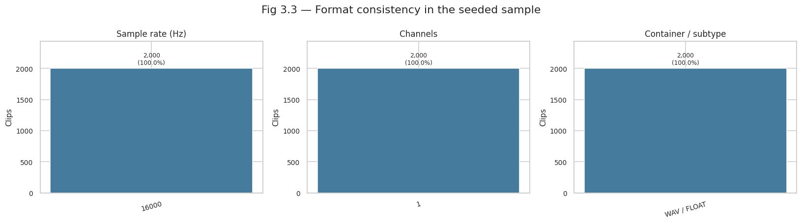
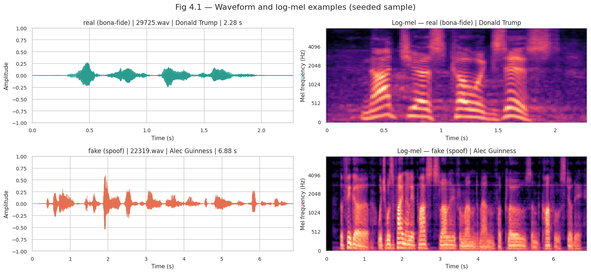
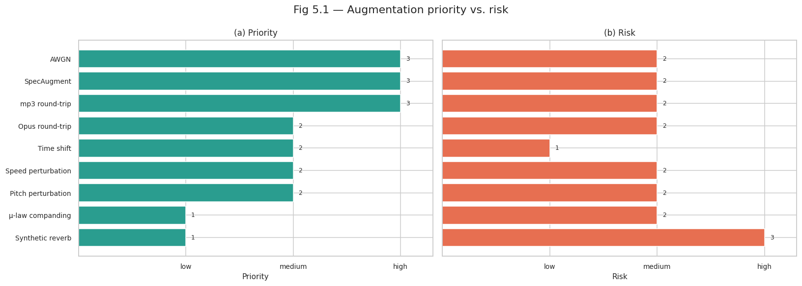
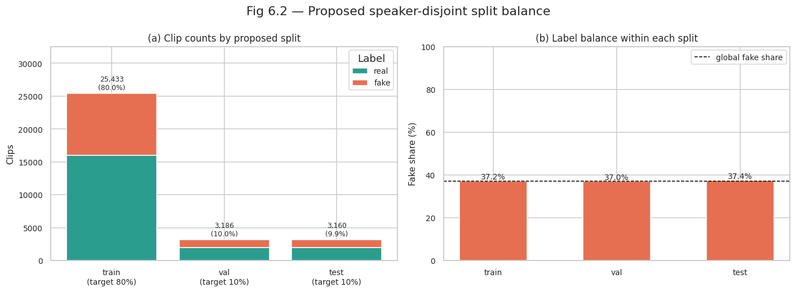

# Milestone 2 Report: In-The-Wild Dataset Audit

## Project: Deepfake Voice Detection for Indian Languages

**Scope:** English "in-the-wild" audio deepfakes scraped from publicly available online videos, paired with real speech from the same speakers — the wild-channel counterpart to the lab-clean ASVspoof 2019 LA benchmark, used to stress-test real-versus-AI-generated voice detection under realistic recording and channel conditions.

_Note: table and figure numbers follow the source notebook (`InTheWild_notebook.ipynb`) for traceability, so they do not always match report section numbers._

## 1. Objective

This report documents the data source, dataset structure, packaging and integrity checks, sampled audio statistics, split and leakage assessment, suitability for the project, and the augmentation recommendation for the In-The-Wild corpus (Müller et al., 2022). Unlike ASVspoof 2019 LA, whose audio was created in the lab with 13 documented attack algorithms, every fake clip here comes from **one undisclosed commercial text-to-speech system** used in real online videos, and there is **no official train/dev/test protocol** — the split for the later Milestone must be defined (and defended) by us.

## 2. Dataset Access and Licensing

- **Source:** [mueller91/In-The-Wild on Hugging Face](https://huggingface.co/datasets/mueller91/In-The-Wild), pinned to revision `eee168f92c367f8c82ff2cf42b6f61e362fd6211` for reproducibility.
- **Package contents:** a single `release_in_the_wild.zip` archive of **8.16 GB (8,161,489,023 bytes)** — 31,779 WAV clips in a flat `release_in_the_wild/` directory plus `meta.csv` (1.02 MB) and `attribution.txt` (87 bytes). There is no loading script and no parquet store, so `load_dataset()` cannot be used; the notebook downloads the archive once and reads its **central directory plus a seeded sample of members in place**, extracting nothing to disk (8.16 GB compressed vs. 8.72 GB uncompressed payload, 1.07×).
- **Licensing:** the HF dataset card states **CC BY-SA 4.0** (the authors' website states Apache 2.0 — the discrepancy is recorded as observed, not settled). Attribution line shipped in the archive: _"We thank 'VocalSynthesis' for his audio deepfakes, which were included in this dataset."_
- **Project use:** a wild, real-majority English benchmark to measure how a countermeasure trained on clean lab data generalises to real internet deepfakes; complementing both ASVspoof 2019 LA (single corpus with a single undisclosed commercial TTS; the paper describes the fake clips as segments from 219 publicly available videos advertising deepfakes, so there is no attack-ID axis to analyse).

**Table 1.1 — HF packaging inventory**

| Metric                                     | Value                                                    |
| ------------------------------------------ | -------------------------------------------------------- |
| HF repo files (pinned)                     | `.gitattributes`, `README.md`, `release_in_the_wild.zip` |
| Audio archives                             | 1 (`release_in_the_wild.zip`)                            |
| Archive size (on disk)                     | 8.16 GB (8,161,489,023 bytes)                            |
| ZIP entries                                | 31,782                                                   |
| Audio members                              | 31,779 (`.wav`)                                          |
| Metadata member                            | `meta.csv` — 1.02 MB                                     |
| Attribution member                         | `attribution.txt` — 87 bytes                             |
| Directory entries                          | 1                                                        |
| Uncompressed audio payload                 | 8.72 GB                                                  |
| Compressed audio payload                   | 8.16 GB                                                  |
| Compression ratio (uncompressed / archive) | 1.07×                                                    |
| Archive retrieval                          | 1.1 min                                                  |

## 3. Dataset Size and Distribution

The corpus is **real-majority** — the inverse direction of ASVspoof 2019 LA eval (10.3% bonafide): a classifier that always predicts "real" already scores 62.8%. All overview tables in this section use the **full manifest** (31,779 clips), not the sample.

**Table 2.1 — Corpus at a glance**

| Metric                                 |                                    Value |
| -------------------------------------- | ---------------------------------------: |
| Clips                                  |                                   31,779 |
| Real (bona-fide)                       |                           19,963 (62.8%) |
| Fake (spoof)                           |                           11,816 (37.2%) |
| Majority-class accuracy                |                                    62.8% |
| Speakers (released metadata)           |                                       54 |
| Speakers (paper)                       |                                       58 |
| Speakers with both labels              |                                  54 / 54 |
| Clips per speaker (min / median / max) |                       14 / 212.5 / 3,636 |
| Top-3 speaker share                    |                                    33.6% |
| Top-10 speaker share                   |                                    70.6% |
| Published total duration               |                                   37.9 h |
| Container (sampled, §6)                |                       WAV / IEEE float32 |
| Sample rate / channels (sampled, §6)   |                            16 kHz / mono |
| Attack IDs                             | none (single undisclosed commercial TTS) |
| Official train/dev/test protocol       |               none (eval-only benchmark) |
| License (HF card)                      |                             CC BY-SA 4.0 |

**Fig 2.1 — Class imbalance and the accuracy trap**

Because 62.8% of clips are real, the majority-class accuracy of 62.8% towers over the 50% balanced baseline, so accuracy alone is a meaningless headline here as well. Balanced accuracy, per-class recall, AUC and EER should be tracked instead.

## 3.1 Speaker Coverage and Concentration

**Table 2.2 — Per-speaker coverage (top 10 of 54 speakers)**

`meta.csv` carries a `speaker` column with real-world identities (mostly politicians, actors and public figures). Coverage is extremely concentrated — the top 10 speakers account for 70.6% of all clips:

| Speaker              | Clips |  Real |  Fake | Fake share | Clip share | Cumulative |
| -------------------- | ----: | ----: | ----: | ---------: | ---------: | ---------: |
| Barack Obama         | 3,636 | 3,302 |   334 |       9.2% |      11.4% |      11.4% |
| Alec Guinness        | 3,625 | 1,907 | 1,718 |      47.4% |      11.4% |      22.8% |
| Donald Trump         | 3,423 | 3,268 |   155 |       4.5% |      10.8% |      33.6% |
| Bernie Sanders       | 2,877 | 1,623 | 1,254 |      43.6% |       9.1% |      42.7% |
| Ayn Rand             | 2,493 | 1,389 | 1,104 |      44.3% |       7.8% |      50.5% |
| Bill Clinton         | 1,832 | 1,129 |   703 |      38.4% |       5.8% |      56.3% |
| Ronald Reagan        | 1,536 |   620 |   916 |      59.6% |       4.8% |      61.1% |
| Christopher Hitchens | 1,339 |   798 |   541 |      40.4% |       4.2% |      65.3% |
| Winston Churchill    |   882 |   625 |   257 |      29.1% |       2.8% |      68.1% |
| Martin Luther King   |   799 |   516 |   283 |      35.4% |       2.5% |      70.6% |

**Fig 2.2 — File-size distribution and speaker concentration**

Per-speaker fake shares vary widely (Barack Obama 9.2% vs. The Notorious B.I.G. 95.7%), and **every one of the 54 speakers contributes both real and fake clips**. This is a critical leakage risk for any random clip-level split — it is the core driver of the speaker-disjoint split proposed in §9.

**Table 2.3 — File-size accounting and duration-proxy cross-check**

| Metric                                          |                      Value |
| ----------------------------------------------- | -------------------------: |
| Clips                                           |                     31,779 |
| Total uncompressed audio                        |                    8.72 GB |
| Total compressed audio payload                  |                    8.16 GB |
| Mean clip size                                  |                  274.48 KB |
| Median clip size                                |                  209.47 KB |
| Largest clip                                    |                    1.60 MB |
| Published total duration (cross-check only)     |                     37.9 h |
| Implied mean clip duration from published hours |                     4.29 s |
| Implied average byte rate from published hours  |                 63,930 B/s |
| Expected byte rate for 16 kHz mono float32      | 64,000 B/s (validated, §6) |

## 4. Metadata and Protocol Integrity

The metadata is a 31,779-row `meta.csv` with columns `file`, `speaker`, `label` (`bona-fide`/`spoof`, mapped to `real`/`fake`) — one row per audio member, joined 1:1 by exact basename. Filename stems are dense numeric indices (`0.wav` … `31778.wav`), so names carry no label or speaker information.

**Table 1.2 — Metadata schema and completeness**

| Field             | Present | Type   | Missing | Unique | Note                                                    |
| ----------------- | ------- | ------ | ------: | -----: | ------------------------------------------------------- |
| `file`            | yes     | string |       0 | 31,779 | join key; exact basename                                |
| `speaker`         | yes     | string |       0 |     54 | per-speaker analysis possible                           |
| `label`           | yes     | string |       0 |      2 | `bona-fide` / `spoof` → `real` / `fake`                 |
| source / video ID | no      | —      |       — |      — | source-level overlap cannot be audited                  |
| attack ID         | no      | —      |       — |      — | single undisclosed commercial TTS                       |
| duration          | no      | —      |       — |      — | derived from decoded frames / WAV header                |
| official split    | no      | —      |       — |      — | eval-only benchmark                                     |
| license           | card    | —      |       — |      — | CC BY-SA 4.0 (HF card); authors' site states Apache 2.0 |

**Table 1.3 — Data integrity checks**

| Check                                              | Observed        | Status |
| -------------------------------------------------- | --------------- | ------ |
| Expected flat layout (`release_in_the_wild/*.wav`) | observed        | PASS   |
| Audio members discovered                           | 31,779          | PASS   |
| Real clips vs. published                           | 19,963 / 19,963 | PASS   |
| Fake clips vs. published                           | 11,816 / 11,816 | PASS   |
| Unique audio basenames                             | 31,779 / 31,779 | PASS   |
| Dense numeric filenames 0..N-1                     | 0..31778        | PASS   |
| Metadata rows                                      | 31,779          | PASS   |
| Metadata ↔ audio 1:1 alignment                     | 31,779 / 31,779 | PASS   |
| Missing labels                                     | 0               | PASS   |
| Missing speaker names                              | 0               | PASS   |
| Label values in allowed set                        | fake, real      | PASS   |
| Media extension                                    | .wav            | PASS   |
| Zero-byte audio members                            | 0               | PASS   |
| Unexpected archive members                         | 0               | PASS   |
| Distinct speaker names vs. paper                   | 54 / 58         | REVIEW |
| Attribution present                                | yes             | PASS   |

Every structural check passes and the label counts match the published figures exactly. Two items are flagged rather than resolved: the release exposes **54 speaker names where the paper reports 58** (the discrepancy is recorded, not hidden), and `meta.csv` has **no source/video ID**, so two clips cut from the same underlying video cannot be detected.

**Where reality differs from `PLAN.md`:** the anticipated `real/`/`fake/` folders of mp3 files with variable sample rates and no speaker metadata do not exist in this release. The observed archive is flat WAV only, uniformly 16 kHz mono float32, and speaker metadata is present — the notebook analyses what the data actually is, and §9 uses that metadata for the split.

## 5. Duration Analysis

Decoding all 31,779 clips was unnecessary; audio statistics use a **label-stratified sample of 2,000 clips (6.29% of the corpus)** drawn with seed 42, preserving the 62.8% / 37.2% mix exactly (real 1,256 / fake 744), decoded directly from the ZIP into memory. All numbers in this section are sample estimates; full-corpus totals come from a file-size proxy calibrated on the sample (§5.1) and are labelled as such.

**Table 3.1 — Duration and signal statistics (seeded sample, n=2,000)**

| Statistic                 |        Real |        Fake |
| ------------------------- | ----------: | ----------: |
| Sample size               |       1,256 |         744 |
| Mean duration             |      3.86 s |      5.37 s |
| Median duration           |      3.10 s |      4.29 s |
| 95th percentile duration  |      9.18 s |     13.36 s |
| Maximum duration          |     24.00 s |     24.00 s |
| Median peak level         |  −9.66 dBFS | −10.22 dBFS |
| Median RMS level          | −26.41 dBFS | −28.67 dBFS |
| Median crest factor       |    16.91 dB |    17.99 dB |
| Median zero-crossing rate |       0.114 |       0.125 |
| Median silent frames      |        0.0% |       12.8% |
| Mean clipped samples      |      0.000% |      0.000% |

**Fig 3.1 — Duration distribution by label (sample n=2,000)**

Durations are strongly right-skewed and fake clips skew longer than real clips (median 4.29 s vs. 3.10 s, p95 13.36 s vs. 9.18 s, max 24.00 s), because deepfake videos were harvested as segments of online content rather than cut to fixed lengths. Clips are still short, so training must use fixed-length cropping/padding with a documented normalisation policy.

## 5.1 Full-Corpus Duration Estimates

Because sample statistics cannot give corpus totals directly, the notebook fits a size↔duration proxy on the sample and applies it to all 31,779 file sizes.

**Table 3.3 — Full-corpus duration estimates**

| Estimate                           | Real (h) | Fake (h) | Total (h) | Δ vs. published |
| ---------------------------------- | -------: | -------: | --------: | --------------: |
| Sample mean × corpus counts        |    21.38 |    17.64 |     39.02 |           +1.12 |
| File-size proxy over full manifest |    20.76 |    17.09 |     37.85 |           −0.05 |
| Published (HF card / paper)        |    20.70 |    17.20 |     37.90 |            0.00 |

**Fig 3.4 — File-size ↔ duration proxy (sample fit)**

The linear fit `bytes = 64,000 × seconds + 58` achieves R² = 1.000000 (MAE 0.000 s) on the sample — expected, since 16 kHz mono float32 is exactly 64,000 B/s — and yields proxy durations of mean 4.288 s, median 3.272 s, p95 10.795 s, max 24.991 s over the full manifest. The resulting **37.85 h** total lands within 0.05 h of the published 37.9 h, independently validating both the file accounting and the packaged metadata.

## 6. Audio Technical Audit

**Fig 3.2 — Signal statistics by label (seeded sample)**

Fake clips are quieter and more compressed-looking than real clips (RMS median −28.67 vs. −26.41 dBFS), slightly higher in zero-crossing rate, and — the most marked class skew — carry substantial pause time (median 12.8% silent frames vs. **0.0%** for real clips, the inverse of the ASVspoof 2019 LA direction where bonafide had more silence). Preprocessing must therefore handle leading/trailing silence and loudness identically for both labels so the model does not learn a trivial loudness or pause shortcut.

**Table 3.2 — Sample format and quality checks**

| Check                        |        Value | Status |
| ---------------------------- | -----------: | ------ |
| Clips decoded                |        2,000 | INFO   |
| Decode errors                |            0 | PASS   |
| Sample rates observed        |    16,000 Hz | PASS   |
| 16 kHz share                 |       100.0% | PASS   |
| Channels observed            |            1 | PASS   |
| Mono share                   |       100.0% | PASS   |
| Container / subtype observed |  WAV / FLOAT | PASS   |
| Clipped > 0.1% of samples    |            0 | PASS   |
| Silent > 50% of frames       |           20 | REVIEW |
| Zero-length decodes          |            0 | PASS   |
| Duration range (s)           | 0.46 – 24.00 | INFO   |

**Fig 3.3 — Format consistency in the seeded sample**

The sampled audio is uniformly **16 kHz mono WAV / IEEE float32** with zero decode errors and no clipping — not mp3 with variable rates as anticipated. There is no decode risk, but 20 sample clips are over 50% silent frames and deserve inspection. Format conclusions cover 2,000 of 31,779 clips; level statistics remain estimates.

**Table 3.4 — Sample representativeness**

| Metric                                 |  Seeded sample | Full corpus (proxy/metadata) |
| -------------------------------------- | -------------: | ---------------------------: |
| Clips                                  |          2,000 |                       31,779 |
| Real share                             |          62.8% |                        62.8% |
| Fake share                             |          37.2% |                        37.2% |
| Speakers                               |             51 |                           54 |
| Clips per speaker (min / median / max) | 1 / 15.0 / 241 |           14 / 212.5 / 3,636 |
| Duration mean                          |         4.42 s |                       4.29 s |
| Duration median                        |         3.39 s |                       3.27 s |
| Duration p95                           |        10.75 s |                      10.80 s |

The seeded sample preserves the label mix by construction and matches full-corpus duration statistics to within ~0.15 s, confirming the audio conclusions are not sample artefacts. Rare small speakers (min 14 clips each) are under-represented (min 1 clip in the sample) — a known sampling caveat, not a bias, since per-speaker statistics elsewhere use the full manifest.

## 7. Spectral Examples: Waveform and Log-Mel

One seeded real and one seeded fake clip from the sample were rendered as waveform and log-mel spectrogram.

**Table 4.1 — Seeded example clips used in Fig 4.1**

| Label | File      | Speaker       | Duration | Sample rate | Channels | Codec       | Size (KB) |
| ----- | --------- | ------------- | -------: | ----------: | -------: | ----------- | --------: |
| real  | 29725.wav | Donald Trump  |   2.28 s |      16,000 |        1 | WAV / FLOAT |     145.9 |
| fake  | 22319.wav | Alec Guinness |   6.88 s |      16,000 |        1 | WAV / FLOAT |     440.5 |

**Fig 4.1 — Waveform and log-mel examples (seeded sample)**

Real and fake speech occupy the same 16 kHz band and have broadly similar time-frequency structure — no single visual cue separates the classes. The examples are useful for verifying preprocessing (mono conversion, fixed-length crops, mel geometry), not for visual classification. And because all fakes come from **one** TTS, a model can learn generator-specific artefacts rather than general deepfake cues — which is why the split and leakage checks in §9 matter more than any single spectrogram.

## 8. Augmentation Decision Table

Augmentation is a training-pipeline concern, not an EDA deliverable, so no transformations were applied here. The menu is shaped by this corpus: the released audio is clean WAV, but the **source material is wild online speech with unknown codec history**, so lossy codec round-trips are far more relevant here than in the lab-clean ASVspoof setting. Every waveform augmentation applies symmetrically to both labels and never changes the label.

**Table 5.1 — Augmentation menu, setting, priority and risk**

| Augmentation       | Domain   | Setting                    | Priority | Risk   |
| ------------------ | -------- | -------------------------- | -------- | ------ |
| AWGN               | waveform | SNR 15 dB, random segment  | high     | medium |
| SpecAugment        | log-mel  | 2 time + 2 frequency masks | high     | medium |
| mp3 round-trip     | waveform | 128 kbps / 64 kbps         | high     | medium |
| Opus round-trip    | waveform | 24 kbps, 16 kHz            | medium   | medium |
| Time shift         | waveform | ±0.15 s                    | medium   | low    |
| Speed perturbation | waveform | 0.90× / 1.10×              | medium   | medium |
| Pitch perturbation | waveform | ±2 semitones               | medium   | medium |
| µ-law companding   | waveform | μ = 255                    | low      | medium |
| Synthetic reverb   | waveform | RT60 ≈ 0.30 s              | low      | high   |

**Fig 5.1 — Augmentation priority vs. risk**

Start with AWGN, SpecAugment and **codec round-trips** (mp3 first): they target the wild-channel and lossy-source conditions that dominate this corpus and are cheap on CPU. Time/speed/pitch perturbation follows once the baseline is stable; keep reverb low — the data is already wild, and heavy reverb can erase the very TTS artefacts a detector needs to find.

## 9. Dataset Split and Leakage Assessment

**Scope note:** In-The-Wild is an **evaluation-only** benchmark with no official train/dev/test protocol and no official speaker-independent partition. The split below is a _project-defined_, seed-42, **speaker-disjoint 80/10/10 proposal** (a target, not an executed export) for the later PyTorch milestone: no split column is exported and no audio is copied.

**Table 6.1 — Speaker metadata probe**

| Check                                  | Observed           | Status |
| -------------------------------------- | ------------------ | ------ |
| Speaker column present                 | yes                | PASS   |
| Missing speaker values                 | 0.0%               | PASS   |
| Distinct speaker names                 | 54                 | PASS   |
| Clips per speaker (min / median / max) | 14 / 212.5 / 3,636 | INFO   |
| Speakers with both labels              | 54 / 54            | REVIEW |
| Speakers with <10 clips                | 0                  | INFO   |
| Top-3 speaker share                    | 33.6%              | INFO   |
| Distinct names vs. paper (58)          | 54 / 58            | REVIEW |
| Source / video ID column               | absent             | REVIEW |
| Attack ID column                       | absent             | INFO   |

**Fig 6.1 — Every speaker contributes both real and fake clips**

**Table 6.2 — Leakage and duplicate checks**

| Check                                                      | Observed                   | Status |
| ---------------------------------------------------------- | -------------------------- | ------ |
| Exact duplicate fingerprints (CRC32 + uncompressed size)   | 0 groups / 0 files         | PASS   |
| Cross-label duplicate fingerprints                         | 0 groups / 0 files         | PASS   |
| MD5 duplicates within decoded sample                       | 0 groups / 0 files         | PASS   |
| Duplicate basenames                                        | 0                          | PASS   |
| Same-size cross-label collisions (heuristic only)          | 4,599 sizes / 19,253 files | INFO   |
| Filename-pattern overlap across labels                     | 1 / 1 patterns (100%)      | INFO   |
| Speaker overlap across labels                              | 54 / 54 speakers           | REVIEW |
| Speaker overlap across proposed splits                     | 0                          | PASS   |
| Source / video ID available for source-level overlap audit | no                         | REVIEW |
| Official train/dev/test protocol available                 | no                         | INFO   |

File-level cleanliness is good: no duplicate files, no zero-byte members, numeric filenames carry no label information. But because **all 54 speakers appear in both labels**, a random clip-level split would leak speaker identity across train/val/test, and because **no video/source IDs exist**, two clips from the same source video could still straddle splits undetected. The speaker-disjoint split mitigates the first risk; the second is documented as a residual limitation. (If speaker metadata were ever absent, the documented fallback is a seeded 80/10/10 clip split with an explicit leakage caveat.)

**Table 6.3 — 80/10/10 split proposal (speaker-disjoint)**

| Split | Speakers |  Clips |   Real |  Fake |   Hours | Fake share | Clip share | Clip deviation |
| ----- | -------: | -----: | -----: | ----: | ------: | ---------: | ---------: | -------------: |
| train |       22 | 25,433 | 15,979 | 9,454 | 29.63 h |      37.2% |      80.0% |      +0.031 pp |
| val   |       16 |  3,186 |  2,006 | 1,180 |  4.00 h |      37.0% |      10.0% |      +0.025 pp |
| test  |       16 |  3,160 |  1,978 | 1,182 |  4.22 h |      37.4% |       9.9% |      −0.056 pp |

**Fig 6.2 — Proposed speaker-disjoint split balance**

The proposal assigns each speaker to exactly one split and hits the 80/10/10 target closely (max clip deviation 0.056 pp) while preserving the global fake share in every split (37.2% / 37.0% / 37.4%). The three largest speakers — Barack Obama (11.4%), Alec Guinness (11.4%) and Donald Trump (10.8%) — each exceed 10% of the corpus and therefore must sit in train, which forces val/test to draw from the smaller half of the speaker pool. All three largest speakers are indeed placed in train in the seed-42 assignment.

## 10. Suitability for the Project

**Strengths**

- Directly provides real-versus-fake labels over **wild internet audio** — the realistic counterpart to lab-clean ASVspoof, exactly the generalisation axis the project needs to test, with 37.9 h of English speech and 54 speakers.
- Clean, complete metadata: labels and speaker names with zero missing entries, verified 1:1 against audio; both labels present for every speaker, so per-speaker error breakdowns are possible.
- No container surprises: uniformly 16 kHz mono WAV/float32 with zero decode errors and no clipping in the sample — minimal ingestion risk.
- Speaker metadata makes the minimum-defensible protocol — a speaker-disjoint 80/10/10 split — actually implementable, with balance achieved to within 0.06 pp.

**Limitations**

- Single-attack corpus: every fake comes from **one undisclosed commercial TTS**, so a classifier can win by learning that generator's artefacts; no attack-ID axis exists for per-attack analysis (unlike ASVspoof's 13).
- **Speaker concentration:** the top 3 speakers are 33.6% of clips and the top 10 are 70.6%; per-speaker fake shares range from 4.5% to 95.7%, so a random split leaks speaker identity and even the proposal's val/test are confined to smaller speakers.
- **Source provenance cannot be audited** — no video/source IDs in `meta.csv`, so clips cut from the same underlying video may straddle the split; the paper's 58 speakers vs. 54 released names is likewise unresolvable from the release.
- Real-majority (62.8%) with a 62.8% majority baseline: report balanced accuracy, per-class recall, AUC and EER rather than raw accuracy.
- Eval-only framing: no training partition exists — training must draw on ASVspoof 2019 LA train/dev or the project's own synthetic data, with this corpus held out for generalisation testing.
- English-only; no Indian-language content, so cross-language robustness must come from the project's own corpora.

## 11. Milestone Requirement Checklist

**Table 7.1 — Requirement coverage checklist** (section numbers refer to this report)

| Requirement                            | Section  | Evidence                                                                                                                         | Verdict                            |
| -------------------------------------- | -------- | -------------------------------------------------------------------------------------------------------------------------------- | ---------------------------------- |
| Detailed dataset description           | §2–3     | Tables 1.1–1.3, 2.1–2.3; Figs 2.1–2.2                                                                                            | PASS                               |
| Dataset quality assessment             | §4, 6, 9 | Metadata completeness (Table 1.2), integrity (Table 1.3), format/audio quality (Table 3.2), duplicate checks (Table 6.2)         | PASS (sampled audio)               |
| Adequacy for the chosen problem        | §3, 10   | Corpus at a glance (Table 2.1); speaker concentration and single-TTS caveats documented                                          | PASS with caveats                  |
| Data augmentation options              | §8       | Prioritised decision table (Table 5.1); priority/risk trade-off (Fig 5.1)                                                        | PASS                               |
| Training / validation / test strategy  | §9       | Speaker-disjoint 80/10/10 proposal (Table 6.3); balance shown (Fig 6.2)                                                          | PASS (proposal)                    |
| No data leakage across splits          | §9       | Duplicate/leakage checks (Table 6.2); speaker overlap across proposed splits = 0                                                 | PASS with source-provenance caveat |
| Audio quality and sampling consistency | §5–7     | Duration/signal stats (Tables 3.1, 3.3), quality checks (Table 3.2), representativeness (Table 3.4), spectral examples (Fig 4.1) | PASS                               |

## 12. Reproducibility

The notebook downloads the pinned single-file release with `hf_hub_download` (revision `eee168f92c367f8c82ff2cf42b6f61e362fd6211`, 8.16 GB, ~1.1 min), reads the ZIP **central directory** without extraction, and decodes only the seeded 2,000-clip sample with `soundfile`; `librosa` is used solely for the log-mel examples and no deep-learning framework is imported (CPU-only). `datasets` is deliberately not used — the repository has no loading script and a ZIP cannot be streamed. All randomness uses **seed 42** (sample draw, split assignment), so every table here is reproducible run-to-run.

## 13. References

1. Müller, N.-C., Czempin, P., Dieckmann, F., Froghyar, A., & Böttinger, K. (2022). _Does Audio Deepfake Detection Generalize?_ Interspeech 2022: https://arxiv.org/abs/2203.16263
2. mueller91, _In-The-Wild dataset card_, Hugging Face (CC BY-SA 4.0): https://huggingface.co/datasets/mueller91/In-The-Wild
3. Companion report: `ASVspoof_report.md` — the lab-clean benchmark that this wild corpus is compared against throughout.
