# Deepfake Voice Detection for Indian Languages using Deep Learning and Generative AI

**Milestone 2: Dataset Identification & Preparation**

---

## 1. Overview

The detector needs speech that is labelled **real** or **AI-generated**, in English, Hindi, Tamil and Telugu, from many speakers and from several voice generators, so that it can be tested on languages, generators and recording conditions it has not seen in training. No single public dataset provides this, so we combine four public datasets with one dataset that we generated ourselves.

| #   | Dataset                  | Language   | Real / Fake | Role in the project                                         | Size used in the EDA                    |
| --- | ------------------------ | ---------- | ----------- | ----------------------------------------------------------- | --------------------------------------- |
| 1   | **Kathbath** (AI4Bharat) | Hi, Ta, Te | Real        | Real Indian-language speech                                 | 266,487 clips (train + valid)           |
| 2   | **IndicSynth**           | Hi, Ta, Te | Fake        | Main Indian-language fakes for training (XTTS-v2, FreeVC24) | 658,146 clips (metadata), 3,000 decoded |
| 3   | **ASVspoof 2019 LA**     | English    | Both        | English benchmark with 13 attack systems                    | 71,237 clips (eval partition)           |
| 4   | **In-the-Wild**          | English    | Both        | Real-world test set                                         | 31,779 clips                            |
| 5   | **Our generated set**    | Hi, Ta, Te | Fake        | Unseen-generator test (Indic Parler-TTS, IndicF5, MMS-TTS)  | 6,480 clips (all)                       |

Every dataset was explored in its own notebook, linked in [Section 11](#11-reproducibility). This report brings the results together. It answers the Milestone-2 questions in order: data sources and constraints (Section 2), description of each dataset (Section 3), quality (Section 4), adequacy and augmentation (Section 5), the synthetic dataset (Section 6), splits and leakage (Section 7), how the datasets fit together (Section 8), preprocessing (Section 9), speech-specific and model-specific requirements (Section 10), reproducibility (Section 11) and open items (Section 12).

<div align="center">
  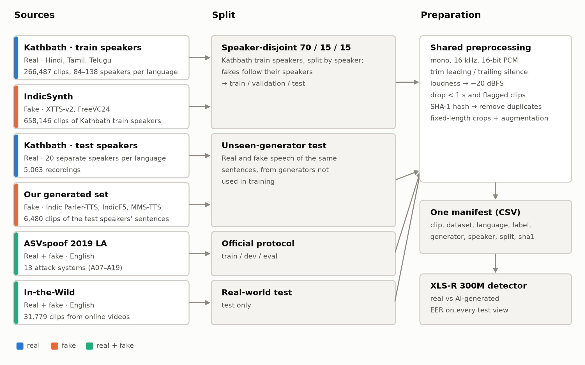
  <br>
  <em>Figure 1: How the five datasets are used. Kathbath's training speakers and their IndicSynth fakes are split by speaker; Kathbath's test speakers and our generated set form the unseen-generator test; ASVspoof keeps its official protocol and In-the-Wild is a real-world test. Every clip then passes the same preprocessing into one manifest.</em>
</div>

**Main findings**

1. All five datasets are **complete and consistent**: row counts match their published figures, labels and speaker fields have no missing values, and the duplicate checks found no repeated files or IDs.
2. **IndicSynth was built only from Kathbath's training speakers.** Kathbath's separate test speakers have no fake clips, so the speaker-disjoint split has to divide the Kathbath training speakers, and Kathbath's own test speakers can supply real clips only.
3. The sources differ in **sample rate (16, 24 and 44.1 kHz), sample format (16-bit and 32-bit float), loudness, leading/trailing silence and clip length**, and several of these differences line up with the real/fake label. A detector could learn these instead of the voice itself, so every clip, real or fake, goes through the same preprocessing (Section 9).
4. Our generated set of **6,480 clips (11.25 hours)** from three generators not used in IndicSynth is complete, and every clip can be regenerated byte for byte.

**How this report covers the Milestone-2 requirements**

| Requirement                                                                                        | Where      | Evidence                                                                             |
| -------------------------------------------------------------------------------------------------- | ---------- | ------------------------------------------------------------------------------------ |
| Identify and verify data sources                                                                   | 2.1, 2.2   | Source table; counts checked against each source's published figures                 |
| Ownership, format and usage constraints                                                            | 2.1, 2.3   | Owner, format, licence and constraints per dataset; ethics                           |
| Size, feature distribution, characteristics                                                        | 1, 3       | Size tables per dataset; Figures 2–8                                                 |
| Quality: missing values, inconsistencies, noise, duplicates                                        | 4          | Side-by-side quality table; audio-quality comparison; Figures 9–11                   |
| Adequacy; augmentation and supplementary data                                                      | 5, 6       | Adequacy assessment; augmentation plan; our generated set as a supplementary dataset |
| Split strategy and leakage checks                                                                  | 7          | Split table with counts; Figure 13; leakage-check table                              |
| Synthetic data: generation process and design choices                                              | 6          | Step-by-step process; design-choice table; Figure 12                                 |
| Multiple datasets and their alignment                                                              | 8          | How the datasets connect; one manifest; Figure 1                                     |
| Model-specific requirements (speech): audio quality, transcription alignment, sampling consistency | 4.2, 9, 10 | Tested preprocessing; alignment checks; requirement status table                     |
| Reproducibility                                                                                    | 9, 11      | Every notebook and script with pinned revisions and seeds                            |

---

## 2. Data Sources

### 2.1 Sources, Ownership, Format and Licences

| Dataset           | Owner / authors                                                  | Access (verified)                                                                                                                     | Format                                                      | Licence                                                                    | Usage constraints                                                 |
| ----------------- | ---------------------------------------------------------------- | ------------------------------------------------------------------------------------------------------------------------------------- | ----------------------------------------------------------- | -------------------------------------------------------------------------- | ----------------------------------------------------------------- |
| Kathbath          | AI4Bharat, IIT Madras (Javed et al., 2023)                       | Hugging Face `ai4bharat/Kathbath` (gated: accept terms); transcripts from the AI4Bharat object store                                  | Audio + transcript + speaker ID + gender                    | CC0 for the dataset packaging (IndicSUPERB); the text comes from IndicCorp | Credit AI4Bharat; text not owned by AI4Bharat                     |
| IndicSynth        | Sharma, Ekbote & Gupta (2025)                                    | Hugging Face `vdivyasharma/IndicSynth` (public), revision `c0a10386`                                                                  | Parquet with WAV audio, 24 kHz                              | CC BY-NC 4.0                                                               | Non-commercial use only                                           |
| ASVspoof 2019 LA  | ASVspoof consortium, University of Edinburgh (Wang et al., 2020) | Hugging Face `SpeechAntiSpoofingBenchmarks/ASVspoof2019_LA`, revision `401e90d3` (eval partition); full corpus on Edinburgh DataShare | Audio, 16 kHz, with official protocol files                 | Research licence of the ASVspoof organisers                                | Research use; cite the corpus                                     |
| In-the-Wild       | Fraunhofer AISEC (Müller et al., 2022)                           | Hugging Face `mueller91/In-The-Wild`, revision `eee168f9`                                                                             | One ZIP of WAV files + `meta.csv`                           | CC BY-SA 4.0 (dataset card; the authors' site states Apache 2.0)           | Contains public figures: used for testing only, not redistributed |
| Our generated set | Group 3                                                          | Private Hugging Face dataset `TarikaHedaoo/dsai-group3-fake-speech`                                                                   | FLAC at each generator's native rate + JSON-lines manifests | CC BY-NC 4.0 (inherits MMS-TTS's non-commercial terms)                     | Academic use only                                                 |

The tools used to build our generated set have their own terms: Indic Parler-TTS (Apache 2.0, gated), IndicF5 (MIT, gated; voices may be cloned only with permission), MMS-TTS (CC BY-NC 4.0) and IndicVoices-R (CC BY 4.0, released for training text-to-speech), which supplied the reference voices for IndicF5.

### 2.2 Verification

Each source was checked against its own published figures before use:

- **Kathbath:** 266,487 train and validation records loaded for Hindi, Tamil and Telugu, all decoded without errors (`kathbath_eda.ipynb`).
- **IndicSynth:** row counts match the dataset card exactly (205,938 / 282,312 / 169,896) (`IndicSynth_notebook.ipynb`, Table 1.1).
- **ASVspoof 2019 LA:** all 71,237 protocol rows agree with the independent `labels.parquet` file (`ASVspoof_notebook.ipynb`).
- **In-the-Wild:** 19,963 real and 11,816 fake clips, exactly as published, and a 1:1 match between audio files and metadata rows (`InTheWild_notebook.ipynb`).
- **Generated set:** all 6,480 planned clips are present, each with its manifest row and a matching SHA-1 hash (`summarize_dataset.py`).

### 2.3 Ethics

Kathbath speakers agreed to public release for research. IndicSynth, MMS-TTS and our generated set are non-commercial, which fits academic coursework. For IndicF5 we cloned only IndicVoices-R voices, which were released for text-to-speech, and **never cloned Kathbath speakers**. In-the-Wild contains deepfakes of real public figures, so it is used only for evaluation and is not republished.

---

## 3. Dataset Description

### 3.1 Kathbath (real Indian-language speech)

Kathbath is a read-speech corpus collected from 1,218 contributors across 203 districts of India. We use its Hindi, Tamil and Telugu subsets.

| Language  | Train records | Valid records | Train speakers | Valid speakers | Mean duration (train) |
| --------- | ------------: | ------------: | -------------: | -------------: | --------------------: |
| Hindi     |        91,752 |         3,151 |            101 |             20 |                5.29 s |
| Tamil     |        95,762 |         2,770 |            138 |             20 |                6.46 s |
| Telugu    |        70,673 |         2,379 |             84 |             20 |                7.22 s |
| **Total** |   **258,187** |     **8,300** |                |                |                       |

Kathbath also has two test splits, which are not in the Hugging Face release we loaded but are listed in AI4Bharat's transcript archive: `test_known` (2,410–3,130 recordings per language from the training speakers) and `test` (1,492–1,929 recordings per language from **20 separate speakers** who never appear in training).

- **Gender:** female records outnumber male records in every language (75% female in Hindi train, 58% in Tamil, 66% in Telugu), although Tamil has more male _speakers_.
- **Speakers:** all 20 validation speakers of each language also appear in train, so Kathbath's own validation split cannot measure performance on unseen speakers.
- **Duration and transcripts:** most clips are 2–15 s long (582 records fall outside this range and are flagged for review). Transcripts are 57, 96 and 84 characters long on average for Hindi, Tamil and Telugu.

<div align="center">
  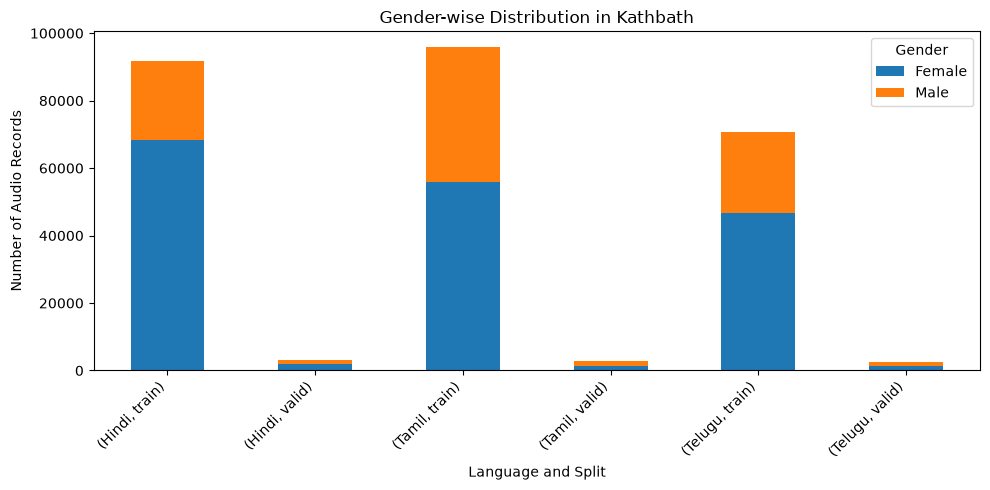
  <br>
  <em>Figure 2: Kathbath records by gender, language and split. Female records outnumber male records in every language.</em>
</div>

<div align="center">
  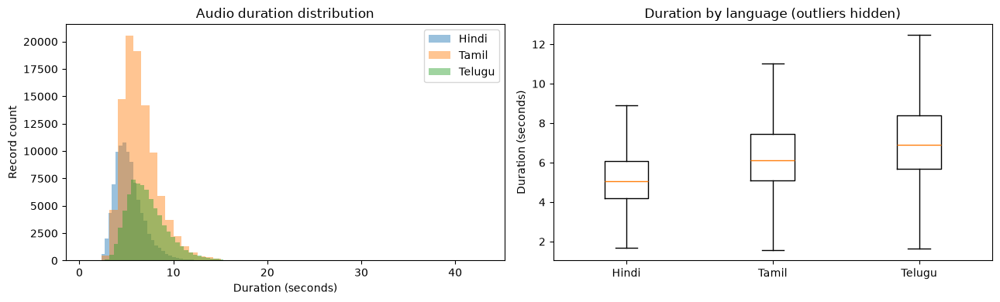
  <br>
  <em>Figure 3: Kathbath clip durations by language. Telugu clips are the longest and Hindi clips the shortest.</em>
</div>

Full details: [`kathbath_report.md`](../../scratchpad/amit/milestone-2/kathbath/kathbath_report.md).

### 3.2 IndicSynth (Indian-language fakes for training)

IndicSynth contains synthetic speech made from Kathbath recordings with two generators:

- **XTTS-v2** speaks a sentence in the voice of a Kathbath speaker, using one of that speaker's recordings as the voice reference.
- **FreeVC24** converts a recording of one Kathbath speaker (the source) into the voice of another (the target).

The metadata of every clip was read, and 3,000 clips (500 per generator and language, from 25 randomly chosen parts of the data) were decoded for the audio statistics.

| Language  | XTTS-v2 clips | FreeVC24 clips | Speakers (F / M) |  Est. hours |
| --------- | ------------: | -------------: | ---------------- | ----------: |
| Hindi     |       101,202 |        104,736 | 53 / 48          |         333 |
| Tamil     |       138,276 |        144,036 | 32 / 106         |         570 |
| Telugu    |        84,168 |         85,728 | 41 / 43          |         355 |
| **Total** |   **323,646** |    **334,500** |                  | **≈ 1,260** |

- **Balance:** both generators are equally represented, and every target speaker has about 1,000 clips per generator, so no speaker dominates.
- **Tamil is mostly male:** 32 female and 106 male speakers, so only 23% of Tamil clips have a female voice. Samples drawn for training must be balanced by gender.
- **Content:** XTTS-v2 synthesises Kathbath training sentences (mostly 8–15 words, each used about twice). FreeVC24 always converts between two _different_ speakers of the _same_ gender, and each source recording is converted into 16–21 target voices, so the spoken content of FreeVC24 clips repeats heavily.
- **Link to Kathbath:** every target and source speaker is a Kathbath **training** speaker (the speaker counts equal Kathbath's train speakers: 101, 138 and 84), and every reference and source recording comes from Kathbath's train split. Kathbath's 20 test speakers per language have no IndicSynth clips.

<div align="center">
  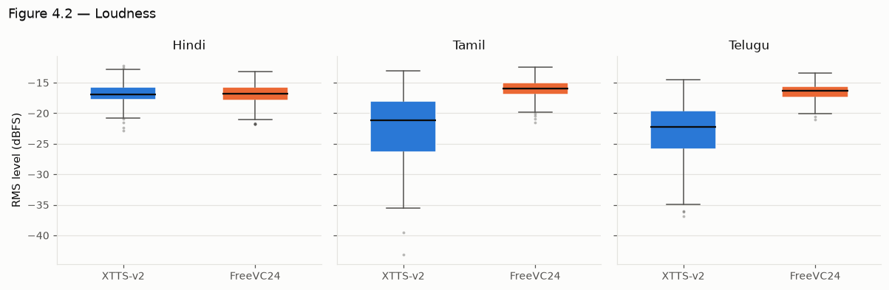
  <br>
  <em>Figure 4: Loudness of 3,000 sampled IndicSynth clips. XTTS-v2 Tamil and Telugu clips are 5–6 dB quieter than FreeVC24 clips; Hindi is similar for both generators.</em>
</div>

Full details: [`IndicSynth_notebook.ipynb`](../../notebooks/Milestone-2/IndicSynth_notebook.ipynb).

### 3.3 ASVspoof 2019 LA (English benchmark)

| Metric                      | Value                                                           |
| --------------------------- | --------------------------------------------------------------- |
| Utterances (eval partition) | 71,237                                                          |
| Bona fide / spoof           | 7,355 (10.3%) / 63,882 (89.7%)                                  |
| Speakers                    | 67 (48 with spoofed speech)                                     |
| Attack systems              | 13 (A07–A19), exactly 4,914 utterances each                     |
| Attack types                | TTS 53.8%, TTS + voice conversion 23.1%, voice conversion 23.1% |
| Audio                       | 16 kHz mono, about 61 hours in total                            |

The class imbalance means a classifier that always answers "spoof" already reaches 89.7% accuracy, so accuracy is not a useful metric here. EER and per-class recall are reported instead. In the sampled audio, real clips contain about three times more silence than spoofed clips (median 17% of frames vs 5.5%).

<div align="center">
  
  <br>
  <em>Figure 5: ASVspoof 2019 LA eval utterances per class and attack system. Each of the 13 attacks contributes 4,914 utterances.</em>
</div>

Full details: [`ASVspoof_report.md`](../../scratchpad/vikram/ASVspoof_report.md).

### 3.4 In-the-Wild (real-world English test set)

| Metric                | Value                                                                                                |
| --------------------- | ---------------------------------------------------------------------------------------------------- |
| Clips                 | 31,779: 19,963 real (62.8%), 11,816 fake (37.2%)                                                     |
| Speakers              | 54 public figures in the metadata (the paper reports 58); every speaker has both real and fake clips |
| Speaker concentration | Top 3 speakers 33.6% of clips, top 10 speakers 70.6%                                                 |
| Audio                 | 16 kHz mono WAV, 32-bit float; 37.9 hours                                                            |
| Generator             | One undisclosed commercial TTS system                                                                |

Fake clips are longer (median 4.29 s vs 3.10 s) and contain more silence than real clips (median 12.8% of frames vs 0%), the opposite direction from ASVspoof.

<div align="center">
  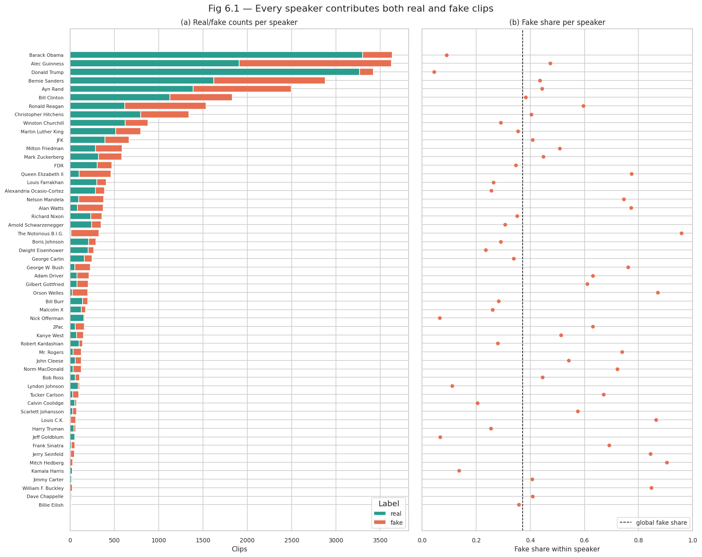
  <br>
  <em>Figure 6: In-the-Wild clips per speaker and label. Every one of the 54 speakers has both real and fake clips.</em>
</div>

Full details: [`InTheWild_report.md`](../../scratchpad/vikram/InTheWild_report.md).

### 3.5 Our Generated Set (unseen-generator test)

| Generator        |     Clips |     Hours | Sample rate | Voices                                   | Median duration (hi / ta / te) |
| ---------------- | --------: | --------: | ----------- | ---------------------------------------- | ------------------------------ |
| Indic Parler-TTS |     2,160 |      3.76 | 44.1 kHz    | 3–4 per language, described by text      | 4.8 / 6.8 / 6.6 s              |
| IndicF5          |     2,160 |      3.38 | 24 kHz      | 10 cloned voices per language (5 F, 5 M) | 5.0 / 4.6 / 6.4 s              |
| MMS-TTS          |     2,160 |      4.11 | 16 kHz      | 1 per language                           | 4.8 / 7.9 / 7.4 s              |
| **Total**        | **6,480** | **11.25** |             | **40**                                   |                                |

Each language has 720 sentences, and every sentence is spoken by all three generators (2,160 clips per language). How the set was made, and why, is described in Section 6.

<div align="center">
  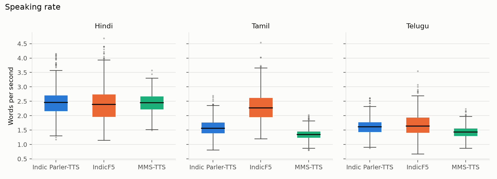
  <br>
  <em>Figure 7: Speaking rate of the generated clips. All three generators speak Hindi at about 2.4 words per second; in Tamil and Telugu Parler and MMS-TTS are slower, while IndicF5 Tamil copies the fast pace of its reference speakers.</em>
</div>

<div align="center">
  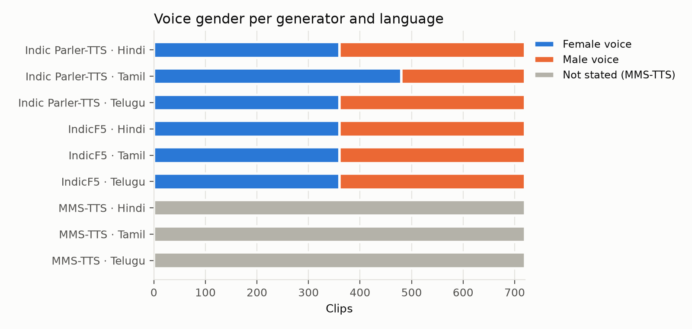
  <br>
  <em>Figure 8: Voice gender in the generated set. IndicF5 and Parler are balanced except Parler Tamil (2:1 female); MMS-TTS has one voice whose gender is not stated.</em>
</div>

Full details: [`GeneratedSet_EDA_notebook.ipynb`](../../notebooks/Milestone-2/GeneratedSet_EDA_notebook.ipynb), with data checks, voices, duration, speaking rate, loudness, IndicF5's pace per reference voice and listening examples of the same sentence from all three generators.

---

## 4. Data Quality Assessment

### 4.1 Missing Values, Inconsistencies and Duplicates

| Check                  | Kathbath                                                                 | IndicSynth                                                                           | ASVspoof 2019 LA                            | In-the-Wild                                                    | Generated set                                                       |
| ---------------------- | ------------------------------------------------------------------------ | ------------------------------------------------------------------------------------ | ------------------------------------------- | -------------------------------------------------------------- | ------------------------------------------------------------------- |
| Missing values         | 0 in all metadata fields                                                 | 0 (empty fields only where the generator does not use them)                          | 0                                           | 0                                                              | 0                                                                   |
| Decode errors          | 0 of 266,487                                                             | 0 of 3,000 sampled                                                                   | 0 of 2,000 sampled                          | 0 of 2,000 sampled                                             | 0 of 6,480                                                          |
| Label / ID consistency | Language codes all correct                                               | Speaker IDs and gender match the reference file names                                | Protocol and label file agree on all 71,237 | Metadata and audio match 1:1                                   | Text, language and generator match the sentence list for every clip |
| Duplicate files        | 0 duplicate file names                                                   | 0 duplicate file names; 0 identical audio in the sample                              | 0 duplicate IDs                             | 0 duplicate files (CRC32 + size)                               | 0 identical files (SHA-1)                                           |
| Repeated content       | Same sentence read by different speakers (81 transcripts)                | XTTS-v2 sentences used about twice; FreeVC24 source recordings converted 16–21 times | —                                           | —                                                              | Each sentence spoken by all 3 generators (by design)                |
| Flags                  | 582 clips outside 2–15 s; clipping flags on about 12k clips (for review) | 76 XTTS-v2 clips repeat a sentence from the same reference (separate files)          | 16 sampled clips more than 50% silent       | 20 sampled clips more than 50% silent; 54 of 58 speakers named | 1 silent clip (Parler, `te_0623`)                                   |

None of the datasets has missing labels or broken files. The flags are kept for review rather than removed automatically. The one silent generated clip is excluded through its flag in the manifest. Exact duplicates across datasets are removed by audio hash after preprocessing, once every clip has the same format.

### 4.2 Audio Quality and Shortcut Risks

| Property      | Kathbath                 | IndicSynth                                                 | ASVspoof                     | In-the-Wild                  | Generated set                                             |
| ------------- | ------------------------ | ---------------------------------------------------------- | ---------------------------- | ---------------------------- | --------------------------------------------------------- |
| Sample rate   | 16 kHz                   | 24 kHz                                                     | 16 kHz                       | 16 kHz                       | 44.1 / 24 / 16 kHz by generator                           |
| Sample format | Lossy source files (m4a) | 16-bit, except XTTS-v2 Tamil and Telugu (32-bit float)     | 16-bit                       | 32-bit float                 | FLAC, 16-bit                                              |
| Loudness      | Varies by language       | XTTS-v2 Tamil/Telugu 5–6 dB quieter than FreeVC24          | Spoof louder than real       | Fake quieter than real       | IndicF5 fixed at −20 dBFS; MMS ≈ −17; Parler ≈ −24 to −26 |
| Edge silence  | —                        | XTTS-v2 Hindi ends with ≈ 0.56 s of silence; FreeVC24 none | Real clips have more silence | Fake clips have more silence | —                                                         |

In every dataset, some property of the recording lines up with the label or the generator. A model could reach a low error by learning "24 kHz", "−20 dBFS" or "trailing silence" instead of the voice itself, and such a model would fail on new data. Figures 9–11 show three examples.

<div align="center">
  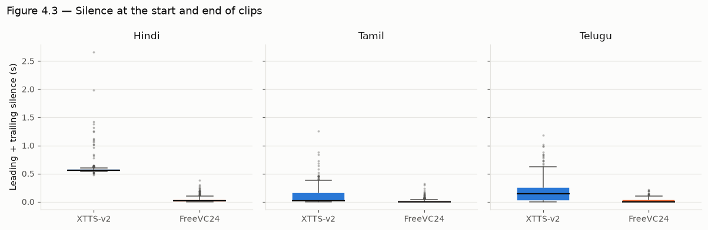
  <br>
  <em>Figure 9: Leading plus trailing silence in sampled IndicSynth clips. XTTS-v2 Hindi clips almost always end with about half a second of silence; FreeVC24 clips do not.</em>
</div>

<div align="center">
  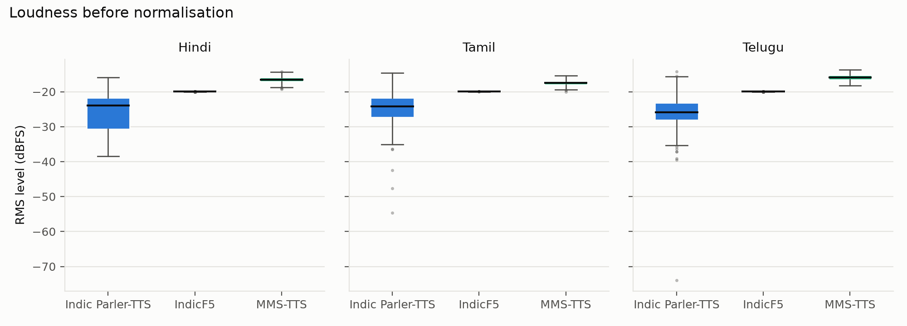
  <br>
  <em>Figure 10: Loudness of the generated clips before normalisation. IndicF5 normalises every clip to −20 dBFS, so loudness alone would identify it.</em>
</div>

<div align="center">
  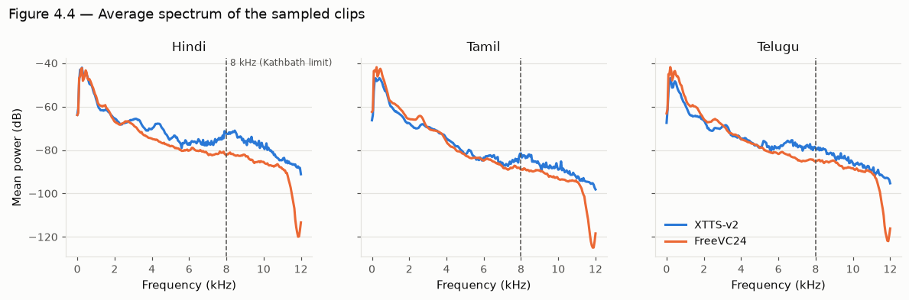
  <br>
  <em>Figure 11: Average spectrum of sampled IndicSynth clips. At most 0.4% of the energy lies above 8 kHz, so resampling to 16 kHz removes the bandwidth difference to the 16 kHz real data.</em>
</div>

These findings decide the preprocessing in Section 9. Every clip, real or fake, is resampled to 16 kHz, converted to 16-bit mono, trimmed of leading and trailing silence, normalised in loudness and cropped to a fixed length.

### 4.3 Noise

Kathbath is used only in its **clean** version, so the background noise of the real Indian-language data is controlled. ASVspoof is studio-quality. In-the-Wild contains real-world noise and codec history, which is what makes it a useful test set. Noise is added later in a controlled way through augmentation (Section 5.2), on both classes.

---

## 5. Adequacy and Augmentation

### 5.1 Adequacy Assessment

| Criterion                                | Assessment  | Notes                                                                                                                  |
| ---------------------------------------- | ----------- | ---------------------------------------------------------------------------------------------------------------------- |
| Indian-language real speech              | ✅ Adequate | Kathbath: 266k clips, 84–138 training speakers per language                                                            |
| Indian-language fake speech for training | ✅ Adequate | IndicSynth: 658k clips, two generator types (TTS and voice conversion)                                                 |
| Generator variety in training            | ⚠️ Limited  | Only XTTS-v2 and FreeVC24 for Indian languages; newer generators are covered by the test set                           |
| Fakes from unseen generators             | ✅ Adequate | Our generated set: three generators, 6,480 clips                                                                       |
| English real and fake speech             | ⚠️ Partial  | ASVspoof 2019 LA eval explored (13 attacks); train and dev audio still to be downloaded from the official distribution |
| Real-world conditions                    | ✅ Adequate | In-the-Wild: 31,779 clips from online videos                                                                           |
| Phone-quality audio                      | ❌ Missing  | Not in any dataset; created through augmentation (Section 5.2)                                                         |
| Class balance                            | ⚠️ Uneven   | ASVspoof 90% fake, In-the-Wild 63% real; handled by sampling and EER-based metrics                                     |
| Gender balance                           | ⚠️ Uneven   | IndicSynth Tamil 23% female, Kathbath records 58–75% female; handled by gender-balanced sampling                       |
| Label quality                            | ✅ Good     | Labels come from how each clip was made (recorded or generated), not from annotators                                   |

The volume is far larger than needed. Following the plan from Milestone 1, training uses a seeded, gender-balanced sample: about 6,000 Kathbath clips per language and about 3,000 IndicSynth clips per generator and language. The two weak spots are the small number of Indian-language generators in training (two) and the lack of phone-channel audio. The first is why the generated set exists; the second is covered by augmentation.

### 5.2 Augmentation Plan (applied during training, to both classes)

| Augmentation                             | Domain   | Setting                               | Priority | Purpose / risk                                                                                |
| ---------------------------------------- | -------- | ------------------------------------- | -------- | --------------------------------------------------------------------------------------------- |
| Additive noise (AWGN, background noise)  | Waveform | SNR around 15 dB                      | High     | Robustness to noisy calls; too much can hide subtle fake cues                                 |
| SpecAugment                              | Log-mel  | 2 time + 2 frequency masks            | High     | Robustness; can mask artefacts                                                                |
| Codec round-trip (MP3, Opus)             | Waveform | 64–128 kbps MP3, 24 kbps Opus         | High     | Matches online audio; also removes the lossy-vs-clean shortcut between Kathbath and WAV fakes |
| Phone channel                            | Waveform | 8 kHz downsampling + G.711 companding | High     | Covers the phone-channel test                                                                 |
| RawBoost                                 | Waveform | Linear/non-linear channel distortion  | Medium   | Known to improve generalisation of spoofing detectors                                         |
| Time shift, speed and pitch perturbation | Waveform | ±0.15 s; 0.9–1.1×; ±2 semitones       | Medium   | Variety in timing and voice; keep small                                                       |
| Reverberation                            | Waveform | RT60 ≈ 0.3 s                          | Low      | Room sound; heavy reverb can erase generator artefacts                                        |

Labels never change under augmentation, and every augmentation is applied to real and fake clips with the same probability.

---

## 6. Synthetic Data: Our Generated Set

### 6.1 Purpose

IndicSynth covers only two generators (XTTS-v2 and FreeVC24). To measure how the detector handles voice tools it never saw in training, we generated a **test-only** set with three different open-source generators that support Hindi, Tamil and Telugu.

### 6.2 Generation Process

<div align="center">
  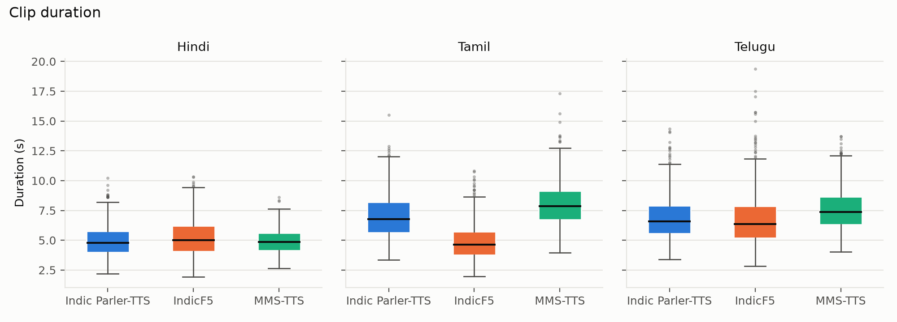
  <br>
  <em>Figure 12: Duration of the generated clips per generator and language. The same sentences take different lengths with different generators.</em>
</div>

1. **Sentence selection** (`select_sentences.py`, seed 42):
   - Sentences come only from Kathbath's **`test` split**, i.e. its 20 unseen speakers per language.
   - Any sentence that also appears in Kathbath's train, valid or test_known split is removed.
   - Only sentences of 6–18 words are kept. From the remaining sentences, 720 are drawn at random per language.
   - The list is fixed (MD5 `ad1f2223…`), and the notebook rebuilds it from AI4Bharat's transcript archive and checks this hash on every run.
2. **Generation** (`generate_fakes_kaggle.ipynb`; the executed notebooks of the three full runs are kept as [`generate_fakes_parler_run.ipynb`](../../notebooks/Milestone-2/generate_fakes_parler_run.ipynb), [`generate_fakes_indicf5_run.ipynb`](../../notebooks/Milestone-2/generate_fakes_indicf5_run.ipynb) and [`generate_fakes_mms_run.ipynb`](../../notebooks/Milestone-2/generate_fakes_mms_run.ipynb)):
   - Runs on Kaggle with two T4 GPUs, with the clips split evenly between the GPUs.
   - Each clip has a fixed seed (42 + its position) and is saved as FLAC at the generator's native rate, without resampling.
   - Clips are uploaded in batches of 50 to a private Hugging Face dataset, together with a JSON-lines manifest. A run that stops can be restarted and skips finished clips.
3. **Checks** (`summarize_dataset.py`):
   - 17 automatic checks on all 6,480 manifests: completeness, duplicates, text consistency, sample rate, labels, silence, clipping.
   - A listening check of clips from each generator and language.
   - A reproducibility check: 15 clips per generator were regenerated in a separate run and were **byte-identical** to the stored clips.

Generating one clip took on average 14–22 s with Parler, 11–13 s with IndicF5 and 0.1–0.2 s with MMS-TTS on a T4 GPU (generated-set EDA, Table 2.1); the Parler and IndicF5 runs were made in parallel on two Kaggle sessions.

### 6.3 Design Choices and Justification

| Choice                                                                                                                           | Reason                                                                                                                                                                                                                                                               |
| -------------------------------------------------------------------------------------------------------------------------------- | -------------------------------------------------------------------------------------------------------------------------------------------------------------------------------------------------------------------------------------------------------------------- |
| Generators: **Indic Parler-TTS**, **IndicF5**, **MMS-TTS**                                                                       | None is used in IndicSynth, and they cover three designs: text-described voices, voice cloning from a reference, and a single-voice VITS model                                                                                                                       |
| Sentences from Kathbath's **test** speakers only, excluding any sentence also used in training                                   | No training text appears in the test set, and the fakes can be compared with the real recordings of the same test speakers                                                                                                                                           |
| **Parallel design**: every sentence spoken by all three generators                                                               | Differences between generators are not caused by differences in text; Kathbath's test split also has only 1,492–1,929 recordings per language (IndicSynth EDA, Table 3.1), fewer than the 2,160 different sentences that separate sentences per generator would need |
| **720 sentences per language** (2,160 clips)                                                                                     | Meets the planned 2,000 clips per language with a margin for clips that fail quality checks                                                                                                                                                                          |
| Parler voices: the model card's recommended speakers plus unnamed male and female voices, rotating through 3 paces and 3 pitches | More voice variety, and voice and gender are known for every clip                                                                                                                                                                                                    |
| IndicF5 voices: 10 speakers per language (5 F, 5 M) from IndicVoices-R, 4–9 s, transcript of at least 8 words                    | IndicVoices-R is released for TTS, so cloning respects consent; Kathbath speakers are never cloned. IndicF5 copies the pace of its reference, and short transcripts were mostly slowly read lists that produced unnaturally slow clips                               |
| Native sample rate, FLAC                                                                                                         | No information is lost before the shared preprocessing step                                                                                                                                                                                                          |
| Fixed seed per clip, pinned sentence list, resumable runs                                                                        | Every clip can be regenerated exactly                                                                                                                                                                                                                                |

### 6.4 Quality of the Generated Set

All 6,480 clips were generated with no failures, no duplicates and no clipping, and one Parler clip (`te_0623`) is flagged as silent. Two properties are recorded for the analysis rather than fixed:

- Parler's Tamil clips are 2:1 female to male, because the only recommended Tamil speaker is female.
- IndicF5's speaking pace depends on the reference voice: clips are 0.55–1.57 times the length of Parler's clip of the same sentence. This is realistic variation in speaking rate.

The full tables are in [`summary.md`](../../scratchpad/Tarika/milestone-2/summary/summary.md).

---

## 7. Dataset Splits and Leakage

### 7.1 Split Strategy

| Data                                       | Train           | Validation      | Test                                                 |
| ------------------------------------------ | --------------- | --------------- | ---------------------------------------------------- |
| Kathbath training speakers + IndicSynth    | 70% of speakers | 15% of speakers | 15% of speakers                                      |
| Kathbath `test` speakers (20 per language) | —               | —               | Real side of the unseen-generator test               |
| Our generated set                          | —               | —               | Fake side of the unseen-generator test               |
| ASVspoof 2019 LA                           | Official train  | Official dev    | Official eval (attacks A07–A19 not seen in training) |
| In-the-Wild                                | —               | —               | Real-world test (100%)                               |

**Indian-language data is split by speaker:**

1. The Kathbath training speakers of each language are divided 70/15/15 with a fixed seed, separately for female and male speakers so that each split keeps the gender balance.
2. Every real Kathbath clip (train, valid and test_known) follows its speaker.
3. An IndicSynth clip is kept only if **every** speaker it involves is in the same split: the target speaker for XTTS-v2, and both the source and the target speaker for FreeVC24.

With the fixed seed, this rule gives the following IndicSynth clip counts (from `IndicSynth_notebook.ipynb`, Table 5.1). The real Kathbath clips are divided by the same speaker assignment.

| Language | Speakers (train / valid / test) | XTTS-v2 (train / valid / test) | FreeVC24 (train / valid / test) | FreeVC24 dropped |
| -------- | ------------------------------- | ------------------------------ | ------------------------------- | ---------------: |
| Hindi    | 71 / 15 / 15                    | 71,142 / 15,030 / 15,030       | 51,308 / 2,044 / 2,044          |           49,340 |
| Tamil    | 96 / 21 / 21                    | 96,192 / 21,042 / 21,042       | 69,266 / 3,060 / 3,060          |           68,650 |
| Telugu   | 59 / 12 / 13                    | 59,118 / 12,024 / 13,026       | 41,850 / 1,500 / 1,788          |           40,590 |

The split is made on speaker IDs before any clip is sampled, so a clip can only ever belong to the split of its speaker, and a check that no speaker ID appears in two splits returns 0 for every language.

<div align="center">
  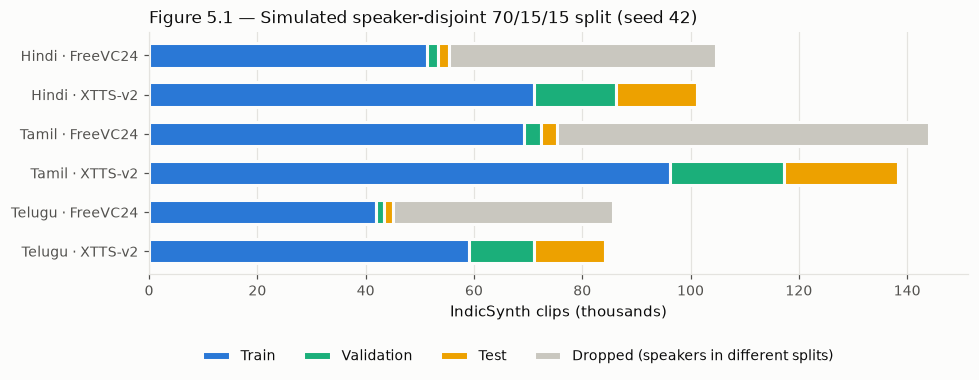
  <br>
  <em>Figure 13: Simulated speaker-disjoint split of IndicSynth (seed 42). XTTS-v2 clips follow their speaker; FreeVC24 clips whose source and target speakers fall in different splits are dropped (about 47%).</em>
</div>

Kathbath's own valid split is not used as our validation set, because all its speakers also appear in train. Kathbath's `test` speakers have no IndicSynth fakes, so they form the real side of the unseen-generator test. They are paired with our generated set, which speaks their sentences.

**Extra test views** from the same splits:

- **Cross-language:** train on two Indian languages plus English and test on the third.
- **Cross-generator:** train on XTTS-v2 and test on FreeVC24.
- **Channel:** the phone-channel version of each test set.

In-the-Wild stays test-only. Its speaker-disjoint 80/10/10 split ([`InTheWild_report.md`](../../scratchpad/vikram/InTheWild_report.md), Section 9) is kept in reserve in case part of it is later used for fine-tuning.

### 7.2 Leakage Checks

| Check                                                                   | Result                                                                                                                                                                                                                      |
| ----------------------------------------------------------------------- | --------------------------------------------------------------------------------------------------------------------------------------------------------------------------------------------------------------------------- |
| Speakers shared between splits (IndicSynth + Kathbath, simulated split) | 0 in every language                                                                                                                                                                                                         |
| FreeVC24 clips whose two speakers fall in different splits              | 47% of FreeVC24 clips are dropped; 42k–69k per language remain for training and 1,500–3,000 for validation and test                                                                                                         |
| IndicSynth reference recordings                                         | All are Kathbath training recordings of the same speaker, so a reference always sits in the same split as its fakes                                                                                                         |
| Generated set vs. training text                                         | Sentences only from Kathbath test speakers; no sentence also appears in train, valid or test_known. The 8 Hindi sentences shared by IndicSynth and Kathbath's test split are among those excluded                           |
| Kathbath validation speakers                                            | All 20 per language also in train, so handled by the speaker-level split instead of Kathbath's own split                                                                                                                    |
| In-the-Wild                                                             | 0 duplicate files; 0 speakers shared between the proposed splits; no video IDs, so two clips from the same video cannot be detected (recorded as a limitation)                                                              |
| ASVspoof 2019 LA                                                        | Official protocol with unique utterance IDs                                                                                                                                                                                 |
| Sentence overlap within IndicSynth (XTTS-v2)                            | 57–70% of test sentences also occur in train, because Kathbath has several people read the same sentence. This is overlap in content, not in speakers; it is reported, and test clips can be filtered by sentence if needed |
| Exact duplicates across all datasets                                    | Checked by audio hash after preprocessing                                                                                                                                                                                   |

---

## 8. Combining the Datasets

### 8.1 How the Datasets Connect

Figure 1 (Section 1) shows the whole picture.

- **IndicSynth is built from Kathbath.** Its speakers are exactly Kathbath's training speakers, and its references are their recordings. The real and fake clips of a speaker therefore come from the same people and recording sessions, which keeps "dataset A vs dataset B" differences small. It also means a speaker's real and fake clips must stay in the same split.
- **Our generated set is built from Kathbath's test text.** It speaks the sentences of Kathbath's unseen test speakers, so the unseen-generator test pairs real and fake speech of the same sentences.
- **ASVspoof and In-the-Wild** are separate English sources. ASVspoof trains and tests the English side; In-the-Wild tests real-world English audio.

### 8.2 One Manifest for All Data

All datasets are joined through one CSV manifest, so later stages read a single file:

```
clip_id, path, dataset, language, label (real / fake), generator, speaker_id,
ref_speaker_id, gender, duration_s, orig_sr, sha1, split
```

| Field            | Kathbath  | IndicSynth                | ASVspoof            | In-the-Wild              | Generated set                              |
| ---------------- | --------- | ------------------------- | ------------------- | ------------------------ | ------------------------------------------ |
| `label`          | real      | fake                      | from protocol       | from `meta.csv`          | fake                                       |
| `generator`      | —         | `xtts_v2` / `freevc24`    | attack ID (A07–A19) | `unknown_commercial_tts` | `indic-parler-tts` / `indicf5` / `mms-tts` |
| `speaker_id`     | file name | target speaker            | protocol speaker    | `meta.csv` speaker       | Kathbath speaker whose sentence was used   |
| `ref_speaker_id` | —         | source speaker (FreeVC24) | —                   | —                        | IndicVoices-R speaker (IndicF5)            |

---

## 9. Preprocessing & Data Preparation

### 9.1 Preprocessing Pipeline

One function, [`preprocess.py`](../../scratchpad/himanshu/milestone-2/preprocess.py), is applied to every clip from every source, real or fake. It removes the shortcuts found in Section 4.2.

```python
TARGET_SR = 16000          # XLS-R was pretrained on 16 kHz audio
TARGET_RMS_DBFS = -20.0    # one loudness level for every clip
SILENCE_DB = 40            # frames 40 dB below the loudest frame count as silence

def preprocess(path):
    audio, sr = load_mono(path)                                  # decode, mix to mono
    audio = trim_silence(resample(audio, sr), TARGET_SR)        # 16 kHz, cut edge silence
    if len(audio) < MIN_SECONDS * TARGET_SR:
        return None, "shorter than 1 s after trimming"           # drop very short clips
    pcm = np.round(normalise_loudness(audio) * 32767).astype(np.int16)   # 16-bit PCM
    return pcm, hashlib.sha1(pcm.tobytes()).hexdigest()          # hash for duplicate removal
```

| #   | Step                               | Detail                                                                                                             | Removes                                                                           |
| --- | ---------------------------------- | ------------------------------------------------------------------------------------------------------------------ | --------------------------------------------------------------------------------- |
| 1   | Decode and mix to mono             | `soundfile`; Kathbath's m4a files are first decoded with `ffmpeg` (or taken from the decoded Hugging Face release) | Container and codec differences in reading                                        |
| 2   | Resample to 16 kHz                 | Polyphase resampling (`scipy.signal.resample_poly`)                                                                | Sample-rate and bandwidth shortcut (16 / 24 / 44.1 kHz)                           |
| 3   | Trim edge silence                  | 20 ms frames; frames more than 40 dB below the loudest frame are cut at the start and end                          | Silence shortcut (ASVspoof, In-the-Wild, XTTS-v2 Hindi)                           |
| 4   | Drop short or flagged clips        | Shorter than 1 s after trimming, or flagged silent in a manifest                                                   | Empty and broken clips                                                            |
| 5   | Normalise loudness                 | RMS scaled to −20 dBFS, peak limited to 0.99 so nothing clips                                                      | Loudness shortcut (IndicF5 fixed level, XTTS-v2 Tamil/Telugu quieter)             |
| 6   | Store as 16-bit PCM WAV and hash   | SHA-1 of the processed samples                                                                                     | Sample-format shortcut (32-bit float vs 16-bit); exact duplicates across datasets |
| 7   | Split                              | Speaker-level assignment from Section 7, before any sampling                                                       | Speaker leakage                                                                   |
| 8   | Fixed-length crops (training only) | Random crop of a fixed length, padding for shorter clips                                                           | Clip-length shortcut                                                              |
| 9   | Augmentation (training only)       | Section 5.2, same probability for both classes                                                                     | Codec shortcut; adds noise and phone-channel robustness                           |

**Check on real clips.** The function was run on clips from all four generator sources of different formats:

| Input                        | Sample rate in | Duration in → out | RMS out    | Format out     |
| ---------------------------- | -------------- | ----------------- | ---------- | -------------- |
| Indic Parler-TTS (`hi_0001`) | 44.1 kHz       | 4.93 s → 4.40 s   | −20.0 dBFS | 16 kHz, 16-bit |
| IndicF5 (`hi_0001`)          | 24 kHz         | 3.38 s → 3.26 s   | −20.0 dBFS | 16 kHz, 16-bit |
| MMS-TTS (`hi_0001`)          | 16 kHz         | 4.98 s → 4.28 s   | −20.0 dBFS | 16 kHz, 16-bit |
| IndicSynth XTTS-v2           | 24 kHz         | 4.86 s → 4.28 s   | −20.0 dBFS | 16 kHz, 16-bit |

Every output has the same rate, format and level, the edge silence is removed, and running the function twice gives the same SHA-1 hash. One Parler clip with a very loud peak ends at −21.2 dBFS because of the clipping guard.

### 9.2 Preparation Order

1. Download each source at its pinned revision (`kathbath`, IndicSynth row groups, ASVspoof, In-the-Wild, our generated set).
2. Draw the seeded, gender-balanced training samples (Section 5.1) and keep every test clip.
3. Assign splits by speaker (Section 7).
4. Run `preprocess.py` on every selected clip and write one row per clip to the manifest (Section 8.2).
5. Remove exact duplicates by SHA-1 and rerun the leakage checks on the final manifest.

---

## 10. Speech-Specific and Model-Specific Requirements

### 10.1 Audio Quality and Sampling Consistency

Section 4.2 lists the audio properties of each source, and Section 9.1 shows how they are made consistent. After preprocessing, every clip is 16 kHz, mono, 16-bit PCM, trimmed and at the same loudness, whatever its source.

### 10.2 Transcription Alignment

The classifier uses only audio and a label, so transcripts are not needed for training. They matter only for the generated set, where they are the input text. Alignment was checked in three ways:

- every clip's text matches the fixed sentence list;
- a listening check confirmed that the clips speak their sentence;
- IndicF5 clips were compared in length with the other generators' clips of the same sentence (0.55–1.57×), which also exposed and fixed the slow-reference problem described in Section 6.3.

### 10.3 Key Dataset Requirements

| Requirement                                        | Status     | Detail                                                                                                |
| -------------------------------------------------- | ---------- | ----------------------------------------------------------------------------------------------------- |
| Ground-truth real / fake labels                    | ✅ Met     | Every clip is labelled by how it was made; protocol labels cross-checked for ASVspoof and In-the-Wild |
| 16 kHz mono input for XLS-R 300M                   | ✅ Met     | Shared preprocessing (Section 9.1), tested on 16, 24 and 44.1 kHz inputs                              |
| Speaker-disjoint splits with no leakage            | ✅ Met     | 0 shared speakers in the simulated split; references stay with their speaker                          |
| Unseen-generator test set                          | ✅ Met     | 6,480 clips from three generators not used in IndicSynth                                              |
| Real-world and cross-language tests                | ✅ Met     | In-the-Wild; cross-language fold from the same splits                                                 |
| Shortcut removal (rate, format, silence, loudness) | ✅ Met     | Section 9.1                                                                                           |
| Class and gender balance                           | ⚠️ Partial | Planned through sampling and EER-based metrics; to be confirmed on the final manifest                 |
| English training data                              | ⚠️ Partial | ASVspoof train and dev audio still to be downloaded                                                   |
| Phone-channel data                                 | ⚠️ Partial | Only through augmentation                                                                             |
| Ethical and licence compliance                     | ✅ Met     | Research licences respected; non-commercial terms recorded; no Kathbath voice cloned                  |
| Clean, deduplicated input                          | ✅ Met     | 0 duplicate files in every dataset; SHA-1 deduplication after preprocessing                           |

---

## 11. Reproducibility

| Step                       | File                                                                                                                                                                                                                  | Runs on                             | Fixed inputs                                |
| -------------------------- | --------------------------------------------------------------------------------------------------------------------------------------------------------------------------------------------------------------------- | ----------------------------------- | ------------------------------------------- |
| Kathbath EDA               | [`kathbath/kathbath_eda.ipynb`](kathbath/kathbath_eda.ipynb)                                                                                                                                                          | Hugging Face streaming              | seed 42                                     |
| IndicSynth EDA             | [`IndicSynth_notebook.ipynb`](../../notebooks/Milestone-2/IndicSynth_notebook.ipynb)                                                                                                                                  | Kaggle / Colab / local CPU          | revision `c0a10386`, seed 42                |
| ASVspoof 2019 LA EDA       | [`ASVspoof_notebook.ipynb`](../../notebooks/Milestone-2/ASVspoof_notebook.ipynb)                                                                                                                                      | Colab / local CPU                   | revision `401e90d3`, seed 42                |
| In-the-Wild EDA            | [`InTheWild_notebook.ipynb`](../../notebooks/Milestone-2/InTheWild_notebook.ipynb)                                                                                                                                    | Colab / Kaggle CPU                  | revision `eee168f9`, seed 42                |
| Sentence selection         | [`select_sentences.py`](../../scratchpad/Tarika/milestone-2/select_sentences.py)                                                                                                                                      | any                                 | seed 42; output MD5 `ad1f2223…`             |
| Generation                 | [`generate_fakes_kaggle.ipynb`](../../notebooks/Milestone-2/generate_fakes_kaggle.ipynb)                                                                                                                              | Kaggle, 2 × T4                      | seed 42 + clip index; one generator per run |
| Generation runs (executed) | [`parler`](../../notebooks/Milestone-2/generate_fakes_parler_run.ipynb), [`indicf5`](../../notebooks/Milestone-2/generate_fakes_indicf5_run.ipynb), [`mms`](../../notebooks/Milestone-2/generate_fakes_mms_run.ipynb) | Kaggle, 2 × T4                      | outputs of the three full runs              |
| Generated-set EDA          | [`GeneratedSet_EDA_notebook.ipynb`](../../notebooks/Milestone-2/GeneratedSet_EDA_notebook.ipynb)                                                                                                                      | any CPU (Hugging Face token needed) | reads the manifests; seed 42                |
| Generated-set checks       | [`summarize_dataset.py`](../../scratchpad/Tarika/milestone-2/summarize_dataset.py)                                                                                                                                    | any                                 | reads the manifests                         |
| Preprocessing              | [`preprocess.py`](../../scratchpad/himanshu/milestone-2/preprocess.py)                                                                                                                                                | any                                 | fixed parameters; deterministic output hash |

> **Reproducibility statement.** All randomness uses seed 42 (sampling, sentence selection, generation and split assignment), and every Hugging Face source is pinned to a fixed revision. Generation was verified to be deterministic: clips regenerated in separate runs were byte-identical to the stored clips. The analysis notebooks need only a CPU; generation needs a Kaggle GPU session.

---

## 12. Items to Address Before Milestone 3

| #   | Item                                                | Priority  | Action                                                                                                                                 |
| --- | --------------------------------------------------- | --------- | -------------------------------------------------------------------------------------------------------------------------------------- |
| 1   | ASVspoof 2019 LA train and dev audio                | 🔴 High   | Download from the official Edinburgh DataShare release; the explored Hugging Face copy has the eval partition only                     |
| 2   | Final manifest and leakage checks on processed data | 🔴 High   | Run steps 1–5 of Section 9.2 and repeat the checks of Section 7.2 on the final manifest                                                |
| 3   | Gender balance                                      | 🟡 Medium | Balance IndicSynth Tamil (23% female) and Kathbath (58–75% female records) when sampling; report results per gender                    |
| 4   | Sentence overlap in IndicSynth                      | 🟡 Low    | Decide whether to filter test clips whose sentence also occurs in train (57–70% of XTTS-v2 test sentences)                             |
| 5   | In-the-Wild provenance                              | 🟡 Low    | No video IDs and 54 of 58 speakers named; recorded as a limitation of the real-world test                                              |
| 6   | Audio statistics from samples                       | 🟡 Low    | IndicSynth, ASVspoof and In-the-Wild audio statistics come from seeded samples of 2,000–3,000 clips; repeat on the final processed set |

---

## 13. References

1. Javed, T., Bhogale, K. S., Raman, A., et al. (2023). _IndicSUPERB: A Speech Processing Universal Performance Benchmark for Indian Languages_. AAAI 2023. <https://arxiv.org/abs/2208.11761>
2. Sharma, D. V., Ekbote, V., & Gupta, A. (2025). _IndicSynth: A Large-Scale Multilingual Synthetic Speech Dataset for Low-Resource Indian Languages_. ACL 2025. <https://aclanthology.org/2025.acl-long.1070>
3. Wang, X., Yamagishi, J., Todisco, M., et al. (2020). _ASVspoof 2019: A large-scale public database of synthesized, converted and replayed speech_. Computer Speech & Language, 64. <https://arxiv.org/abs/1911.01601>
4. Müller, N. M., Czempin, P., Dieckmann, F., et al. (2022). _Does Audio Deepfake Detection Generalize?_. Interspeech 2022. <https://arxiv.org/abs/2203.16263>
5. Babu, A., Wang, C., Tjandra, A., et al. (2021). _XLS-R: Self-supervised Cross-lingual Speech Representation Learning at Scale_. arXiv. <https://arxiv.org/abs/2111.09296>
6. Casanova, E., Davis, K., Gölge, E., et al. (2024). _XTTS: A Massively Multilingual Zero-Shot Text-to-Speech Model_. Interspeech 2024. <https://arxiv.org/abs/2406.04904>
7. Sankar, A., Lacombe, Y., Thomas, S., et al. (2024). _Indic Parler-TTS: Multilingual Text-to-Speech for Indian Languages_. Hugging Face. <https://huggingface.co/ai4bharat/indic-parler-tts>
8. Praveen, S. V., Anand, S., Siddhartha, S., et al. (2025). _IndicF5: High-Quality Text-to-Speech for Indian Languages_. Hugging Face. <https://huggingface.co/ai4bharat/IndicF5>
9. Pratap, V., Tjandra, A., Shi, B., et al. (2023). _Scaling Speech Technology to 1,000+ Languages_. arXiv. <https://arxiv.org/abs/2305.13516>
10. Sankar, A., Anand, S., Varadhan, P. K., et al. (2024). _IndicVoices-R: Unlocking a Massive Multilingual Multi-speaker Speech Corpus for Scaling Indian TTS_. NeurIPS 2024 Datasets and Benchmarks. <https://arxiv.org/abs/2409.05356>
11. Tak, H., Kamble, M., Patino, J., Todisco, M., & Evans, N. (2022). _RawBoost: A Raw Data Boosting and Augmentation Method applied to Automatic Speaker Verification Anti-Spoofing_. ICASSP 2022. <https://arxiv.org/abs/2111.04433>
12. Park, D. S., Chan, W., Zhang, Y., et al. (2019). _SpecAugment: A Simple Data Augmentation Method for Automatic Speech Recognition_. Interspeech 2019. <https://arxiv.org/abs/1904.08779>
