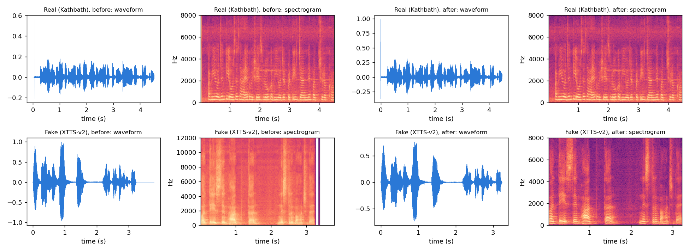
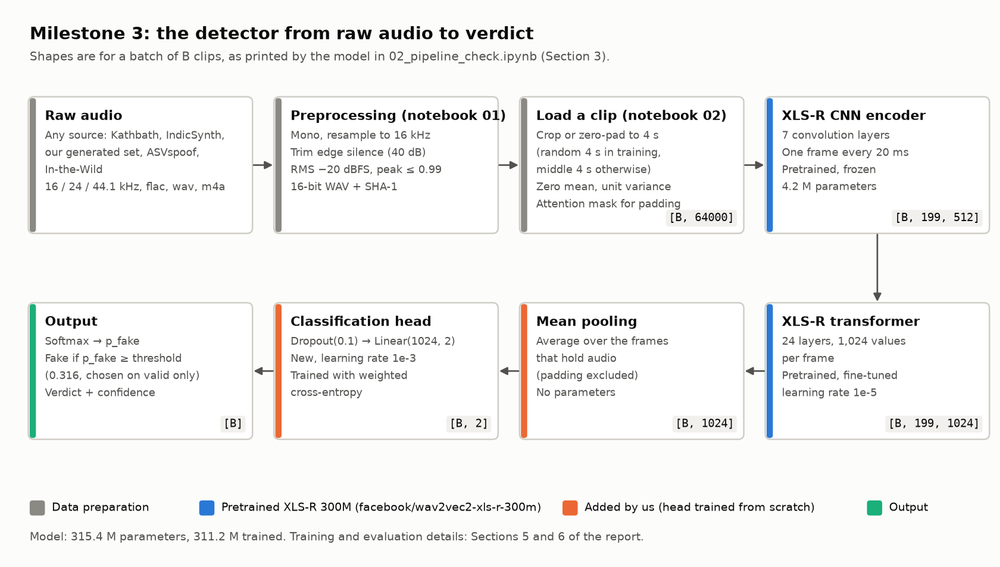
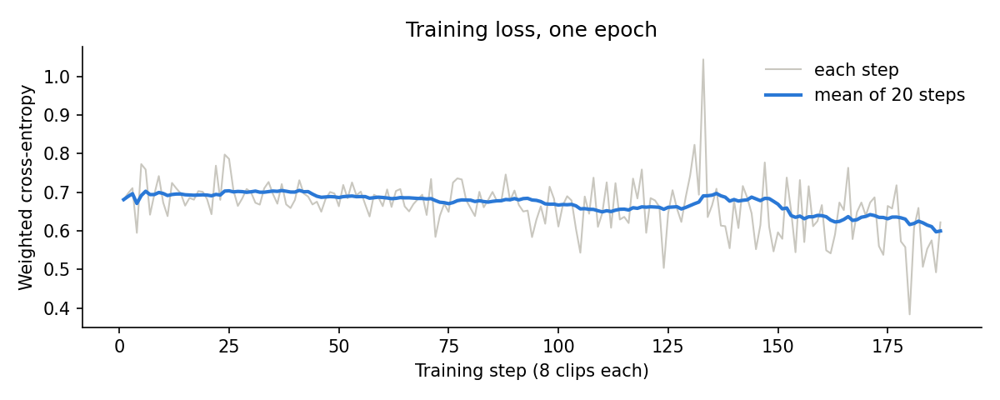
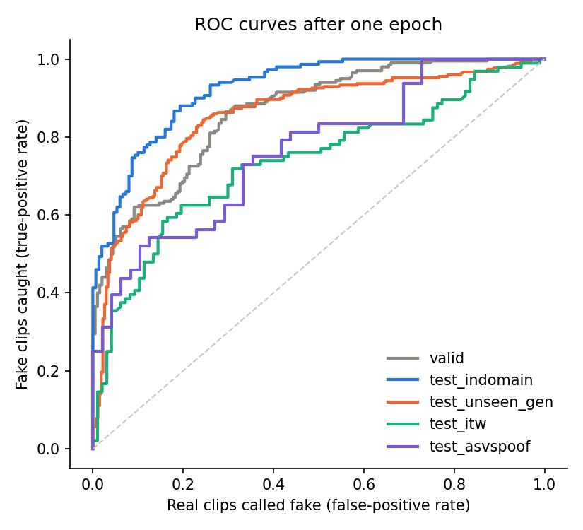

# Deepfake Voice Detection for Indian Languages using Deep Learning and Generative AI

**Milestone 3: Model Architecture and End-to-End Pipeline Verification**

---

## 1. Overview

This milestone designs and justifies the detector's architecture, then shows that the whole pipeline works end to end. We built a small, seeded subset from all five datasets of Milestone 2, prepared it with one preprocessing step, and passed it through every stage: training, inference and evaluation.

The detector is the pretrained speech encoder **XLS-R 300M** (Babu et al., 2021) with a small classification head, as chosen in Milestone 1. It reads the waveform and returns `p_fake`, the probability that a clip is AI-generated, and a real/fake verdict.

| | Result |
| --- | --- |
| Subset | 3,018 clips (4.73 h), balanced real/fake, 4 languages, 25 generators and attack systems, 6 splits |
| Leakage | 0 speakers shared between splits, 0 duplicate clips |
| Model | 315.4 M parameters, of which 311.2 M are trained |
| Training | One epoch on a Kaggle T4: 187 steps in 3.0 min, loss 0.701 → 0.610 |
| Evaluation | 1,526 clips scored. EER 17.7% on new speakers, 20.6% on unseen generators, 31.6% on real-world audio, 33.3% on unseen English attacks |

These numbers check that the pipeline works after one epoch. They don't measure final performance, which comes from full training in Milestone 4.

The work is in two notebooks, both saved with their outputs:

| Notebook | What it does |
| --- | --- |
| [`01_data_preparation.ipynb`](../../notebooks/Milestone-3/01_data_preparation.ipynb) | Speaker-disjoint split, subset selection, preprocessing, manifest, leakage checks |
| [`02_pipeline_check.ipynb`](../../notebooks/Milestone-3/02_pipeline_check.ipynb) | Before/after sample, model, one training epoch, inference, evaluation |
---

## 2. Dataset Organisation and Preprocessing

### 2.1 The Subset

The full datasets are large (IndicSynth alone has 658,146 clips), so this milestone uses a small subset that still covers every source, language and test condition. All choices use seed 42.

| Split | Real | Fake | Total | Duration | Purpose |
| --- | --- | --- | ---: | ---: | --- |
| `train` | Kathbath, 200 per language; ASVspoof train, 146 | IndicSynth, 200 per language (half XTTS-v2, half FreeVC24); ASVspoof train, 146 | 1,492 | 139.8 min | Training |
| `valid` | Kathbath, 50 per language; ASVspoof dev, 47 | IndicSynth, 50 per language; ASVspoof dev, 50 | 397 | 36.6 min | Choosing the decision threshold |
| `test_indomain` | Kathbath, 50 per language | IndicSynth, 50 per language | 300 | 34.1 min | New speakers, known generators |
| `test_unseen_gen` | Kathbath test speakers, 90 per language | Our generated set, 30 per generator and language | 540 | 54.1 min | Generators never seen in training |
| `test_itw` | In-the-Wild, 97 | In-the-Wild, 96 | 193 | 14.9 min | Real-world English audio |
| `test_asvspoof` | ASVspoof eval, 48 | ASVspoof eval, 48 | 96 | 4.1 min | Unseen English attacks (A07–A19) |
| **Total** | **1,508** | **1,510** | **3,018** | **4.73 h** | |

How the clips were chosen:

- **Kathbath and IndicSynth** are large parquet files. Their text columns are read in full, and clips are picked from randomly chosen row groups, at most 10 from each, so only those row groups are downloaded.
- **Unseen-generator test:** 90 sentences per language are chosen from our generated set, 30 per generator. The real side is the Kathbath recording of the same sentence by a Kathbath test speaker. So real and fake clips in this test say the same words.
- **In-the-Wild and ASVspoof eval** are sampled per label.
- **ASVspoof train and dev** come from a full copy of the corpus (Section 7). They're sampled per label from random row groups.

Requested sizes were 150 / 50 / 50 per label for ASVspoof and 100 per label for In-the-Wild. The small shortfalls are the 22 clips that preprocessing dropped (Section 2.3).

### 2.2 Directory Structure

Audio isn't stored in the repository. [`01_data_preparation.ipynb`](../../notebooks/Milestone-3/01_data_preparation.ipynb) creates `data/`, which is also stored as a private Kaggle dataset for training (Section 8). The tree below is printed by the notebook (Section 7):

```
data/
├── README.md
├── manifests/
│   ├── manifest_subset.csv     # one row per clip: path, label, generator, speaker, split, SHA-1, ...
│   ├── speaker_split.csv       # the train / valid / test split of every Kathbath train speaker
│   ├── leakage_report.csv      # results of the leakage checks (Section 2.5)
│   └── dropped.csv             # clips removed by preprocessing, with the reason
├── processed/                  # 3,018 clips after preprocessing: 16 kHz mono 16-bit WAV
│   ├── asvspoof2019_la/en/     # 485
│   ├── generated/{hi,ta,te}/   # 90 each
│   ├── in_the_wild/en/         # 193
│   ├── indicsynth/{hi,ta,te}/  # 300 each
│   └── kathbath/{hi,ta,te}/    # 390 each
└── raw/                        # the same clips as stored in the source, before preprocessing
    ├── asvspoof2019_la/en/  generated/{hi,ta,te}/  in_the_wild/en/
    ├── indicsynth/{hi,ta,te}/  (+ the IndicSynth metadata file)
    └── kathbath/{hi,ta,te}/    (+ the Kathbath test-speaker archive)
```

The manifest has one row per clip. Its columns follow the format fixed in Milestone 2 (Section 8.2), plus `raw_path` and `text`:

`clip_id, path, raw_path, dataset, language, label, generator, speaker_id, ref_speaker_id, gender, text, duration_s, orig_sr, sha1, split`

The splits aren't separate folders. Each clip's split is a column in the manifest, so later stages filter one file.

### 2.3 Preprocessing

Every clip, real or fake, goes through the same steps (the Milestone-2 `preprocess.py`). That way sample rate, format, edge silence and loudness can't give the label away, which were the shortcuts found in Milestone 2:

| # | Step | Setting | Why |
| --- | --- | --- | --- |
| 1 | Decode and mix to mono | Kathbath's test recordings are m4a; they're decoded with `ffmpeg` from a temporary file | One input format |
| 2 | Resample | 16 kHz | XLS-R was pretrained on 16 kHz; removes the 16 / 24 / 44.1 kHz difference |
| 3 | Trim edge silence | 20 ms frames more than 40 dB below the loudest frame are cut at the start and end | Silence differed between real and fake in Milestone 2 |
| 4 | Drop very short clips | Less than 1 s left after trimming | Too little speech to judge |
| 5 | Normalise loudness | RMS set to −20 dBFS, but the peak is limited to 0.99 | Removes loudness differences without clipping |
| 6 | Store | 16-bit PCM WAV, with a SHA-1 hash of the samples | One format; finds exact duplicates |

Before preprocessing, the subset mixed three sample rates: 16 kHz (ASVspoof, In-the-Wild, Kathbath, MMS-TTS), 24 kHz (IndicSynth, IndicF5) and 44.1 kHz (Kathbath test m4a, Indic Parler-TTS). Afterwards every clip is 16 kHz.

**Dropped clips.** 22 of 3,040 selected clips had less than 1 s of speech after trimming: 7 In-the-Wild and 15 ASVspoof clips. They're listed in `dropped.csv`.

**A bug found and fixed.** In a first build, 28 Kathbath test recordings were dropped as "shorter than 1 s". About 1 in 10 of those m4a files keep their index at the end of the file, and `ffmpeg` decoded them to nothing when the audio came through a pipe. Decoding from a temporary file fixed it, and none of them are dropped now.

**Steps applied when a clip is loaded** (notebook 02), because they depend on how the model reads the data:

- **Crop or pad to 4 s** (64,000 samples): a random 4 s in training, the middle 4 s otherwise. Shorter clips are zero-padded, and an attention mask marks the padding.
- **Scale to zero mean and unit variance**, per clip, as XLS-R's own feature extractor does.

**Nothing is fitted on the data during preprocessing.** Every step uses fixed settings. The two things that are learned from data use only training or validation clips: the class weights of the loss come from `train` counts, and the decision threshold comes from `valid` (Section 6).

### 2.4 Splits

The split rule is the one designed in Milestone 2 (Section 7.1):

- **IndicSynth was built only from Kathbath's train speakers.** Its fakes imitate those speakers and use their recordings as references. So a speaker's real and fake clips must stay in the same split.
- **Kathbath's train speakers are split 70 / 15 / 15** into `train`, `valid` and `test_indomain`, separately for female and male speakers, with seed 42. This is exactly the split simulated in the Milestone-2 IndicSynth notebook.
- **A real clip follows its speaker.** An IndicSynth clip is used only if every speaker it involves is in the same split: the target speaker, and for FreeVC24 also the source speaker.
- **The unseen-generator test** uses Kathbath's separate test speakers, who aren't in IndicSynth at all.
- **ASVspoof keeps its official partitions** (train → `train`, dev → `valid`, eval → `test_asvspoof`). Their speakers are disjoint by design.
- **In-the-Wild is used for testing only**, as decided in Milestone 2.

| Language | Speakers in `train` | `valid` | `test_indomain` | Total |
| --- | ---: | ---: | ---: | ---: |
| Hindi | 71 (37 F, 34 M) | 15 (8 F, 7 M) | 15 (8 F, 7 M) | 101 |
| Tamil | 96 (22 F, 74 M) | 21 (5 F, 16 M) | 21 (5 F, 16 M) | 138 |
| Telugu | 59 (29 F, 30 M) | 12 (6 F, 6 M) | 13 (6 F, 7 M) | 84 |

### 2.5 Leakage Checks

Run on the final manifest (`01_data_preparation.ipynb`, Section 6):

| Check | Result |
| --- | ---: |
| Speakers in both `train` and `valid` | 0 |
| Speakers in both `train` and `test_indomain` | 0 |
| Speakers in both `valid` and `test_indomain` | 0 |
| Speakers of `test_unseen_gen` that are also in `train` | 0 |
| Duplicate clips (same SHA-1 of the processed samples) | 0 |
| ASVspoof speakers in two partitions | 0 |
| `test_unseen_gen` sentences that also appear in `train` | 0 |

A FreeVC24 clip's source speaker counts in these checks as well as its target speaker.

### 2.6 A Sample Before and After Preprocessing

<div align="center">
  
  <br>
  <em>Figure 1: Waveform and spectrogram of a real Kathbath clip and a fake IndicSynth XTTS-v2 clip (Hindi), before and after preprocessing.</em>
</div>

| Clip | Stage | Sample rate | Duration | RMS | Peak |
| --- | --- | ---: | ---: | ---: | ---: |
| Real (Kathbath) | before | 16 kHz | 4.53 s | −28.0 dBFS | 0.56 |
| Real (Kathbath) | after | 16 kHz | 4.48 s | −23.0 dBFS | 0.99 |
| Fake (XTTS-v2) | before | 24 kHz | 3.80 s | −18.4 dBFS | 1.00 |
| Fake (XTTS-v2) | after | 16 kHz | 3.24 s | −20.0 dBFS | 0.77 |

Before preprocessing the fake clip was 24 kHz and the real one 16 kHz, a difference a model could use instead of the voice. Afterwards both are 16 kHz, and the edge silence is cut (0.56 s from the fake clip). The fake clip reaches −20 dBFS. The real clip stops at −23.0 dBFS, because raising it further would push its peak past 0.99.

---

## 3. Model Architecture

The detector is a pretrained speech encoder, XLS-R 300M, followed by a small classification head. It reads the waveform directly; there are no hand-made features such as spectrograms or MFCCs.

### 3.1 Data-Flow Diagram

<div align="center">
  
  <br>
  <em>Figure 2: The detector from raw audio to verdict, with the output shape of each stage.</em>
</div>

### 3.2 Components

| Component | What it does | Pretrained? | Trained in this milestone? |
| --- | --- | --- | --- |
| Preprocessing (notebook 01) | Converts every clip to 16 kHz mono 16-bit WAV, trims edge silence, sets loudness (Section 2.3) | — | — |
| Load a clip | Crops or pads to 4 s, scales to zero mean and unit variance, builds the attention mask | — | — |
| XLS-R CNN feature encoder | 7 convolution layers turn the waveform into one 512-value frame every 20 ms | Yes (`facebook/wav2vec2-xls-r-300m`) | No, frozen |
| XLS-R transformer | 24 layers that model context across the clip; one 1,024-value vector per frame | Yes | Yes, fine-tuned (learning rate 1e-5) |
| Mean pooling | Averages the frame vectors over the frames that hold audio (padding excluded) | — | No parameters |
| Classification head | Dropout(0.1) → Linear(1024, 2) | No, new | Yes (learning rate 1e-3) |
| Softmax and threshold | Turns the two logits into `p_fake`. The verdict uses the threshold where `valid` reaches its EER (0.316 in this run) | — | Threshold from `valid` only |

The model has **315.4 M parameters**. **311.2 M** are trained; the frozen CNN feature encoder holds the other 4.2 M.

**Pretrained component.** XLS-R was pretrained by Meta, without labels, on about 436,000 hours of speech in 128 languages, including Hindi, Tamil and Telugu (Babu et al., 2021). We use it as a general speech encoder and fine-tune it to tell real from synthetic speech. Its built-in time masking (`mask_time_prob=0.075`) is active only during training. The pretraining-only weights (`quantizer.*`, `project_q`, `project_hid`) aren't loaded, because the detector doesn't use them.

### 3.3 Input and Output Shapes

These shapes were printed by the model on one training batch (`02_pipeline_check.ipynb`, Section 3). `B` is the batch size: 8 in training, 16 in inference.

| Stage | Tensor | Shape | Type |
| --- | --- | --- | --- |
| Model input | Waveform, 4 s at 16 kHz | `[B, 64000]` | float32 |
| Model input | Attention mask (1 = audio, 0 = padding) | `[B, 64000]` | int64 |
| After the CNN feature encoder | One frame per 20 ms | `[B, 199, 512]` | float |
| After the transformer | Contextual frame vectors | `[B, 199, 1024]` | float |
| After mean pooling | One vector per clip | `[B, 1024]` | float |
| Head output | Logits for (real, fake) | `[B, 2]` | float |
| Final output | `p_fake`, then the verdict and its confidence | `[B]` | float, then real / fake |

### 3.4 How the Processed Data Matches the Model's Input

XLS-R expects raw 16 kHz mono audio as a float waveform. Preprocessing already stores every clip at 16 kHz mono, so loading a clip needs only three steps: the 4 s crop or pad, the zero-mean/unit-variance scaling, and the attention mask. Because XLS-R rescales each clip itself, the −20 dBFS loudness from preprocessing doesn't reach the model directly. It keeps the stored clips consistent and free of clipping, and gives augmentation a known starting level in Milestone 4.

---

## 4. Architecture Justification

### 4.1 Why XLS-R Fits Our Problem

1. **Our speech is mostly Indian-language.** XLS-R was pretrained on 128 languages, including Hindi, Tamil and Telugu. Models trained from scratch, such as LCNN and AASIST, only know the data they're trained on. Published detectors are trained on English ASVspoof, and the IndicSynth authors report that anti-spoofing models perform poorly on languages they weren't trained on (Sharma et al., 2025).
2. **We have few generators to learn from.** Our Indian-language training fakes come from only two generators (XTTS-v2 and FreeVC24, Milestone 2). The detector must still catch generators it has never seen. Self-supervised encoders generalise much better to unseen attacks than models trained from scratch: in ASVspoof 5, AASIST reached 29.12% EER, while the best open-condition system with a self-supervised model reached 2.59% (Wang et al., 2024). On ASVspoof 2021 DF, adding XLS-R to AASIST lowered EER from 21.06% to 7.69%, and to 2.85% with augmentation (Tak et al., 2022).
3. **It works from the waveform.** Our preprocessing ends in 16 kHz waveforms, which is exactly XLS-R's input. There's no spectrogram setting to tune, and no hand-made feature that a new generator could avoid.
4. **It fits our compute.** We train on free Kaggle GPUs. The 300M version, fine-tuned with batch 8 and mixed precision, trained one epoch of 1,492 clips in 3.0 minutes on one T4 (Section 5). The 1B and 2B versions of XLS-R would need far more memory and time.
5. **It meets our Milestone-1 objectives.** Those targets are EER-based and include an unseen-generator test below 15% EER. Generalisation is the main requirement, and that's where self-supervised models are strongest.

**Why a simple head.** We use mean pooling and one linear layer instead of a larger back-end such as AASIST. It's the simplest head that turns XLS-R's frames into a decision, so the pipeline check tests XLS-R itself. A stronger back-end (XLS-R + AASIST, Tak et al., 2022) can be compared in Milestone 4.

### 4.2 Strengths and Limitations

| Strengths | Limitations |
| --- | --- |
| Multilingual pretraining, including our three Indian languages | Large: 315.4 M parameters, against about 85K for AASIST-L. It needs a GPU to train and is slower to run |
| Strongest published generalisation to unseen attacks and data (Section 4.1) | Published results are on English benchmarks; on Indian languages it's largely untested, which is what this project measures |
| No hand-made features; reads the waveform | Reads 4 s at a time, so longer clips are cropped (Section 9) |
| Needs less labelled data than training from scratch | Not interpretable on its own; the explanation view from Milestone 1 has to be added (Milestone 4) |
| Simple to fine-tune with standard tools (Hugging Face `transformers`) | Fine-tuning a large model on little data can overfit; needs augmentation and validation-based early stopping in full training |

### 4.3 Comparison with Other Approaches

Published results from the Milestone-1 literature review. The EERs come from different datasets and settings, so they show each approach's strength, not a direct ranking.

| Approach | Input | Size | Published EER | Multilingual pretraining | Compute | In this project |
| --- | --- | --- | --- | --- | --- | --- |
| LFCC-GMM (Wang et al., 2020; Tak et al., 2020) | Hand-made LFCC features | Small | 8.09% (official baseline), 3.50% (high-resolution) on ASVspoof 2019 LA | No | CPU | Not used: hand-made features miss modern generators |
| LCNN on spectrograms (Lavrentyeva et al., 2019; Wang & Yamagishi, 2021) | Spectrogram / LFCC | Small CNN | 1.92% on ASVspoof 2019 LA (best single model) | No | One GPU | **Baseline** (Milestone 4) |
| AASIST-L (Jung et al., 2022) | Raw waveform | ~85K | 0.99% on ASVspoof 2019 LA | No | One GPU, light | **Baseline** (Milestone 4) |
| RawNet2 (Tak et al., 2021) | Raw waveform | ~25M | 4.66% on ASVspoof 2019 LA; 33.94% on In-the-Wild (Müller et al., 2022) | No | One GPU | Not used: weaker than AASIST |
| XLS-R + AASIST (Tak et al., 2022) | Raw waveform | 300M+ | 0.82% on ASVspoof 2021 LA (with augmentation) | Yes | GPU | Candidate back-end for Milestone 4 |
| **XLS-R 300M + linear head (ours)** | Raw waveform | 315.4M | Not yet measured (this milestone checks the pipeline) | **Yes** | One T4 (3.0 min per epoch on 1,492 clips) | **Main model** |

Models trained from scratch can do very well on the benchmark they're trained on, but fail on new data. In-the-Wild raised their EERs about 8–30 times (Müller et al., 2022). Our data adds new languages and unseen generators, so we pick the approach built on multilingual pretraining. LCNN and AASIST-L stay in the plan as baselines, so Milestone 4 can show what XLS-R adds.

---

## 5. End-to-End Pipeline Verification

We ran the complete workflow once on the subset: load the preprocessed clips, train XLS-R with its head for one epoch, score every validation and test clip, and evaluate. The run is saved with all its outputs in [`02_pipeline_check.ipynb`](../../notebooks/Milestone-3/02_pipeline_check.ipynb). Its scores, loss log and results table are in [`run_outputs/`](../../notebooks/Milestone-3/run_outputs/).

### 5.1 Samples Used

All 3,018 clips of the subset (Section 2.1). Training used the 1,492 `train` clips. The other 1,526 clips (`valid` and the four test splits) were scored. The clips were chosen with seed 42, balanced between real and fake in every split, and cover every language, generator and test condition.

### 5.2 How to Reproduce the Run

1. **Build the subset** (optional; it's already on Kaggle): `pip install -r requirements.txt`, accept the terms of `ai4bharat/Kathbath` on Hugging Face, then run [`01_data_preparation.ipynb`](../../notebooks/Milestone-3/01_data_preparation.ipynb) from top to bottom (about 40 minutes, mostly downloading). It writes `data/`.
2. **Run the pipeline:** on Kaggle, open [`02_pipeline_check.ipynb`](../../notebooks/Milestone-3/02_pipeline_check.ipynb), choose a **T4 GPU**, turn on internet access (XLS-R is downloaded from Hugging Face), add the subset dataset as input, and use *Run All* (about 10 minutes). The notebook finds the dataset under `/kaggle/input` by itself.

The notebook writes `train_log.csv`, `predictions.csv`, `results.csv`, three figures, and the checkpoint `detector_1epoch.pt` (1.2 GB, not stored in the repository).

### 5.3 Run Log

| Item | Value |
| --- | --- |
| Hardware | Kaggle, one NVIDIA Tesla T4 (16 GB) |
| Model | XLS-R 300M + head, 315.4 M parameters (311.2 M trained) |
| Training | 1 epoch, 187 steps of 8 clips, weighted cross-entropy (weights 1.0 / 1.0, as `train` is balanced), AdamW (1e-5 encoder, 1e-3 head), fp16, seed 42 |
| Training time | 3.0 min |
| Loss | 0.701 (mean of the first 25 steps) → 0.610 (mean of the last 25) |
| Inference | 1,526 clips in 174 s, batch 16 |

<div align="center">
  
  <br>
  <em>Figure 3: Weighted cross-entropy per training step over one epoch, falling from about 0.70 to about 0.61.</em>
</div>

The loss falls steadily, so the model learns from the data, and nothing breaks between the data, model and optimiser. GPU training isn't exactly repeatable even with a fixed seed: earlier runs of the same notebook ended at a slightly different loss and EERs. All numbers in this report come from the saved run.

### 5.4 Sample Outputs

One real and one fake clip from each test split, chosen at random (seed 42). A clip is called **fake** when `p_fake` ≥ **0.316**, the threshold where `valid` reaches its EER. The confidence is the model's probability for the label it predicts.

| Clip | Test split | Language | Generator | Expected | Predicted | `p_fake` | Confidence |
| --- | --- | --- | --- | --- | --- | ---: | ---: |
| `kathbath_hi_844424930731870-1148-f` | `test_indomain` | Hindi | — | real | real ✅ | 0.242 | 0.758 |
| `indicsynth_te_xtts_v2____1195-m-722` | `test_indomain` | Telugu | XTTS-v2 | fake | real ❌ | 0.309 | 0.691 |
| `kathbath_te_844424932737198-944-f` | `test_unseen_gen` | Telugu | — | real | real ✅ | 0.264 | 0.736 |
| `te_0513_mms-tts` | `test_unseen_gen` | Telugu | MMS-TTS | fake | real ❌ | 0.283 | 0.717 |
| `itw_10118` | `test_itw` | English | — | real | real ✅ | 0.266 | 0.734 |
| `itw_31576` | `test_itw` | English | unknown TTS | fake | fake ✅ | 0.382 | 0.382 |
| `asvspoof_LA_E_9034056` | `test_asvspoof` | English | — | real | fake ❌ | 0.398 | 0.398 |
| `asvspoof_LA_E_4945590` | `test_asvspoof` | English | A10 | fake | fake ✅ | 0.349 | 0.349 |

After one epoch every `p_fake` is between 0.20 and 0.65, and half are below 0.30. So a correct "fake" verdict can come with a `p_fake` below 0.5 and a low confidence. All 1,526 scores are in [`run_outputs/predictions.csv`](../../notebooks/Milestone-3/run_outputs/predictions.csv).

### 5.5 Failures, Incomplete Parts and Workarounds

| Item | What happened | Workaround or plan |
| --- | --- | --- |
| Kathbath m4a decoding | 28 test recordings decoded to nothing through a pipe and were dropped | Fixed: decoding from a temporary file (Section 2.3) |
| ASVspoof eval threshold | At the validation threshold, every ASVspoof eval clip is called fake (accuracy 0.500), although the scores still rank them (AUC 0.763) | After one epoch the scores aren't consistent across sources. Longer training and per-source analysis in Milestone 4 |
| IndicF5 fakes | Only 26.7% are caught at the validation threshold | IndicF5 clones real voices and is the hardest unseen generator. Tracked in full training |
| English training data | Taken in blocks of clips, so ASVspoof train covers attacks A01–A05 and `valid` covers A04 and A06 | Fine for a pipeline check; full training uses every attack |
| Augmentation | Implemented (noise, shift, speed, pitch, reverberation) but not used in this run | Switched off on purpose for the one-epoch check; used in Milestone 4 |
| Clips longer than 4 s | Only 4 s is used: a random 4 s in training, the middle 4 s in evaluation | Scoring several windows per clip in Milestone 4 |
| Explanation view | The saliency output from the Milestone-1 design isn't built yet | Milestone 4 |

---

## 6. Loss Functions and Evaluation Metrics

### 6.1 Training Loss

The model is trained with **cross-entropy** on its two logits (real, fake). This is the standard loss for a two-class decision. It pushes `p_fake` towards 1 for fake clips and towards 0 for real ones, and it penalises confident mistakes the most. Each class is weighted by `N / (2 × N_class)`, with the counts taken from `train` only, so that a smaller class isn't ignored. Our `train` split is balanced (746 real, 746 fake), so both weights are 1.0 here. They matter for full training, where the classes won't be balanced.

### 6.2 Evaluation Metrics

The loss is only used for training. The model is judged by these metrics, which follow the Milestone-1 objectives:

| Metric | What it measures | Why we use it |
| --- | --- | --- |
| **EER** (main metric) | The error rate at the threshold where the share of fakes accepted as real equals the share of real clips rejected as fake | It doesn't depend on a chosen threshold, it isn't misled by class imbalance, and it's the standard measure in ASVspoof work, so our numbers can be compared with published ones. Our Milestone-1 targets are stated as EER |
| **ROC AUC** | How well `p_fake` ranks fake clips above real ones over all thresholds (0.5 = chance, 1 = perfect) | Shows whether the scores separate the classes even when one threshold works badly |
| **Accuracy and confusion matrix** | Results at one fixed threshold, the one where `valid` reaches its EER | Shows how a deployed system with one threshold would behave. The threshold is chosen on `valid` only and used unchanged on every test split |

Each test split answers one Milestone-1 question: new speakers (`test_indomain`), unseen generators (`test_unseen_gen`), real-world audio (`test_itw`) and unseen English attacks (`test_asvspoof`). The cross-language and phone-channel tests come with full training in Milestone 4.

### 6.3 Preliminary Results

From `02_pipeline_check.ipynb`, Section 6, after one epoch. Decision threshold: `p_fake` ≥ 0.316, chosen on `valid`.

| Split | Clips | EER | ROC AUC | Accuracy | Real → real | Real → fake | Fake → real | Fake → fake |
| --- | ---: | ---: | ---: | ---: | ---: | ---: | ---: | ---: |
| `valid` | 397 | 24.4% | 0.863 | 0.756 | 149 | 48 | 49 | 151 |
| `test_indomain` | 300 | 17.7% | 0.924 | 0.780 | 142 | 8 | 58 | 92 |
| `test_unseen_gen` | 540 | 20.6% | 0.854 | 0.743 | 251 | 19 | 120 | 150 |
| `test_itw` | 193 | 31.6% | 0.735 | 0.658 | 89 | 8 | 58 | 38 |
| `test_asvspoof` | 96 | 33.3% | 0.763 | 0.500 | 0 | 48 | 0 | 48 |

<div align="center">
  
  <br>
  <em>Figure 4: ROC curves of the validation and four test splits after one epoch.</em>
</div>

Share of each unseen generator's fakes caught at the threshold:

| Generator | Hindi | Tamil | Telugu | All |
| --- | ---: | ---: | ---: | ---: |
| Indic Parler-TTS | 1.000 | 0.767 | 0.933 | 0.900 |
| IndicF5 | 0.300 | 0.133 | 0.367 | 0.267 |
| MMS-TTS | 0.967 | 0.533 | 0.000 | 0.500 |

**What the results show.**

- The model already ranks fakes above real clips on every test split (AUC 0.735–0.924).
- It's best on new speakers with known generators (EER 17.7%), close behind on unseen Indian-language generators (20.6%), and weakest on real-world English (31.6%) and ASVspoof eval (33.3%).
- Among the unseen generators, IndicF5 is by far the hardest.
- On ASVspoof eval the validation threshold calls every clip fake. The scores still separate the classes, but the threshold doesn't carry over to that source yet.

**These numbers check the pipeline.** They come from one epoch on 1,492 training clips. They don't measure final performance and shouldn't be compared with the Milestone-1 targets (EER ≤ 2% on ASVspoof eval, ≤ 5% in-domain, < 15% on unseen generators), which apply to full training in Milestone 4.

---

## 7. Response to Milestone-2 Feedback

**Feedback:** the ASVspoof 2019 LA training and development audio hadn't been downloaded, so only the evaluation partition had been explored.

**What we did.** The Hugging Face copy used in Milestone 2 (`SpeechAntiSpoofingBenchmarks/ASVspoof2019_LA`) has only the eval partition. We found a full copy of the corpus with all three partitions: `Bisher/ASVspoof_2019_LA`, pinned to revision `aea92dd8`. Its counts match the official ASVspoof 2019 LA protocol (Wang et al., 2020):

| Partition | Clips | Bona fide | Spoof | Attacks |
| --- | ---: | ---: | ---: | --- |
| Train | 25,380 | 2,580 | 22,800 | A01–A06 |
| Dev | 24,844 | 2,548 | 22,296 | A01–A06 |
| Eval (explored in Milestone 2) | 71,237 | 7,355 | 63,882 | A07–A19 |

Train and dev are now part of the subset (292 and 97 clips after preprocessing). They're prepared exactly like every other clip, and the official partitions are kept: train → `train`, dev → `valid`, eval → `test_asvspoof`. The leakage check confirms that no ASVspoof speaker appears in two partitions (Section 2.5). So English is now in training, and the English test (eval, attacks A07–A19) uses attacks the model hasn't seen.

---

## 8. Reproducibility

| Item | How it's fixed |
| --- | --- |
| Sources | Every Hugging Face source is pinned to a revision in notebook 01: IndicSynth `c0a10386`, Kathbath `5b9e9284`, our generated set `b9db125b`, ASVspoof eval `401e90d3`, ASVspoof train/dev `aea92dd8`, In-the-Wild `eee168f9`. The Kathbath test recordings come from the official archive (`testunk_audio.tar`) |
| Randomness | Seed 42 for the speaker split, the subset, the data loader and PyTorch |
| Data | The processed subset (3,018 clips, 1.1 GB) is a private Kaggle dataset, `tarikasubhashhedaoo/dsai-group3-m3-subset`, available to the team on request. Audio isn't stored in this repository because of its size and the licences (IndicSynth and MMS-TTS outputs are non-commercial; In-the-Wild contains deepfakes of real people) |
| Code | Both notebooks are saved with their outputs. Dependencies are in [`requirements.txt`](../../requirements.txt) |
| Outputs | [`run_outputs/`](../../notebooks/Milestone-3/run_outputs/): `predictions.csv` (every score), `results.csv` (the metrics table), `train_log.csv` (loss per step) |
| Limit | GPU training isn't bit-for-bit repeatable, so a re-run gives slightly different losses and EERs |

---

## 9. Limitations and Next Steps

| Limitation | Next step (Milestone 4) |
| --- | --- |
| One epoch on 1,492 clips | Train on the full split with more epochs and early stopping on `valid` |
| The validation threshold doesn't carry over to ASVspoof eval | Analyse scores per source; train longer; consider per-source calibration |
| IndicF5 is rarely caught (26.7%) | Track per-generator results; augmentation; more varied training generators |
| No augmentation in this run | Add noise, codec, phone-channel, speed, pitch and reverberation augmentation, applied equally to both classes |
| 4 s crops | Score several windows per clip and combine them |
| ASVspoof train and dev cover only some attacks in the subset | Use every attack in full training |
| Baselines not trained yet | Train LCNN and AASIST-L on the same splits for comparison |
| Cross-language and phone-channel tests | Add them, as planned in Milestone 1 |
| No explanation view | Add the saliency view from the Milestone-1 design |

---

## 10. References

1. Babu, A., Wang, C., Tjandra, A., et al. (2021). _XLS-R: Self-supervised Cross-lingual Speech Representation Learning at Scale_. arXiv. <https://arxiv.org/abs/2111.09296>
2. Wang, X., Yamagishi, J., Todisco, M., et al. (2020). _ASVspoof 2019: A large-scale public database of synthesized, converted and replayed speech_. Computer Speech & Language, 64. <https://arxiv.org/abs/1911.01601>
3. Tak, H., Patino, J., Nautsch, A., et al. (2020). _Spoofing Attack Detection using the Non-linear Fusion of Sub-band Classifiers_. Interspeech 2020. <https://arxiv.org/abs/2005.10393>
4. Lavrentyeva, G., Novoselov, S., Tseren, A., et al. (2019). _STC Antispoofing Systems for the ASVspoof2019 Challenge_. Interspeech 2019. <https://arxiv.org/abs/1904.05576>
5. Wang, X., & Yamagishi, J. (2021). _A Comparative Study on Recent Neural Spoofing Countermeasures for Synthetic Speech Detection_. Interspeech 2021. <https://arxiv.org/abs/2103.11326>
6. Tak, H., Patino, J., Todisco, M., et al. (2021). _End-to-End Anti-Spoofing with RawNet2_. ICASSP 2021. <https://arxiv.org/abs/2011.01108>
7. Jung, J., Heo, H. S., Tak, H., et al. (2022). _AASIST: Audio Anti-Spoofing using Integrated Spectro-Temporal Graph Attention Networks_. ICASSP 2022. <https://arxiv.org/abs/2110.01200>
8. Tak, H., Todisco, M., Wang, X., et al. (2022). _Automatic Speaker Verification Spoofing and Deepfake Detection using wav2vec 2.0 and Data Augmentation_. Odyssey 2022. <https://arxiv.org/abs/2202.12233>
9. Müller, N. M., Czempin, P., Dieckmann, F., et al. (2022). _Does Audio Deepfake Detection Generalize?_. Interspeech 2022. <https://arxiv.org/abs/2203.16263>
10. Wang, X., Delgado, H., Tak, H., et al. (2024). _ASVspoof 5: Crowdsourced Speech Data, Deepfakes, and Adversarial Attacks at Scale_. ASVspoof Workshop 2024. <https://arxiv.org/abs/2408.08739>
11. Sharma, D. V., Ekbote, V., & Gupta, A. (2025). _IndicSynth: A Large-Scale Multilingual Synthetic Speech Dataset for Low-Resource Indian Languages_. ACL 2025. <https://aclanthology.org/2025.acl-long.1070>
12. Javed, T., Bhogale, K. S., Raman, A., et al. (2023). _IndicSUPERB: A Speech Processing Universal Performance Benchmark for Indian Languages_. AAAI 2023. <https://arxiv.org/abs/2208.11761>
