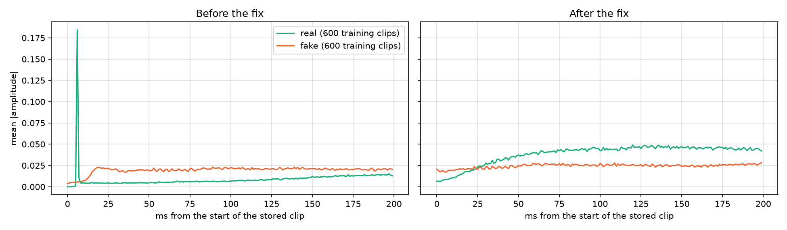
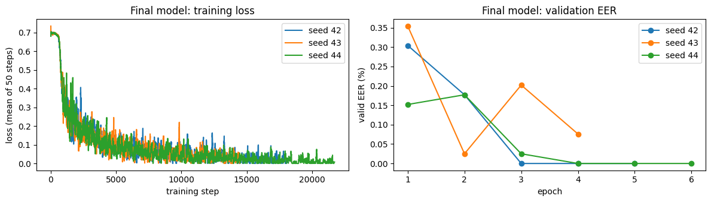
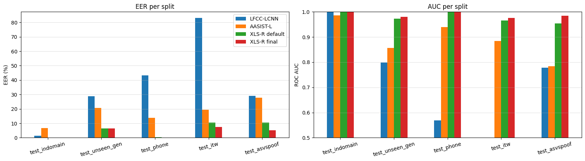
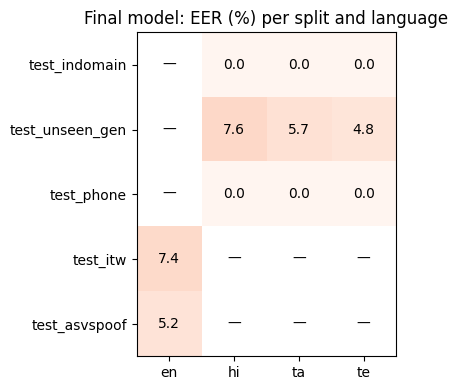
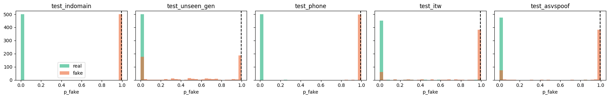
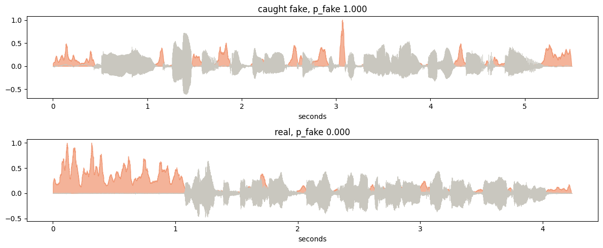

# Deepfake Voice Detection for Indian Languages using Deep Learning and Generative AI

**Milestone 4: Model Training, Hyperparameter Experiments and Regularization**

---

## 1. Overview

This milestone trains the detector designed in Milestone 3, finds its settings by experiment, makes it more robust with regularization and augmentation, and compares it with the two baselines chosen in Milestone 1. It is our last training milestone: the models trained here are the ones evaluated in Milestone 5.

The detector is still **XLS-R 300M** (Babu et al., 2021) with a small classification head. The baselines are **LFCC-LCNN** (Lavrentyeva et al., 2019) and **AASIST-L** (Jung et al., 2022).

| | Result |
| --- | --- |
| Data | 28,953 training and 3,952 validation clips (4 languages), and a 4,891-clip sample of five test sets. Leakage checks all 0 |
| Data finding | A recording click at the start of almost every real Kathbath clip gave the label away (ROC AUC 1.000 from 20 ms of audio). Removed for all clips |
| Experiments | 35 training runs on Kaggle T4 GPUs: 14 hyperparameter sweeps, 11 regularization, augmentation and stability runs, 3 cross-language runs, 2 baselines, the default config on the full data, the final config with 3 seeds, 1 check run |
| Final config | Encoder learning rate 3e-5, dropout 0.5, weight decay 0.1, phone-channel augmentation; each a clear gain in the sweeps |
| Final model | Test EER: in-domain 0.0%, unseen generators 8.5 ± 1.8%, phone channel 0.0%, In-the-Wild 8.5 ± 0.9%, ASVspoof eval 10.1 ± 5.5% (3 seeds) |
| Against the baselines | 12–23 points lower EER than the best baseline on every hard test set |
| Cross-language | 2.7–3.9% EER on a language left out of training |

The final model makes about 60–75% fewer errors than the Milestone-3 pipeline check on the hard test sets. Its weak spot is the same as in Milestone 3: generators it has never seen, in particular IndicF5.

The work is in five notebooks, all saved with their outputs:

| Notebook | What it does |
| --- | --- |
| [`01_data_preparation.ipynb`](../../notebooks/Milestone-4/01_data_preparation.ipynb) | Training and validation data, tuning subset, manifest, leakage checks |
| [`01b_test_data.ipynb`](../../notebooks/Milestone-4/01b_test_data.ipynb) | The five test sets and their Milestone-4 sample |
| [`01c_click_fix.ipynb`](../../notebooks/Milestone-4/01c_click_fix.ipynb) | Finds the start-of-clip click, removes it, checks again |
| [`02_training.ipynb`](../../notebooks/Milestone-4/02_training.ipynb) | Runs a queue of training runs on Kaggle, one config file each |
| [`03_training_and_evaluation.ipynb`](../../notebooks/Milestone-4/03_training_and_evaluation.ipynb) | Brings every run together: baselines, tuning, augmentation, comparisons, metrics, sample outputs |

This report answers the Milestone-4 questions in order: datasets and preprocessing (Section 2), architecture recap (Section 3), training configuration (Section 4), hyperparameter experiments (Section 5), generalization and training stability (Section 6), results and observations (Section 7), training artifacts (Section 8) and key findings (Section 9).

---

## 2. Datasets and Preprocessing

### 2.1 Training and Validation Data

The data come from the same sources as Milestone 3, with the same speaker-disjoint split: Kathbath's training speakers are split 70 / 15 / 15 by gender with seed 42, a real clip follows its speaker, and an IndicSynth fake is used only if every speaker it involves is in the same split. Milestone 4 uses the full training size.

| Split | Contents | Clips |
| --- | --- | ---: |
| `train` | Kathbath (real) 4,000 + IndicSynth (fake, XTTS-v2 and FreeVC24) 4,000 per language; ASVspoof 2019 LA train: every bona fide clip + 430 of each attack A01–A06 | 28,953 |
| `valid` | The same sources with other speakers: 500 + 500 per language; ASVspoof dev 500 + 500 | 3,952 |
| Tuning subset | A fixed 5,000 of `train`, with the same share of each source, language and label; used by the sweeps | (part of `train`) |

### 2.2 Test Sets

The test sets are fixed now and reused unchanged in Milestone 5. Milestone 4 scores a seeded sample of 500 real + 500 fake clips from each (column `m4_eval` in the manifest); Milestone 5 scores the full sets.

| Test set | What it measures | Milestone-4 sample | Full set |
| --- | --- | ---: | ---: |
| `test_indomain` | New speakers, known generators | 1,000 | 6,000 |
| `test_unseen_gen` | Our generated set (Indic Parler-TTS, IndicF5, MMS-TTS), never used in training | 1,000 | 8,639 |
| `test_phone` | `test_indomain` through a simulated phone channel (300–3,400 Hz, 8 kHz, G.711) | 1,000 | 6,000 |
| `test_itw` | In-the-Wild, real-world English | 942 | 31,779 |
| `test_asvspoof` | ASVspoof 2019 LA eval, attacks A07–A19 (none seen in training) | 949 | 71,237 |

All leakage checks are 0: no test speaker is a training or validation speaker (FreeVC24 source speakers included), no clip appears twice, the ASVspoof partitions share no speakers, and no unseen-generator sentence appears in `train`.

### 2.3 Preprocessing

Every clip, real or fake, goes through the same steps in `src/preprocess.py`:

| # | Step | Setting |
| --- | --- | --- |
| 1 | Decode, mix to mono | `soundfile`; m4a through `ffmpeg` |
| 2 | Resample | 16 kHz |
| 3 | Trim edge silence | 20 ms frames more than 40 dB below the loudest frame |
| 4 | **Cut the start and trim again (new)** | First 30 ms (Section 2.4) |
| 5 | Drop very short clips | Less than 1 s left |
| 6 | Normalise loudness | RMS −20 dBFS, peak at most 0.99 |
| 7 | Store and hash | 16-bit PCM WAV, SHA-1 |

At load time each clip is cropped or zero-padded to 4 s (a random crop in training, the middle crop otherwise), scaled to zero mean and unit variance, and given an attention mask. Augmentation, when used, is applied to training crops only.

### 2.4 The Start-of-Clip Click

Milestone 3 noted a peak about 47 ms into real Kathbath recordings. We checked it on the full data ([`01c_click_fix.ipynb`](../../notebooks/Milestone-4/01c_click_fix.ipynb)):

| Check | Before the fix | After the fix |
| --- | ---: | ---: |
| Real Kathbath clips with a click in the first 12 ms | 97–100% | 0–2% |
| Fake clips (any source) with a click there | 0% | — |
| Real vs fake from only the first 20 ms (ROC AUC) | **1.000** | 0.80 |
| The same test on 20 ms from the middle or end of a clip | 0.74–0.77 | 0.70–0.73 |

Silence trimming stops at the first loud frame, which is the click, so after trimming it always sits 5–10 ms into the clip. Cutting the first 30 ms and trimming again removes it; the remaining 0.80 is close to what any 20 ms of a clip gives from ordinary recording differences. 96 clips became shorter than 1 s and were dropped.

  
   
  <em>Figure 1: Mean loudness of the first 200 ms of 600 real and 600 fake training clips, before and after the fix. Before, real clips show a sharp peak about 6 ms in; after, it is gone.</em>

The 4 s crop had hidden the click from most training crops: the default sweep, trained again on the fixed data, changed its validation EER by only 0.25 points, within noise (T-01c vs T-01). Every run from then on, including the final runs, uses the fixed data.

---

## 3. Model Architecture Recap

### 3.1 Components and Shapes

| Stage | Output shape | Pretrained? | Trained? |
| --- | --- | --- | --- |
| Input: 4 s at 16 kHz, zero mean, unit variance, with an attention mask | `[B, 64000]` | — | — |
| XLS-R CNN feature encoder: one frame every 20 ms | `[B, 199, 512]` | Yes | No, frozen |
| XLS-R transformer, 24 layers | `[B, 199, 1024]` | Yes | Yes |
| Mean pooling over the frames that hold audio | `[B, 1024]` | — | No parameters |
| Dropout → Linear(1024, 2) | `[B, 2]` | No | Yes |
| Softmax → `p_fake` → verdict at the threshold from `valid` | `[B]` | — | Threshold from `valid` only |

The model has **315.4 M parameters**, of which **311.2 M** are trained. Only the dropout rate changes in the final config (0.1 → 0.5); the architecture is the one from Milestone 3.

### 3.2 Two Design Details

**Softmax vs sigmoid.** For two classes, softmax over two logits equals the sigmoid of their difference, so both give the same results. We use two logits because `CrossEntropyLoss` takes one weight per class directly, and the head can later grow to more classes.

**Attention mask.** Short clips are zero-padded to 4 s, and the mask tells the transformer and the mean pooling to ignore the padded frames, so the amount of padding cannot change the score or give the label away. A unit test confirms that padding a clip leaves its logits unchanged.

### 3.3 Baselines

| Model | Input | Architecture | Parameters | Training |
| --- | --- | --- | ---: | --- |
| LFCC-LCNN (A-01) | LFCC features, 20 ms frames | Light CNN with max-feature-map activations | Small | From scratch; lr 1e-3, batch 32 |
| AASIST-L (A-02) | Raw waveform | Sinc filters + spectro-temporal graph attention | 85K | From scratch; lr 1e-4, weight decay 1e-4, batch 24, full precision |

Both are trained with the same training script, data, splits, crops, class weights and early stopping on `valid` EER as XLS-R, for up to 10 epochs.

---

## 4. Training Configuration

### 4.1 Loss and Metrics

| Item | Choice | Why |
| --- | --- | --- |
| Loss | Cross-entropy on the two logits, each class weighted by `N / (2 × N_class)` from `train` only | The standard two-class loss; the weights keep an imbalance from biasing the model |
| Main metric | **EER** on `valid`, for early stopping and for choosing settings | Threshold-free and the standard measure in anti-spoofing, so results can be compared with published ones |
| Other metrics | ROC AUC; accuracy and confusion matrix at the EER threshold of `valid` | AUC shows ranking over all thresholds; accuracy shows a deployed system with one threshold |

### 4.2 Optimisation Settings

| Setting | Final config | Default config | Source |
| --- | --- | --- | --- |
| Optimizer | AdamW | AdamW | |
| Learning rate, XLS-R | **3e-5** | 1e-5 | Section 5 |
| Learning rate, head | 1e-3 | 1e-3 | Section 5 |
| Schedule | 10% linear warmup, then cosine decay | same | |
| Weight decay | **0.1** | 0.01 | Section 6 |
| Dropout | **0.5** | 0.1 | Section 6 |
| Augmentation | **Phone channel**, on half of the training crops | none | Section 6 |
| Batch size | 8 | 8 | Section 5 |
| Epochs | Up to 8, early stopping after 2 epochs without a better `valid` EER | up to 5 | |
| Precision and stability | fp16 mixed precision with loss scaling, gradient clipping at 1.0 | same | Section 6 |
| Seeds | 42, 43, 44 (runs F-01, F-02, F-03) | 42 | |

### 4.3 Hardware and Runtime

| Item | Value |
| --- | --- |
| Hardware | Kaggle, 2 × Tesla T4 (16 GB each), data parallel |
| One epoch on the full `train` split | About 35 min (default config); 41 min with phone-channel augmentation |
| Final runs | 3–4.5 h each (4–6 epochs, early stopping) |
| One sweep run (tuning subset, 3 epochs) | About 20 min |
| GPU budget | About 30 T4-hours per account per week, four accounts |

### 4.4 Training Strategy

- **Sweeps on a tuning subset.** Each hyperparameter was tried at 3–4 values on the fixed 5,000-clip tuning subset for 3 epochs, changing one setting at a time, then the winning settings were combined for the final runs on the full data.
- **Validation only for choices.** Settings and the best epoch were chosen on `valid` EER; the test sets were never used for choosing.
- **One config per run.** Every run is a YAML file in `configs/`, and `src/train.py` turns one config into one run, so 35 runs could be shared across four Kaggle accounts without conflicts.
- **Three seeds** for the final config, so that the spread caused by training randomness can be reported.

---

## 5. Hyperparameter Experiments

### 5.1 Protocol

Each run changes one setting of the default config and is trained on the tuning subset for 3 epochs. Besides the validation EER, every run logs the EER on 1,000 of its own training clips (without augmentation), the "training EER": a large gap between the two means overfitting, both high means underfitting.

### 5.2 Results

  
   
  <em>Figure 2: Training EER (green) and validation EER (red) against the value of each hyperparameter. The dashed line marks the value in the final config.</em>

| Hyperparameter | Values tried (default in bold) | Validation EER | Final value |
| --- | --- | --- | --- |
| XLS-R learning rate | 3e-6, **1e-5**, 3e-5, 1e-4 | 4.11, 1.09, 0.30, 0.20% | **3e-5** |
| Head learning rate | 1e-4, **1e-3**, 1e-2 | 1.39, 1.09, 0.73% | 1e-3 |
| Crop length | 2, **4**, 6 s | 2.10, 1.09, 0.73% | 4 s |
| Frozen transformer layers | **0**, 6, 12, 18 | 1.09, 4.22, 6.36, 4.95% | 0 |
| Effective batch (gradient accumulation) | **8**, 16, 32 | 1.09, 1.41, 2.40% | 8 |
| Pooling | **mean**, attentive statistics | 1.09, 0.45% | mean |

The XLS-R learning rate matters most: the encoder has to be fine-tuned harder than the default, and all of it has to be trained. Freezing even the bottom 6 of its 24 layers costs about 3 points.

### 5.3 How the Final Values Were Chosen

Most differences are small, 0.2–0.9 points on a validation set where one point is about 40 clips. So each run was compared with its baseline **on the same validation clips with a paired bootstrap** (2,000 resamples), and a change counted only if its whole 95% interval was on the improving side. We also split the validation EER by source, because most errors are on its English part (ASVspoof dev: 2.9% vs 0.4% on the Indian languages for the default config).

| Hyperparameter | Difference vs default (95% interval) | Decision |
| --- | --- | --- |
| XLS-R learning rate 3e-5 / 1e-4 | −0.78 [−1.34, −0.50] / −0.88 [−1.46, −0.56] points | Both clearly better. **3e-5** chosen: as good as 1e-4 within noise, and gentler for final runs 6 times longer than the sweeps |
| Head learning rate 1e-2 | −0.35 [−0.88, −0.10] | Small gain overall but worse on the Indian part (0.53% vs 0.40%); not used |
| Crop length 6 s | −0.35 [−0.86, −0.08] | Small gain for about 20% more time per epoch; not used |
| Attentive pooling | −0.63 [−1.06, −0.30] | Clear gain, but it changes the Milestone-3 architecture; kept as a finding for later |
| Freezing 6 / 12 / 18 layers, 2 s crops, effective batch 32, XLS-R lr 3e-6 | All clearly worse | Not used |
| Head lr 1e-4, effective batch 16 | Intervals include 0 | Not used |

---

## 6. Generalization and Training Stability

These runs use the same protocol on the data without the click, and are compared with the default config on that data (T-01c, 1.34% validation EER).

### 6.1 Regularization

| Technique | Values (default in bold) | Validation EER | Difference (95% interval) | Final |
| --- | --- | --- | --- | --- |
| Dropout | 0.0, **0.1**, 0.3, 0.5 | 1.32, 1.34, 0.99, 0.78% | 0.5: −0.56 [−0.94, −0.30] | **0.5** |
| Weight decay | 0.0, **0.01**, 0.1 | 1.09, 1.34, 0.89% | 0.1: −0.46 [−0.86, −0.13] | **0.1** |
| Early stopping | on `valid` EER | | | Yes |

Dropout improves steadily from 0.0 to 0.5. With no dropout the gap between training and validation EER is widest (0.2% vs 1.3%), a sign of overfitting; dropout 0.5 narrows it.

### 6.2 Data Augmentation

| Augmentation | Aim | Validation EER | Difference (95% interval) | Final |
| --- | --- | ---: | --- | --- |
| Noise + gain | Robustness to noise and level | 1.47% | +0.13, includes 0 | No |
| Speed + pitch + reverberation | New voices and rooms | 4.58% | +3.24, worse | No |
| RawBoost | Unseen generators | 1.47% | +0.13, includes 0 | No |
| **Phone channel** (300–3,400 Hz, 8 kHz, G.711) | Phone-call audio | **0.61%** | −0.73 [−1.21, −0.46] | **Yes** |
| All of the above together | | 20.70% | +19.36, much worse | No |

Only the phone channel helps, and it matches the use case: in the final model the phone-channel test set is at 0.0% EER (0.3% for the default config). Heavy augmentation was still improving at epoch 3, so the short protocol penalises it; the combined run did learn, but its scores leaned strongly to "fake".

### 6.3 Training Stability

| Technique | Purpose | Result |
| --- | --- | --- |
| Warmup (10%) + cosine decay | Avoid large early updates that damage the pretrained weights | Kept |
| Gradient clipping at 1.0 | Bound each update | Kept |
| fp16 with loss scaling | Fit a T4's memory without underflow | Used in every XLS-R run; off for AASIST-L |
| No warmup, no clipping (V-11) | Stability check | 0.51%, −0.83 [−1.32, −0.53] |

Removing warmup and clipping looked better in the 3-epoch sweep, most likely because warmup slows the first epoch, the same effect as a higher learning rate. We kept both for the final runs, which are 3–4 times longer and use a 3 times higher learning rate, where stability matters more. All final runs trained without divergence.

### 6.4 Impact

  
   
  <em>Figure 3: For each regularization, augmentation and stability run, the gap between validation and training loss per epoch (left) and the validation EER per epoch (right).</em>

Combined in the final config, the chosen techniques improved phone-channel audio (0.3% → 0.0%) and In-the-Wild (10.6% → 8.5%) over the default config trained on the same data, but not unseen generators (6.5% → 8.5 ± 1.8%) or ASVspoof eval (10.4% → 10.1 ± 5.5%). Section 7.2 discusses why.

---

## 7. Results and Observations

### 7.1 Training of the Final Model

| Run | Seed | Epochs run | Best epoch | Validation EER | Training time |
| --- | ---: | ---: | ---: | ---: | ---: |
| F-01 | 42 | 5 | 3 | 0.00% | 267 min |
| F-02 | 43 | 4 | 2 | 0.03% | 182 min |
| F-03 | 44 | 6 | 4 | 0.00% | 249 min |

  
   
  <em>Figure 4: Training loss (left, mean of 50 steps) and validation EER per epoch (right) of the three final runs.</em>

The three seeds follow almost the same loss curve: a sharp drop in the first ~1,000 steps, then a slow decline with small spikes and no divergence. Training EER was 0 at the best epoch of every seed. After each epoch, F-01 also scored 300 clips of each test set; these curves were only observed, never used for choosing.

  
   
  <em>Figure 5: EER (left) and ROC AUC (right) of the final model F-01 after each epoch on training clips, valid and 300 clips of each test set. The chosen epoch is marked.</em>

Validation EER reaches 0 at epoch 3 and cannot fall further, while the unseen-generator and In-the-Wild curves get worse again after epoch 3 (In-the-Wild 6.7% → 11.0% by epoch 5). The model keeps fitting the sources it knows, and `valid` cannot show it.

### 7.2 Comparison Across Models and Test Sets

From [`03_training_and_evaluation.ipynb`](../../notebooks/Milestone-4/03_training_and_evaluation.ipynb), Sections 5 and 7; each clip is scored as the mean over 4 s windows every 2 s.

| EER (%) | LFCC-LCNN | AASIST-L | XLS-R default (D-01) | XLS-R final (3 seeds) | Milestone 3 (1 epoch) |
| --- | ---: | ---: | ---: | ---: | ---: |
| `valid` | 2.1 | 7.8 | 0.2 | 0.1 ± 0.1 | 24.4 |
| `test_indomain` | 1.3 | 6.8 | 0.0 | 0.0 ± 0.0 | 17.7 |
| `test_unseen_gen` | 28.9 | 20.8 | 6.5 | 8.5 ± 1.8 | 20.6 |
| `test_phone` | 43.2 | 13.7 | 0.3 | 0.0 ± 0.0 | — |
| `test_itw` | 83.2 | 19.3 | 10.6 | 8.5 ± 0.9 | 31.6 |
| `test_asvspoof` | 29.0 | 27.7 | 10.4 | 10.1 ± 5.5 | 33.3 |

  
   
  <em>Figure 6: EER (left) and ROC AUC (right) of LFCC-LCNN, AASIST-L, the default XLS-R and the final XLS-R on each test set.</em>

- **Pretraining is what generalises.** Both baselines do well on known data (LFCC-LCNN 1.3% in-domain) but fall apart outside it; LFCC-LCNN's 83% on In-the-Wild means its scores are reversed on real-world audio. XLS-R is 12–23 points better than the best baseline on every hard test set.
- **Tuning helped less than validation suggested.** The final config is better than the default on phone-channel audio and In-the-Wild, but not on unseen generators or ASVspoof. Validation EER was already near 0 for most settings, so it could rank them only on known generators.
- **Seeds vary a lot on ASVspoof eval**: 5.2%, 16.0% and 9.1% for the three final runs, larger than most differences in the sweeps.

### 7.3 Across Languages and the Cross-Language Test

| EER (%), all test sets | Hindi | Tamil | Telugu | English |
| --- | ---: | ---: | ---: | ---: |
| LFCC-LCNN | 31.0 | 33.0 | 33.7 | 50.0 |
| AASIST-L | 16.2 | 11.5 | 16.2 | 23.7 |
| XLS-R default (D-01) | 2.8 | 3.1 | 3.4 | 11.3 |
| XLS-R final (F-01) | 2.9 | 3.0 | 3.1 | 6.4 |

  
   
  <em>Figure 7: EER of the final model F-01 per test set and language.</em>

For the cross-language test, three runs were trained with one Indian language left out of `train` and `valid` (default config, full data, 3 epochs) and tested on that language's test clips:

| Run | Left out | EER on the left-out language | Same language, model trained on all three (D-01) |
| --- | --- | ---: | ---: |
| C-hi | Hindi | 3.5% | 2.8% |
| C-ta | Tamil | 2.7% | 3.1% |
| C-te | Telugu | 3.9% | 3.4% |

A model that never heard a language detects its fakes almost as well as one trained on it: XLS-R's multilingual pretraining carries over between these languages.

### 7.4 The Decision Threshold and Unseen Generators

EER does not depend on a threshold, but a verdict does. At the EER threshold of `valid` (`p_fake` ≥ 0.994 for F-01), real clips are almost never called fake (99.4–100% correct on every test set), but many fakes from unseen sources are called real:

| Fakes caught at the `valid` threshold (F-01) | Hindi | Tamil | Telugu |
| --- | ---: | ---: | ---: |
| Indic Parler-TTS | 57% | 54% | 29% |
| IndicF5 | 11% | 23% | 18% |
| MMS-TTS | 82% | 32% | 11% |

Overall, 35% of unseen-generator fakes, 77% of In-the-Wild fakes and 80% of ASVspoof fakes are caught. The scores are almost all near 0 or near 1, so a threshold set on known generators sits very high and misses fakes from new ones. IndicF5, which clones real voices from reference recordings, remains the hardest generator, as in Milestone 3.

  
   
  <em>Figure 8: Distribution of p_fake for real and fake clips of each test set (F-01). The dashed line is the threshold from valid.</em>

### 7.5 Sample Outputs

One real and one fake clip from each test set, chosen at random (seed 42) and scored by F-01 at its `valid` threshold:

| Clip | Test set | Generator | True | Predicted | `p_fake` |
| --- | --- | --- | --- | --- | ---: |
| `indicsynth_hi_freevc24____f____src_89____tgt_321___16` | `test_indomain` | FreeVC24 | fake | fake ✅ | 1.000 |
| `kathbath_te_844424932679206-832-f` | `test_indomain` | — | real | real ✅ | 0.000 |
| `phone_indicsynth_ta_xtts_v2____499-m-688` | `test_phone` | XTTS-v2 | fake | fake ✅ | 1.000 |
| `phone_kathbath_ta_844424933326299-340-m` | `test_phone` | — | real | real ✅ | 0.000 |
| `hi_0301_indic-parler-tts` | `test_unseen_gen` | Indic Parler-TTS | fake | real ❌ | 0.001 |
| `kathbath_te_844424931033644-831-m` | `test_unseen_gen` | — | real | real ✅ | 0.000 |
| `itw_23585` | `test_itw` | unknown | fake | fake ✅ | 1.000 |
| `itw_3491` | `test_itw` | — | real | real ✅ | 0.000 |
| `asvspoof_LA_E_1939320` | `test_asvspoof` | A18 | fake | fake ✅ | 1.000 |
| `asvspoof_LA_E_7146859` | `test_asvspoof` | — | real | real ✅ | 0.001 |

The one miss is typical of the failures: a fake from an unseen generator scored as confidently real.

  
   
  <em>Figure 9: Explanation view (F-01): the waveform (grey) and the gradient of p_fake with respect to the input, smoothed over 20 ms (orange), for a caught fake (top) and a real clip (bottom).</em>

For the fake clip, the model reacts mostly to the quiet gaps between words, where synthetic speech is known to differ from real recordings. For the real clip, it reacts most to the first second, the near-silent start before speech. After removing the click (Section 2.4), the start of real recordings may still carry a cue such as room noise; this is checked in Milestone 5.

### 7.6 Other Observations

| Observation | Detail |
| --- | --- |
| Validation saturates | Most runs reach 0.2–1.3% validation EER, and the final runs 0.0–0.2%; `valid` contains only generators and attacks seen in training |
| Overconfident scores | Nearly every `p_fake` is below 0.01 or above 0.99, so the confidence shown to a user says little on its own |
| English is harder | 6.4% EER on English test clips against about 3% on each Indian language (F-01), mostly from In-the-Wild and ASVspoof eval |
| The start of real clips still draws attention | The explanation view of a real clip focuses on its near-silent first second (Figure 9) |
| The click mattered little in practice | Because the 4 s crop hid it in most training crops (T-01c vs T-01: +0.25 points, within noise) |

---

## 8. Training Artifacts

### 8.1 Notebooks

| File | Content |
| --- | --- |
| [`01_data_preparation.ipynb`](../../notebooks/Milestone-4/01_data_preparation.ipynb), [`01b_test_data.ipynb`](../../notebooks/Milestone-4/01b_test_data.ipynb), [`01c_click_fix.ipynb`](../../notebooks/Milestone-4/01c_click_fix.ipynb) | Data preparation, test sets, click fix |
| [`02_training.ipynb`](../../notebooks/Milestone-4/02_training.ipynb) (and `02b_training.ipynb`, with startup checks) | Training on Kaggle: a queue of runs per session |
| [`03_training_and_evaluation.ipynb`](../../notebooks/Milestone-4/03_training_and_evaluation.ipynb) | The final notebook: every table and figure of this report |

### 8.2 Code, Configs and Tests

| Path | Content |
| --- | --- |
| `src/preprocess.py`, `dataset.py`, `model.py`, `train.py` | Preprocessing, loading, the detector and baselines, the training script |
| `src/augment.py`, `metrics.py`, `evaluate.py`, `score.py`, `explain.py`, `collect_runs.py`, `src/baselines/` | Augmentation, EER, multi-window scoring, saliency, run summary, baseline models |
| `configs/` | One YAML file per run: `default.yaml`, T-xx, V-xx, D-01, C-xx, A-xx, F-xx |
| `tests/` | 70 unit tests: training, configs, augmentation, evaluation, baselines |

### 8.3 Run Outputs and Weights

| Artifact | Where |
| --- | --- |
| Config, loss per step, metrics per epoch, validation predictions, run summary | `results/<run>/config.yaml`, `train_log.csv`, `epoch_log.csv`, `valid_predictions.csv`, `run.json` |
| Test-sample predictions and metrics (final models, D-01, baselines, cross-language runs) | `results/<run>/predictions.csv`, `results.json` |
| Per-epoch evaluation of the final model | `results/F-01/epoch_eval.csv` |
| Model weights (`best.pt`, the best epoch on `valid`, with its config) | Output of the Kaggle notebook that trained the run, linked in each `run.json` |
| Checkpoints (`last.pt`: weights, optimizer, scheduler and scaler after each epoch) | Kept while a run trains, so a stopped run continues with `--resume`; deleted when it finishes |
| All runs in one table | `python -m src.collect_runs` → `results/runs.csv` |
| Figures | `assets/infographics/Milestone-4/` |

---

## 9. Key Findings

### 9.1 What Worked Well

| Finding | Evidence |
| --- | --- |
| Fine-tuning all of XLS-R at a higher learning rate | Largest single gain (1.09% → 0.30% validation EER); freezing any layers hurt |
| Pretraining generalises far better than training from scratch | XLS-R is 12–23 points better than the best baseline on every hard test set |
| The model carries over to unseen languages | 2.7–3.9% EER on a language left out of training |
| Phone-channel augmentation | Clear validation gain; phone-channel test at 0.0% |
| Checking the data for shortcuts | Found and removed a near-perfect real-class marker (ROC AUC 1.000 from 20 ms) |
| One config and one result folder per run | Four people ran 35 experiments on four Kaggle accounts without conflicts |

### 9.2 What Did Not Perform as Expected

| Finding | Evidence |
| --- | --- |
| Validation EER saturated | Most runs at 0.2–1.3%, final runs at 0.0–0.2%; tuning on it did not improve unseen generators (6.5% default vs 8.5 ± 1.8% final) |
| Unseen generators, especially IndicF5 | Only 35% of unseen-generator fakes caught at the `valid` threshold; IndicF5 11–23% |
| Heavy augmentation | Speed + pitch + reverberation 4.58%, all effects 20.70% validation EER at the 3-epoch budget |
| Large seed-to-seed variation | ASVspoof eval EER 5.2–16.0% across the three final seeds |
| Late epochs overfit the known sources | In-the-Wild EER 6.7% → 11.0% from epoch 3 to 5 while validation stays at 0% |

### 9.3 Bottlenecks

| Bottleneck | Effect |
| --- | --- |
| GPU time | About 30 free T4-hours per account per week, two sessions at a time; a full-data epoch takes 35–41 min, and scoring one XLS-R model on 8,800 clips with several windows each takes about 30 min |

### 9.4 Plans for Improvement

| Limitation | Next step |
| --- | --- |
| Only a sample of each test set was scored | Score every model on the full test sets (about 124,000 clips) in Milestone 5, with per-generator and per-attack results |
| Validation contains only known generators | Choose settings and the epoch on a validation set that includes a held-out generator |
| Overconfident scores and a threshold that does not transfer | Calibrate the scores and the threshold; report results at several operating points |
| Real clips may still differ at their start (explanation view) | Check the onset of real and fake clips again, e.g. by scoring with the first second removed |
| IndicF5 and other voice-cloning generators | More varied training fakes, including voice cloning |
| Promising settings not adopted (attentive pooling, 6 s crops, no warmup) and heavy augmentation | Retest at full length with several seeds |

---

## 10. Reproducibility

| Item | How it's fixed |
| --- | --- |
| Sources | Every Hugging Face source is pinned to the same revision as in Milestone 3; the Kathbath test recordings come from the official archive |
| Data | Built by notebooks `01`, `01b` and `01c`; stored as the private Kaggle dataset `dsai-group3-m4-data` (version 3), available to the team on request. Audio isn't stored in this repository because of its size and the licences |
| Randomness | Seed 42 for the split, the subsets, the samples and every run except the final seeds (42, 43, 44) |
| Training | `python -m src.train --config configs/<run>.yaml --data <data folder> --out <folder>`, or `02_training.ipynb` on Kaggle with `RUN_IDS` set |
| Scoring | `python -m src.score <run> --data <data folder> --checkpoints <folder> --out <folder>` |
| Code version | Every `run.json` records the git commit the run used |
| Dependencies | [`requirements.txt`](../../requirements.txt) |
| Limit | GPU training isn't bit-for-bit repeatable; the three seeds of the final model show how much results vary |

---

## 11. References

1. Babu, A., Wang, C., Tjandra, A., et al. (2021). _XLS-R: Self-supervised Cross-lingual Speech Representation Learning at Scale_. arXiv. <https://arxiv.org/abs/2111.09296>
2. Jung, J., Heo, H. S., Tak, H., et al. (2022). _AASIST: Audio Anti-Spoofing using Integrated Spectro-Temporal Graph Attention Networks_. ICASSP 2022. <https://arxiv.org/abs/2110.01200>
3. Lavrentyeva, G., Novoselov, S., Tseren, A., et al. (2019). _STC Antispoofing Systems for the ASVspoof2019 Challenge_. Interspeech 2019. <https://arxiv.org/abs/1904.05576>
4. Tak, H., Todisco, M., Wang, X., et al. (2022). _Automatic Speaker Verification Spoofing and Deepfake Detection using wav2vec 2.0 and Data Augmentation_. Odyssey 2022. <https://arxiv.org/abs/2202.12233>
5. Müller, N. M., Czempin, P., Dieckmann, F., et al. (2022). _Does Audio Deepfake Detection Generalize?_. Interspeech 2022. <https://arxiv.org/abs/2203.16263>
6. Sharma, D. V., Ekbote, V., & Gupta, A. (2025). _IndicSynth: A Large-Scale Multilingual Synthetic Speech Dataset for Low-Resource Indian Languages_. ACL 2025. <https://aclanthology.org/2025.acl-long.1070>
