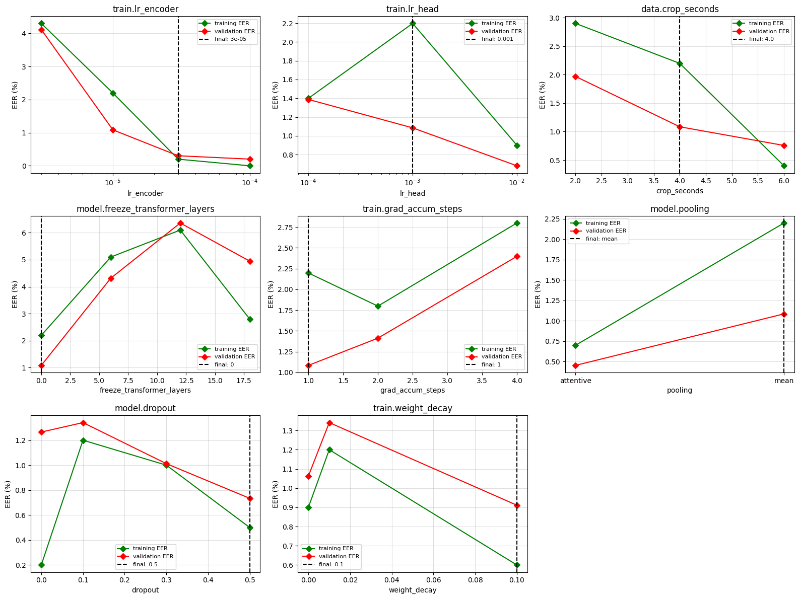
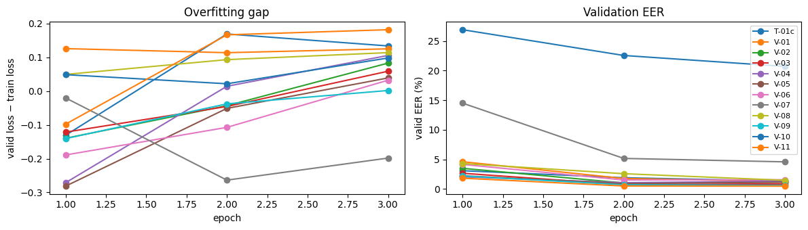
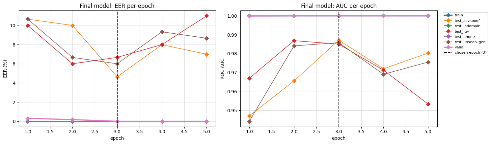

# Deepfake Voice Detection for Indian Languages using Deep Learning and Generative AI

**Milestone 4: Model Training, Hyperparameter Experiments and Regularization**

---

## 1. Overview

This milestone trains the detector designed in Milestone 3, finds its settings by experiment, and compares it with the two baselines chosen in Milestone 1. It is our final training milestone: the models trained here are the ones evaluated in Milestone 5.

We ran **35 training runs** on Kaggle T4 GPUs across four accounts: 14 hyperparameter sweeps, 11 regularization, augmentation and stability runs, the default config on the full data, three cross-language runs, the two baselines, the final config with three seeds, and one check run. Each run is defined by one config file and leaves the same set of files behind (Section 8), and one notebook brings them together.

**Main results** (EER on the Milestone-4 test sample, lower is better):

| Model | In-domain | Unseen generators | Phone channel | In-the-Wild | ASVspoof eval |
| --- | ---: | ---: | ---: | ---: | ---: |
| **XLS-R, final config** (3 seeds, mean ± sd) | **0.0%** | **8.5 ± 1.8%** | **0.0%** | **8.5 ± 0.9%** | **10.1 ± 5.5%** |
| AASIST-L (baseline) | 6.8% | 20.8% | 13.7% | 19.3% | 27.7% |
| LFCC-LCNN (baseline) | 1.3% | 28.9% | 43.2% | 83.2% | 29.0% |
| *Milestone 3 (1 epoch, pipeline check)* | *17.7%* | *20.6%* | *–* | *31.6%* | *33.3%* |

The final model is better than both baselines on every test set, and roughly 60–75% fewer errors than the Milestone-3 pipeline check on the hard tests. On a language it was never trained on it still reaches 2.7–3.9% EER. Its weak spot is the same as in Milestone 3: generators it has never seen, in particular IndicF5.

Along the way we found and removed a recording click at the start of almost every real Kathbath clip that would have let a model tell real from fake without listening to the voice (Section 2.2).

---

## 2. Datasets and Preprocessing

### 2.1 Data

The data come from the same five sources as Milestone 3, with the same speaker-disjoint split (70 / 15 / 15 of Kathbath's training speakers, by gender, seed 42), now at full training size. It is built by `notebooks/Milestone-4/01_data_preparation.ipynb` (training data) and `01b_test_data.ipynb` (test sets) and stored as the Kaggle dataset `dsai-group3-m4-data`.

| Split | Contents | Clips |
| --- | --- | ---: |
| `train` | Kathbath real 4,000 + IndicSynth fake 4,000 (XTTS-v2 and FreeVC24) per language; ASVspoof 2019 LA train: every bona fide clip + 430 per attack (A01–A06) | 28,953 |
| `valid` | The same sources with other speakers (500 + 500 per language); ASVspoof dev 500 + 500 | 3,952 |
| Tuning subset | A fixed, stratified 5,000 of `train`, used by the sweeps | (part of `train`) |
| Test sample (Milestone 4) | 500 real + 500 fake from each test set (below) | 4,891 |

| Test set | What it measures | Full set (Milestone 5) |
| --- | --- | ---: |
| `test_indomain` | New speakers, known generators | 6,000 |
| `test_unseen_gen` | Our generated set (Indic Parler-TTS, IndicF5, MMS-TTS), never used in training | 8,639 |
| `test_phone` | `test_indomain` through a simulated phone channel (300–3,400 Hz, 8 kHz, G.711) | 6,000 |
| `test_itw` | In-the-Wild, real-world English | 31,779 |
| `test_asvspoof` | ASVspoof 2019 LA eval, attacks A07–A19 (none seen in training) | 71,237 |

The full test sets are fixed now and scored in Milestone 5; Milestone 4 scores the seeded sample. All leakage checks are 0: no test speaker is a training or validation speaker (including FreeVC24 source speakers), no clip appears twice, and the ASVspoof partitions share no speakers.

### 2.2 Preprocessing, and the Start-of-Clip Click

Every clip goes through `src/preprocess.py`: decode and mix to mono, resample to 16 kHz, trim edge silence, **cut the first 30 ms and trim again** (new), drop clips under 1 s, normalise to −20 dBFS RMS, store as 16-bit WAV. At load time each clip is cropped or zero-padded to 4 s (random crop in training, middle crop otherwise), scaled to zero mean and unit variance, and given an attention mask.

The new step answers a finding from Milestone 3, a peak about 47 ms into real Kathbath recordings. It turned out to be a click at the start of **97–100% of real Kathbath clips in every split, and of no fake source**. Silence trimming stops at the first loud frame, which is the click, so after trimming it sits 5–10 ms into the clip. A simple classifier that sees only the first 20 ms of a clip told real from fake with **ROC AUC 1.000**. After the cut, 0–2% of real clips have a peak there and the 20 ms shortcut drops to 0.80, close to the 0.70–0.73 that any 20 ms of a clip gives from ordinary recording differences (`notebooks/Milestone-4/01c_click_fix.ipynb`).

  
   
  <em>Figure 1: Mean loudness of the first 200 ms of real and fake training clips, before and after removing the click.</em>

The 4 s crop had hidden the click from most training crops, and rerunning the default sweep on the fixed data moved its validation EER by only 0.25 points (T-01c vs T-01, within noise). All runs from that point on, including every final run, use the fixed data.

---

## 3. Model Recap

| Step | Output shape |
| --- | --- |
| Input: 4 s at 16 kHz, zero mean, unit variance, with an attention mask | `[B, 64000]` |
| XLS-R 300M CNN feature encoder (pretrained, frozen), one frame every 20 ms | `[B, 199, 512]` |
| XLS-R transformer, 24 layers (pretrained, fine-tuned) | `[B, 199, 1024]` |
| Mean pooling over the frames that hold audio | `[B, 1024]` |
| Dropout → Linear(1024, 2) | `[B, 2]` |
| Softmax → `p_fake` → verdict at the threshold from `valid` | `[B]` |

The model has 315.4 M parameters, 311.2 M of them trained.

**Softmax vs sigmoid.** For two classes, softmax over two logits equals the sigmoid of their difference, so both give the same results. We use two logits because `CrossEntropyLoss` takes one weight per class directly, and the head can later grow to more classes.

**Attention mask.** Short clips are zero-padded to 4 s, and the mask tells the transformer and the mean pooling to ignore the padded frames, so the amount of padding cannot change the score or give the label away. A unit test checks that padding a clip leaves its logits unchanged.

**Baselines (Milestone 1).** LFCC-LCNN (Lavrentyeva et al., 2019): LFCC features and a light CNN with max-feature-map activations. AASIST-L (Jung et al., 2022): raw waveform, sinc filters and spectro-temporal graph attention, 85K parameters. Both are trained from scratch with the same training script, data, splits, crops, class weights and early stopping as XLS-R.

---

## 4. Training Configuration

| Item | Final XLS-R config | Default config | Why |
| --- | --- | --- | --- |
| Loss | Cross-entropy, class weights from `train` only | same | Keeps an imbalance from biasing the model |
| Main metric | EER on `valid` (early stopping, choosing settings) | same | Threshold-free; the standard metric in anti-spoofing |
| Other metrics | ROC AUC, accuracy and confusion matrix at the EER threshold of `valid` | same | |
| Optimizer | AdamW | same | |
| Learning rate, XLS-R | **3e-5** | 1e-5 | Sweep (Section 5) |
| Learning rate, head | 1e-3 | 1e-3 | Sweep: no clear gain elsewhere |
| Schedule | 10% linear warmup, then cosine decay | same | |
| Weight decay | **0.1** | 0.01 | Section 6 |
| Dropout (head) | **0.5** | 0.1 | Section 6 |
| Augmentation | **Codec / phone channel**, on half of the training crops | none | Section 6 |
| Batch size | 8 | 8 | Larger effective batches did worse |
| Epochs | Up to 8, early stopping after 2 epochs without a better `valid` EER | up to 5 | |
| Precision, stability | fp16 mixed precision, gradient clipping at 1.0 | same | Fits a T4; keeps updates bounded |
| Hardware | Kaggle, 2 × Tesla T4 (data parallel) | same | About 41 min per epoch on 29k clips |
| Seeds | 42, 43, 44 (F-01, F-02, F-03) | 42 | |

The baselines use their own learning rates (LFCC-LCNN 1e-3, batch 32; AASIST-L 1e-4 with weight decay 1e-4 and full precision, batch 24, from the AASIST recipe) and up to 10 epochs with early stopping after 3.

---

## 5. Hyperparameter Experiments

**Protocol.** Each hyperparameter was tried at 3–4 values, changing only that one from the default config. To afford this, the sweeps used the fixed 5,000-clip tuning subset and 3 epochs (about 20 minutes per run) and were scored on the full `valid` split. Settings were chosen on `valid` only; the test sets were never used for choosing. For every run we also logged the EER on 1,000 of its training clips (no augmentation), the "training EER".

  
   
  <em>Figure 2: Training and validation EER for each hyperparameter. The dashed line marks the final config's value.</em>

**How the final values were chosen.** Most differences were small, 0.2–0.9 points on a validation set where 1 point is about 40 clips. So each run was compared with its baseline on the same validation clips with a **paired bootstrap** (2,000 resamples), and a change counted only if its whole 95% interval was on the improving side. We also split `valid` EER by source, since most errors were on the English (ASVspoof dev) part.

| Hyperparameter | Values tried (default in bold) | Valid EER | Verdict | Final |
| --- | --- | --- | --- | --- |
| XLS-R learning rate | 3e-6, **1e-5**, 3e-5, 1e-4 | 4.11, 1.09, **0.30**, 0.20% | 3e-5 and 1e-4 clearly better; 3e-6 worse | **3e-5**: as good as 1e-4 within noise, and safer for runs 6× longer than the sweeps |
| Head learning rate | 1e-4, **1e-3**, 1e-2 | 1.39, 1.09, 0.73% | 1e-2 slightly better overall but worse on the Indian part | 1e-3 |
| Crop length | 2, **4**, 6 s | 2.10, 1.09, 0.73% | 2 s worse; 6 s slightly better | 4 s: 6 s costs ~20% more time per epoch |
| Frozen transformer layers | **0**, 6, 12, 18 | 1.09, 4.22, 6.36, 4.95% | Freezing clearly worse | 0 (fine-tune all layers) |
| Effective batch (accumulation) | **8**, 16, 32 | 1.09, 1.41, 2.40% | 32 worse | 8 |
| Pooling | **mean**, attentive statistics | 1.09, 0.45% | Attentive better | Mean: keeps the Milestone-3 architecture; reported as a finding |

The learning rate of the encoder mattered most: XLS-R has to be fine-tuned harder than the default, and every layer of it has to be trained. Freezing even the bottom 6 of 24 layers cost about 3 points.

---

## 6. Generalization and Training Stability

These runs used the same protocol, on the data without the click, and are compared with the default config on that data (T-01c, 1.34% valid EER).

| Technique | Aim | Valid EER | vs T-01c (95% interval) | Used in final |
| --- | --- | ---: | --- | --- |
| Dropout 0.0 / 0.3 / **0.5** | Less overfitting | 1.32 / 0.99 / **0.78%** | 0.5: −0.56 [−0.94, −0.30] | **Yes, 0.5** |
| Weight decay 0.0 / **0.1** | Less overfitting | 1.09 / **0.89%** | 0.1: −0.46 [−0.86, −0.13] | **Yes, 0.1** |
| Noise + gain | Robustness | 1.47% | +0.13, no clear difference | No |
| Speed + pitch + reverberation | New voices and rooms | 4.58% | +3.24, worse | No |
| RawBoost | Unseen generators | 1.47% | +0.13, no clear difference | No |
| **Codec / phone channel** | Phone-call audio | **0.61%** | −0.73 [−1.21, −0.46] | **Yes** |
| All augmentations together | | 20.70% | +19.36, much worse | No |
| No warmup, no gradient clipping | Stability check | 0.51% | −0.83 [−1.32, −0.53] | No (kept both) |
| Early stopping on `valid` EER | Keep the best epoch | | | Yes |
| fp16 with loss scaling, gradient clipping | Stability on a T4 | | | Yes |

  
   
  <em>Figure 3: Overfitting gap (validation minus training loss) and validation EER per epoch for the regularization and augmentation runs.</em>

**Impact.**

- **Dropout and weight decay help** and narrow the gap between training and validation EER (dropout 0.0 has the widest gap: 0.2% training vs 1.3% validation EER).
- **Only one augmentation helps: the phone channel.** It matches the phone-call use case, and in the final model the phone-channel test set is at 0.0% EER, against 0.3% for the default config.
- **Heavy augmentation hurts at this budget.** Speed, pitch and reverberation, and especially all effects together, still improved at epoch 3, so the short protocol penalises them; the combined run learned but its scores leaned strongly to "fake".
- **Removing warmup and clipping looked better** in 3-epoch runs, most likely because warmup slows the first epoch, the same effect as a higher learning rate. We kept both for the final runs, which are 3–4 times longer and use a 3 times higher learning rate, where stability matters more. All final runs trained without divergence.

---

## 7. Results and Observations

### 7.1 Training of the Final Model

The three seeds stopped early after 4–6 epochs (best epochs 3, 2 and 4), taking 3–4.5 hours each on 2 × T4. Training EER reached 0 after the first epoch and validation EER reached 0.0–0.2%.

  
   
  <em>Figure 4: The final model (F-01) after each epoch. The test curves were only observed, never used for choosing.</em>

Validation EER reaches 0 at epoch 3 and then cannot fall further, while the unseen-generator and In-the-Wild curves get worse again after epoch 3 (In-the-Wild 6.7% → 11.0% by epoch 5). The model keeps improving on the sources it knows and starts to overfit them, and `valid` cannot show it.

### 7.2 Comparison Across Models and Splits

| EER (%) | LFCC-LCNN | AASIST-L | XLS-R default (D-01) | XLS-R final (3 seeds) |
| --- | ---: | ---: | ---: | ---: |
| `valid` | 2.1 | 7.8 | 0.2 | 0.1 ± 0.1 |
| `test_indomain` | 1.3 | 6.8 | 0.0 | 0.0 ± 0.0 |
| `test_unseen_gen` | 28.9 | 20.8 | 6.5 | 8.5 ± 1.8 |
| `test_phone` | 43.2 | 13.7 | 0.3 | 0.0 ± 0.0 |
| `test_itw` | 83.2 | 19.3 | 10.6 | 8.5 ± 0.9 |
| `test_asvspoof` | 29.0 | 27.7 | 10.4 | 10.1 ± 5.5 |

  
   
  <em>Figure 5: EER and AUC of every model on every test set.</em>

- **Pretraining is what generalises.** Both baselines do well on known data (LFCC-LCNN 1.3% in-domain) but fall apart outside it. LFCC-LCNN's 83% on In-the-Wild means its scores are reversed on real-world audio. XLS-R is 12–23 points better than the best baseline on every hard test set.
- **The final config helps where it was meant to**, on phone-channel audio (0.3 → 0.0%) and In-the-Wild (10.6 → 8.5%), but not on unseen generators (6.5 → 8.5%) or ASVspoof (10.4 → 10.1%). The seed spread is large: ASVspoof EER is 5.2%, 16.0% and 9.1% for the three seeds.
- **Per language** (all test sets): the final model's EER (F-01) is 2.9% (Hindi), 3.0% (Tamil), 3.1% (Telugu) and 6.4% (English); the default config's is 2.8%, 3.1%, 3.4% and 11.3%.

  
   
  <em>Figure 6: The final model's (F-01) EER per test set and language.</em>

### 7.3 Cross-Language Test

Three runs were trained with one Indian language left out of `train` and `valid` (default config, full data, 3 epochs) and tested on that language's test clips.

| Run | Left out | EER on the left-out language |
| --- | --- | ---: |
| C-hi | Hindi | 3.5% |
| C-ta | Tamil | 2.7% |
| C-te | Telugu | 3.9% |

A model that never heard a language still detects its fakes at 2.7–3.9% EER, close to the 2.8–3.4% of D-01, which was trained on all three. The multilingual pretraining of XLS-R carries over between these languages.

### 7.4 The Decision Threshold

EER does not depend on a threshold, but a verdict does. At the EER threshold of `valid` (`p_fake` ≥ 0.994 for F-01), real clips are almost never called fake (99.4–100% correct on every test set), but many unseen fakes are called real:

| Fakes caught at the `valid` threshold (F-01) | Hindi | Tamil | Telugu |
| --- | ---: | ---: | ---: |
| Indic Parler-TTS | 57% | 54% | 29% |
| IndicF5 | 11% | 23% | 18% |
| MMS-TTS | 82% | 32% | 11% |

Overall, 35% of unseen-generator fakes, 77% of In-the-Wild fakes and 80% of ASVspoof fakes are caught. The scores are almost all near 0 or near 1, so a threshold set on known generators sits very high and misses fakes from new ones. IndicF5, which clones real voices, remains the hardest generator, as in Milestone 3.

  
   
  <em>Figure 7: Score distributions per test set; the dashed line is the threshold from <code>valid</code>.</em>

### 7.5 Sample Outputs

One real and one fake clip from each test set, chosen at random (seed 42), scored by F-01 at its `valid` threshold:

| Clip | Test set | Generator | True | Predicted | `p_fake` |
| --- | --- | --- | --- | --- | ---: |
| `indicsynth_hi_freevc24____f____src_89____tgt_321___16` | `test_indomain` | FreeVC24 | fake | fake ✅ | 1.000 |
| `kathbath_te_844424932679206-832-f` | `test_indomain` | — | real | real ✅ | 0.000 |
| `phone_indicsynth_ta_xtts_v2____499-m-688` | `test_phone` | XTTS-v2 | fake | fake ✅ | 1.000 |
| `phone_kathbath_ta_844424933326299-340-m` | `test_phone` | — | real | real ✅ | 0.000 |
| `hi_0301_indic-parler-tts` | `test_unseen_gen` | Indic Parler-TTS | fake | real ❌ | 0.001 |
| `kathbath_te_844424931033644-831-m` | `test_unseen_gen` | — | real | real ✅ | 0.000 |
| `itw_23585` | `test_itw` | unknown | fake | fake ✅ | 1.000 |
| `itw_3491` | `test_itw` | — | real | real ✅ | 0.000 |
| `asvspoof_LA_E_1939320` | `test_asvspoof` | A18 | fake | fake ✅ | 1.000 |
| `asvspoof_LA_E_7146859` | `test_asvspoof` | — | real | real ✅ | 0.001 |

The one miss is typical of the failures: a fake from an unseen generator scored as confidently real. The notebook also shows the gradient-saliency explanation view for a caught fake and a real clip (Section 7.9 of the notebook).

---

## 8. Training Artifacts

| Artifact | Where |
| --- | --- |
| Data preparation, test sets, click fix | `notebooks/Milestone-4/01_data_preparation.ipynb`, `01b_test_data.ipynb`, `01c_click_fix.ipynb` |
| Training notebook (one queue of runs per Kaggle session) | `notebooks/Milestone-4/02_training.ipynb` (and `02b_training.ipynb`, the version with startup checks) |
| Final notebook: training, tuning and evaluation | `notebooks/Milestone-4/03_training_and_evaluation.ipynb` |
| Code | `src/preprocess.py`, `dataset.py`, `model.py`, `train.py`, `augment.py`, `metrics.py`, `evaluate.py`, `score.py`, `explain.py`, `collect_runs.py`, `src/baselines/` |
| Tests | `tests/` (70 tests: training, configs, augmentation, evaluation, baselines) |
| One config per run | `configs/` (`default.yaml`, T-xx, V-xx, D-01, C-xx, A-xx, F-xx) |
| Per run: config, step log, epoch log, valid predictions, summary | `results/<run>/config.yaml`, `train_log.csv`, `epoch_log.csv`, `valid_predictions.csv`, `run.json` |
| Test-sample predictions and metrics (final models, D-01, baselines, cross-language runs) | `results/<run>/predictions.csv`, `results.json` |
| Per-epoch evaluation of the final model | `results/F-01/epoch_eval.csv` |
| Model weights (`best.pt` of each run) | The output of the Kaggle notebook that trained it, linked in each `run.json` |
| All runs in one table | `python -m src.collect_runs` → `results/runs.csv` |
| Figures | `assets/infographics/Milestone-4/` |

---

## 9. Key Findings

**What worked well**

- **Fine-tuning all of XLS-R at a higher learning rate** (3e-5 instead of 1e-5) was the largest single gain; freezing any layers hurt.
- **Pretraining generalises far better than training from scratch**: the final XLS-R beats both baselines by 12–23 points on every hard test set, and works on a language it never saw (2.7–3.9% EER).
- **Phone-channel augmentation** helped validation EER and brought the phone-channel test set to 0%.
- **Treating the data as a suspect**: the start-of-clip check found and removed a near-perfect shortcut in the real class.
- **The team workflow**: one config per run, one result folder per run and a run tracker let four people run 35 experiments in parallel on four Kaggle accounts without conflicts.

**What did not perform as expected**

- **Validation EER saturated.** `valid` contains only the generators and attacks seen in training, and most runs reached 0.2–1.3%, so it could rank settings for known data but not for generalization. Tuning on it improved In-the-Wild and phone audio but not unseen generators, where the default config was as good (6.5% vs 8.5 ± 1.8%).
- **Unseen generators, especially IndicF5**, are still the weak spot: at the `valid` threshold only 35% of unseen-generator fakes are caught (IndicF5 11–23%).
- **Heavy augmentation** (speed, pitch, reverberation; all effects together) made things worse at the 3-epoch sweep budget.
- **Seed-to-seed variation is large** on ASVspoof eval (5.2–16.0% EER), larger than most differences seen in the sweeps.

**Bottlenecks**

- **GPU time**: about 30 free T4-hours per account per week, two sessions at a time; a full-data epoch takes 35–41 minutes, and scoring one XLS-R model on 8,800 clips with several windows per clip takes about 30 minutes.
- **Kaggle logistics**: notebooks that cannot be stopped from the command line, private outputs that must be shared before another account can attach them, and a 12-hour session limit.
- **Laptop memory** when preparing about 38,000 clips locally.

**Plans for improvement (Milestone 5 and beyond)**

- Score every model on the **full test sets** (about 124,000 clips), including all of In-the-Wild and ASVspoof eval, and report per-generator and per-attack results.
- Choose settings and the epoch on a **validation set that includes a held-out generator**, so that generalization can be measured while tuning.
- **Calibrate the threshold**: the scores are near 0 or 1, so the verdict depends heavily on where the threshold sits.
- Retest attentive pooling, 6 s crops and heavy augmentation at full length and with several seeds.

---

## 10. Response to Milestone-3 Feedback

| Feedback | Response |
| --- | --- |
| Too many branches in the repository | The merged branches of Milestones 1–3 and 4 are removed after this milestone is merged into `main`. Each member now works on one branch per milestone, merged by pull request. |
| Softmax over two logits vs sigmoid, and the attention mask for padding, were not explained | Section 3 explains both; a unit test confirms that padding does not change the score. |

---

## 11. Reproducibility

1. Build the data with `notebooks/Milestone-4/01_data_preparation.ipynb`, `01b_test_data.ipynb` and `01c_click_fix.ipynb` (or attach the Kaggle dataset `dsai-group3-m4-data`, version 3).
2. Train any run on Kaggle with `02_training.ipynb`: set `RUN_IDS` to config names (for example `["F-01"]`), choose GPU T4 × 2 with internet on, and attach the dataset. Locally: `python -m src.train --config configs/F-01.yaml --data <data folder> --out <output folder>`.
3. Score trained runs: `python -m src.score F-01 --data <data folder> --checkpoints <folder with F-01/best.pt> --out <output folder>`.
4. Run `03_training_and_evaluation.ipynb`; with `RESCORE = False` it reads the saved predictions and needs only the F-01 checkpoint for the explanation view.

Every source is pinned to a revision, every run uses seed 42 unless stated (the final runs use 42, 43 and 44), and every `run.json` records the git commit it ran on. GPU training is not bit-for-bit repeatable, which the three seeds of the final model quantify.

---

## 12. References

1. Babu, A., Wang, C., Tjandra, A., et al. (2021). _XLS-R: Self-supervised Cross-lingual Speech Representation Learning at Scale_. arXiv. <https://arxiv.org/abs/2111.09296>
2. Jung, J., Heo, H. S., Tak, H., et al. (2022). _AASIST: Audio Anti-Spoofing using Integrated Spectro-Temporal Graph Attention Networks_. ICASSP 2022. <https://arxiv.org/abs/2110.01200>
3. Lavrentyeva, G., Novoselov, S., Tseren, A., et al. (2019). _STC Antispoofing Systems for the ASVspoof2019 Challenge_. Interspeech 2019. <https://arxiv.org/abs/1904.05576>
4. Tak, H., Todisco, M., Wang, X., et al. (2022). _Automatic Speaker Verification Spoofing and Deepfake Detection using wav2vec 2.0 and Data Augmentation_. Odyssey 2022. <https://arxiv.org/abs/2202.12233>
5. Müller, N. M., Czempin, P., Dieckmann, F., et al. (2022). _Does Audio Deepfake Detection Generalize?_. Interspeech 2022. <https://arxiv.org/abs/2203.16263>
6. Sharma, D. V., Ekbote, V., & Gupta, A. (2025). _IndicSynth: A Large-Scale Multilingual Synthetic Speech Dataset for Low-Resource Indian Languages_. ACL 2025. <https://aclanthology.org/2025.acl-long.1070>
