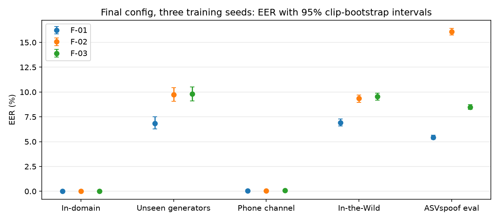
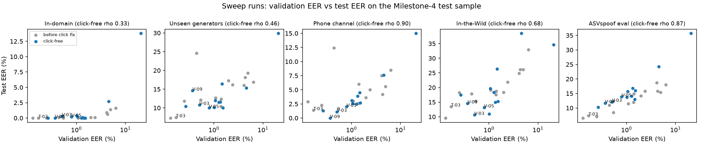
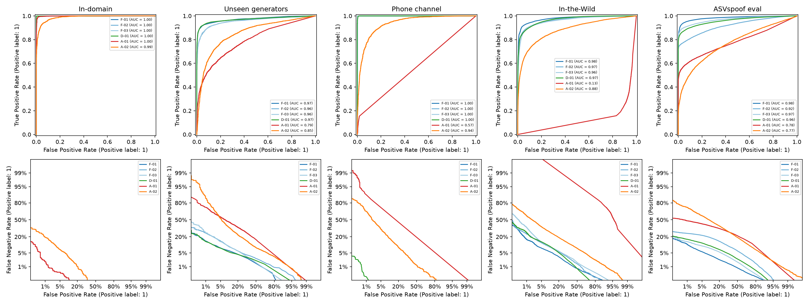
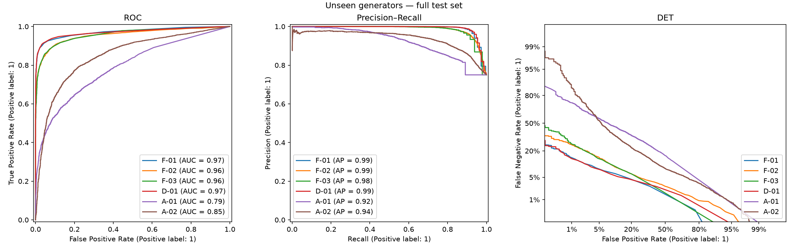
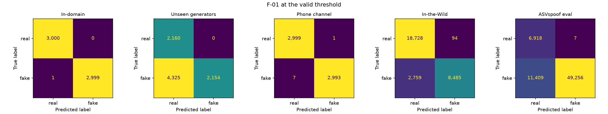
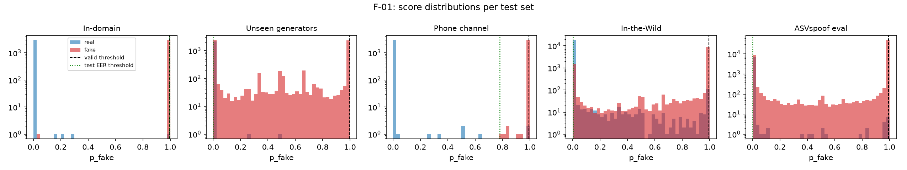
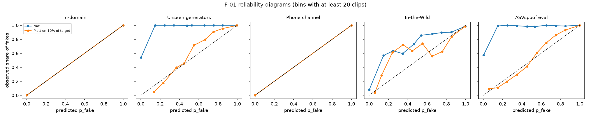
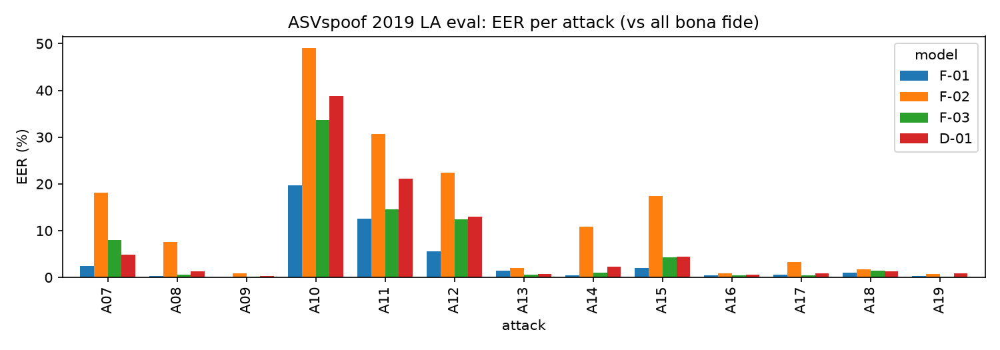

# Deepfake Voice Detection for Indian Languages using Deep Learning and Generative AI

**Milestone 5: Evaluation and Analysis of Results**

---

## 1. Overview

This milestone evaluates the models trained in Milestone 4 on the **full** test sets, about 25 times more clips than the Milestone-4 sample, and analyses where and why they fail. No model was trained or changed; every number comes from scoring saved checkpoints.

| | Result |
| --- | --- |
| Evaluation data | 118,295 test clips in five test sets plus 3,952 validation clips; leakage checks all 0 |
| Models | Final config with 3 seeds (F-01 to F-03), default config (D-01), LFCC-LCNN (A-01), AASIST-L (A-02), three cross-language models, and all 26 sweep checkpoints on the test sample |
| Best model (F-01) | EER: in-domain 0.02%, unseen generators 6.85%, phone channel 0.03%, In-the-Wild 6.91%, ASVspoof eval 5.42% |
| Against the baselines | 22–77 points lower EER than LFCC-LCNN and 12–25 points lower than AASIST-L on every hard test set |
| Main weakness | The threshold set on `valid` does not transfer: at that threshold F-01 misses 67% of unseen-generator fakes, although its ranking is good (AUC 0.97, 8% missed at 5% false alarms) |
| Calibration | Recalibrating on `valid` does not help; recalibrating on 10% of labelled target data cuts ECE from 37.8 to 2.9 points and raises accuracy on unseen generators from 50% to 93% |
| Hardest cases | IndicF5 (15.6% EER), ASVspoof attacks A10 and A11 (19.7% and 12.5%), clips under 2 s |
| Onset check | No shortcut left at the start of real clips: cutting the first second does not move real-clip scores |
| Seeds and multiple comparisons | Seed-to-seed spread (ASVspoof 5.4–16.1%) is 20 times the clip-bootstrap interval; after a Holm correction 3 of the 4 adopted settings remain significant |

Against the targets set in Milestone 1, the model meets three of four: in-domain EER below 5%, unseen-generator and phone-channel EER below 15%, and a lower EER than both baselines on every test set. It misses the fourth, an ASVspoof 2019 LA EER of 2% or below (best seed 5.42%).

The work is in four notebooks, all saved with their outputs:

| Notebook | What it does |
| --- | --- |
| [`01_full_test_sets.ipynb`](../../notebooks/Milestone-5/01_full_test_sets.ipynb) | Builds the full test sets and the merged manifest, leakage checks |
| [`02_errors_and_calibration.ipynb`](../../notebooks/Milestone-5/02_errors_and_calibration.ipynb) | Metrics at the `valid` threshold, ROC/DET curves, operating points, errors by generator, attack, language, duration and speaker, calibration, onset check |
| [`03_configurations_and_sweeps.ipynb`](../../notebooks/Milestone-5/03_configurations_and_sweeps.ipynb) | Holm correction of the sweep comparisons, seed spread, default vs final config, sweep checkpoints on test |
| [`error_analysis.ipynb`](../../notebooks/Milestone-5/error_analysis.ipynb) | Qualitative results, listening review of failures with saliency, quiet-frame analysis, full-set onset check |

The model comparison with bootstrap intervals, per-generator, per-attack and per-language tables and the temperature-scaling check are produced by [`regenerate_evaluation.py`](../../scratchpad/amit/milestone-5/regenerate_evaluation.py) and [`src/calibrate.py`](../../src/calibrate.py) into `results/milestone5_*.csv`.

---

## 2. Evaluation Setup

### 2.1 Model and Pipeline Recap

The detector from Milestone 4 is **XLS-R 300M** (Babu et al., 2021), fine-tuned end to end, with mean pooling over the frames that hold audio, dropout and a linear layer to two logits; the softmax gives `p_fake`. It has 315.4 M parameters.

| Run | Config | Role here |
| --- | --- | --- |
| F-01, F-02, F-03 | Final: encoder lr 3e-5, dropout 0.5, weight decay 0.1, phone-channel augmentation; seeds 42, 43, 44 | Main model; three seeds measure training randomness |
| D-01 | Default: encoder lr 1e-5, dropout 0.1, weight decay 0.01, no augmentation | Effect of tuning |
| C-hi, C-ta, C-te | Default config with one Indian language left out of training | Cross-language generalisation |
| A-01 | LFCC-LCNN (Lavrentyeva et al., 2019) | Spectrogram baseline |
| A-02 | AASIST-L (Jung et al., 2022) | Raw-waveform baseline |
| T-01 to T-14, T-01c, V-01 to V-11 | Hyperparameter, regularization, augmentation and stability sweeps (5,000-clip subset, 3 epochs) | Do validation choices hold on test? |

Each run's decision threshold is the EER point on `valid`, fixed before any test clip is seen.

### 2.2 Evaluation Data

**Size and composition.** The five test sets were fixed in Milestone 4 and are used unchanged; Milestone 4 scored a seeded sample of each, this milestone scores all of them.

| Test set | What it measures | Real | Fake | Total |
| --- | --- | ---: | ---: | ---: |
| `test_indomain` | New speakers (Kathbath real, IndicSynth FreeVC24 / XTTS-v2 fakes), Hindi, Tamil, Telugu | 3,000 | 3,000 | 6,000 |
| `test_unseen_gen` | Generators never used in training: Indic Parler-TTS, IndicF5, MMS-TTS (our generated set) | 2,160 | 6,479 | 8,639 |
| `test_phone` | `test_indomain` through a simulated phone channel (300–3,400 Hz, 8 kHz, G.711) | 3,000 | 3,000 | 6,000 |
| `test_itw` | In-the-Wild (Müller et al., 2022): real-world English recordings of 54 public figures | 18,822 | 11,244 | 30,066 |
| `test_asvspoof` | ASVspoof 2019 LA evaluation, attacks A07–A19 (none seen in training) | 6,925 | 60,665 | 67,590 |
| **Test total** | | 33,907 | 84,388 | **118,295** |
| `valid` | Validation speakers and generators, used only for the threshold | 1,974 | 1,978 | 3,952 |

In-the-Wild and ASVspoof were built in full from their pinned public releases (31,779 and 71,237 files); 5,360 files were dropped because less than 1 s remained after preprocessing. All leakage checks on the full sets are 0: no test speaker is a training or validation speaker, no clip appears twice (SHA-1 of the processed audio), and the ASVspoof partitions share no speakers.

**Preprocessing at evaluation.** Every clip went through the same steps as the training data (`src/preprocess.py`): mono, 16 kHz, edge-silence trimming, cutting the first 30 ms and trimming again (the click fix from Milestone 4), dropping clips under 1 s, RMS normalisation to −20 dBFS, 16-bit WAV.

**Scoring.** Each clip is cut into 4 s windows every 2 s (the last window aligned with the end), each window is scaled to zero mean and unit variance and padded with an attention mask if short, and **`p_fake` is the mean over the windows**. The middle window's score is kept as `p_fake_middle`.

### 2.3 Evaluation Environment

| Item | Value |
| --- | --- |
| Hardware | Kaggle, 2 × Tesla T4 (16 GB each), 4 CPU cores |
| Software | Python 3.13 Kaggle image; PyTorch, Hugging Face Transformers, scikit-learn, SciPy, pandas (minimum versions in `requirements.txt`) |
| Scoring code | `src/score.py` and `src/evaluate.py`: windows from many clips in one batch, fp16 on both GPUs, audio read by 4 worker processes |
| Runtime | One XLS-R model on valid + all test sets (122,247 clips): 46–47 min; a cross-language model on its language: 6–7 min |
| Analysis | CPU only, from the saved predictions; each notebook runs in a few minutes |

The scorer was sped up for this milestone; the old clip-by-clip fp32 code needed about 31 min for the 8,843-clip Milestone-4 sample, the new one 4.8 min. fp16 gives the same EER on every test set; it moves the score of borderline clips (102 of 8,843 changed by more than 0.001, all with `p_fake` between 0.01 and 0.99). `--fp32` restores the exact old scores.

**Reproducibility.** Every result folder records the git commit it was scored with.

| Item | Where |
| --- | --- |
| Model weights (F-01 to F-03, D-01, A-01, A-02) and the manifest | Hugging Face Hub: [`TarikaHedaoo/indic-deepfake-voice-detection`](https://huggingface.co/TarikaHedaoo/indic-deepfake-voice-detection) (CC-BY-NC-4.0) |
| Audio | Rebuilt from the public sources at pinned revisions by `01_data_preparation.ipynb`, `01b_test_data.ipynb` and `01_full_test_sets.ipynb`; the SHA-1 column checks every clip. The audio is not redistributed: some sources are non-commercial, and In-the-Wild contains deepfakes of real people |
| Scoring | `python -m src.score <run> --full --data <data folder> [<more folders>] --checkpoints <folder> --out <folder>` |
| Per-run outputs | `results/<run>/predictions_full.csv.gz` (one row per clip) and `results_full.json` (EER, AUC, accuracy, threshold, commit) |

---

## 3. Evaluation Metrics

| Metric | Definition | Why it fits |
| --- | --- | --- |
| **EER** (main) | Error rate at the threshold where the share of fakes accepted equals the share of real clips rejected | Threshold-free, the standard anti-spoofing metric, comparable with published results; unaffected by the class imbalance of In-the-Wild and ASVspoof |
| ROC AUC | Probability that a random fake scores above a random real clip | Ranking quality over all thresholds |
| PR AUC | Area under precision vs recall, fakes as the positive class | Sensitive to the false alarms that matter when fakes are rare |
| Accuracy, precision, recall, F1 | At the `valid` EER threshold; recall = share of fakes caught | What a deployed detector with one fixed threshold would do |
| Missed fakes at 1% / 5% false alarms | Share of fakes missed when the threshold is set to flag 1% or 5% of real clips | Operating points a real service would use, where false alarms are costly |
| ECE | Expected calibration error: mean gap between `p_fake` and the observed share of fakes, over 15 bins | Whether `p_fake` can be shown to a user as a confidence |
| 95% intervals | Percentile bootstrap over clips (1,000–2,000 resamples); paired when two models are compared on the same clips | Separates real differences from clip-sampling noise |

EER is the headline metric because the project compares across very different test sets and against published work. It hides the choice of threshold, so every EER is read together with the metrics at the `valid` threshold: the gap between the two is the main finding of Section 7.

---

## 4. Quantitative Results

### 4.1 Across Models

EER (%) on the full test sets, with 95% bootstrap intervals:

| Model | In-domain | Unseen generators | Phone channel | In-the-Wild | ASVspoof eval |
| --- | ---: | ---: | ---: | ---: | ---: |
| F-01 (final, seed 42) | **0.02** [0.00, 0.12] | **6.85** [6.27, 7.51] | **0.03** [0.00, 0.17] | **6.91** [6.56, 7.25] | **5.42** [5.26, 5.67] |
| F-02 (final, seed 43) | 0.02 [0.00, 0.10] | 9.73 [9.02, 10.39] | 0.03 [0.00, 0.13] | 9.36 [8.97, 9.68] | 16.08 [15.74, 16.44] |
| F-03 (final, seed 44) | 0.00 [0.00, 0.00] | 9.80 [9.05, 10.50] | 0.08 [0.00, 0.13] | 9.55 [9.17, 9.93] | 8.46 [8.26, 8.74] |
| D-01 (default config) | 0.05 [0.00, 0.17] | 6.85 [6.24, 7.43] | 0.55 [0.37, 0.85] | 9.79 [9.44, 10.19] | 10.20 [9.59, 10.42] |
| A-02 (AASIST-L) | 5.97 [5.50, 6.67] | 21.44 [20.44, 22.49] | 13.77 [12.88, 14.62] | 19.35 [18.88, 19.85] | 30.12 [29.65, 30.60] |
| A-01 (LFCC-LCNN) | 1.23 [0.98, 1.57] | 29.10 [28.00, 30.09] | 43.17 [42.50, 43.85] | 83.62 [83.20, 84.06] | 29.34 [28.91, 29.73] |

| Model | ROC AUC: unseen / ITW / ASVspoof | PR AUC: unseen / ITW / ASVspoof | F1 at `valid` threshold: unseen / ITW / ASVspoof |
| --- | --- | --- | --- |
| F-01 | 0.972 / 0.978 / 0.984 | 0.992 / 0.973 / 0.998 | 0.50 / 0.86 / 0.90 |
| F-02 | 0.957 / 0.966 / 0.920 | 0.987 / 0.959 / 0.991 | 0.64 / 0.86 / 0.83 |
| F-03 | 0.959 / 0.960 / 0.970 | 0.987 / 0.950 / 0.997 | 0.40 / 0.62 / 0.85 |
| D-01 | 0.971 / 0.968 / 0.960 | 0.991 / 0.959 / 0.995 | 0.62 / 0.77 / 0.85 |
| A-02 | 0.849 / 0.882 / 0.769 | 0.938 / 0.860 / 0.968 | 0.76 / 0.75 / 0.71 |
| A-01 | 0.790 / 0.131 / 0.783 | 0.924 / 0.301 / 0.973 | 0.71 / 0.28 / 0.74 |

- **XLS-R is far ahead of both baselines** on every hard test set, by 12–77 points of EER. In-domain, where all models see known generators, the gap is small.
- **The ranking is better than the decisions.** F-01 ranks unseen-generator clips with AUC 0.97, but its F1 at the `valid` threshold is 0.50, lower than AASIST-L's 0.76. AASIST-L's threshold happens to sit in a better place; its ranking is much worse. Section 7.1 explains why.
- **LFCC-LCNN is inverted on In-the-Wild** (AUC 0.13): it learnt features that point the wrong way on real-world recordings, the same failure Milestone 4 found on its sample.
- The full-set EERs are within about one point of the Milestone-4 sample for every model (largest change: AASIST-L on ASVspoof, 27.7% → 30.1%), so the Milestone-4 conclusions hold.

### 4.2 Across Configurations

**Training seeds.** F-01 to F-03 share one config and differ only in the seed:

| Test set | F-01 / F-02 / F-03 EER (%) | Range across seeds (points) | Mean width of one run's 95% interval (points) |
| --- | --- | ---: | ---: |
| Unseen generators | 6.85 / 9.73 / 9.80 | 2.95 | 1.31 |
| In-the-Wild | 6.91 / 9.36 / 9.55 | 2.63 | 0.71 |
| ASVspoof eval | 5.42 / 16.08 / 8.46 | **10.66** | 0.53 |

The seed changes the result far more than the choice of test clips does: on ASVspoof the spread across seeds is 20 times the width of a single run's bootstrap interval. A clip-bootstrap interval from one run therefore understates how uncertain a result is.

  
   
  <em>Figure 1: EER of the three final seeds on each full test set, with 95% clip-bootstrap intervals. On ASVspoof the seeds lie far outside each other's intervals.</em>

**Default vs final config.** D-01 against each final seed, paired on the same clips (1,000 resamples):

| Test set | F-01 vs D-01 | F-02 vs D-01 | F-03 vs D-01 |
| --- | --- | --- | --- |
| Phone channel | −0.52 [−0.77, −0.32] final better | −0.52 final better | −0.47 final better |
| In-the-Wild | −2.87 [−3.22, −2.55] final better | −0.43 final better | −0.24, no clear difference |
| ASVspoof eval | −4.78 [−4.98, −4.12] final better | +5.88 default better | −1.73 final better |
| Unseen generators | 0.00, no clear difference | +2.88 default better | +2.95 default better |
| In-domain | no difference (all below 0.1%) | | |

Tuning clearly helps only on the phone channel, the condition the phone-channel augmentation was added for. On the other hard sets the answer depends on the seed, and on unseen generators the untuned default is as good as or better than every final seed. The settings were chosen on a validation set that holds only known generators (Section 4.3).

**Cross-language.** Models trained without one Indian language, tested on that language's clips of the in-domain, unseen-generator and phone sets (about 6,900 clips each):

| Language left out | EER of that model | D-01 (all languages seen), same clips |
| --- | ---: | ---: |
| Hindi (C-hi) | 3.60% | 3.75% |
| Tamil (C-ta) | 3.64% | 4.72% |
| Telugu (C-te) | 5.64% | 4.77% |

A model that never heard a language is about as good on it as one that did, confirming the Milestone-4 result on the full sets.

### 4.3 Across Hyperparameter Settings

Milestone 4 chose the final settings from 24 paired-bootstrap comparisons on `valid`. Two checks were added here.

**Multiple comparisons.** With 24 tests at the 5% level, about one false positive is expected by chance. A Holm correction keeps the chance of any false positive at 5% (p-values from 2,000 paired bootstrap resamples):

| | Before correction | After Holm |
| --- | ---: | ---: |
| Significant comparisons (of 24) | 18 | 13 |

| Adopted setting | Validation EER change (points) | Holm-adjusted p | Still significant |
| --- | --- | ---: | --- |
| XLS-R learning rate 3e-5 | −0.78 [−1.36, −0.53] | 0.02 | Yes |
| Dropout 0.5 | −0.56 [−0.94, −0.30] | 0.02 | Yes |
| Phone-channel augmentation | −0.73 [−1.17, −0.46] | 0.02 | Yes |
| Weight decay 0.1 | −0.46 [−0.86, −0.10] | 0.10 | **No** |

Head learning rate 1e-2, 6 s crops, 2 s crops and dropout 0.3 also lose significance; none of them was adopted.

**Sweep checkpoints on test.** All 26 sweep checkpoints were scored on `valid` and the Milestone-4 test sample. Every adopted change lowered test EER against its own baseline on In-the-Wild and ASVspoof (by 0.4–5.6 points), including weight decay 0.1. The one exception is the phone channel, which raised unseen-generator EER by 3.0 points while cutting phone-channel EER by 3.9.

| Test set | Rank correlation of validation EER with test EER (click-free sweeps) |
| --- | ---: |
| Phone channel | 0.90 |
| ASVspoof eval | 0.87 |
| In-the-Wild | 0.68 |
| Unseen generators | 0.46 |
| In-domain | 0.33 |

Validation ranks settings well for conditions it resembles and poorly for unseen generators. T-01 to T-14 were trained before the click fix of Milestone 4 and are compared only with each other; T-01c and V-01 to V-11 were trained on the click-free data.

  
   
  <em>Figure 2: Validation EER against test EER for every sweep checkpoint on the Milestone-4 test sample, by data family. The adopted settings are labelled.</em>

---

## 5. Evaluation Visualizations

  
   
  <em>Figure 3: ROC (top) and DET (bottom) curves of all six models on each full test set. The DET axes are normal deviates, so differences at low error rates are visible.</em>

  
   
  <em>Figure 4: ROC, precision-recall and DET curves on the unseen-generator test set. The XLS-R models keep precision near 1 up to about 90% recall; the baselines lose precision early.</em>

  
   
  <em>Figure 5: Confusion matrices of F-01 at the `valid` threshold. On the hard sets almost all errors are fakes called real (bottom left); real clips are rarely flagged.</em>

  
   
  <em>Figure 6: F-01 score distributions per test set (log scale), with the `valid` threshold (dashed) and each test set's own EER threshold (dotted).</em>

The per-test-set ROC, precision-recall and DET curves, confusion matrices, reliability diagrams and score distributions of all six models are in `assets/infographics/Milestone-5/test_<set>_*.png`.

---

## 6. Qualitative Results

F-03 is used here; its threshold is 0.959. One seeded correct prediction and the most extreme mistake per test set:

| Test set | Correct example | Mistake |
| --- | --- | --- |
| In-domain | Fake, IndicSynth FreeVC24 (Tamil), `p_fake` 0.99999 → fake | Real Telugu Kathbath clip, 0.98945 → fake |
| Phone channel | Fake, IndicSynth FreeVC24 (Tamil), 0.99999 → fake | The same real Telugu clip after the phone channel, 0.99988 → fake |
| Unseen generators | Fake, Indic Parler-TTS (Telugu), 0.99991 → fake | Fake, IndicF5 (Hindi), 0.00002 → real |
| In-the-Wild | Real, 0.00005 → real | Real, 0.99998 → fake |
| ASVspoof | Fake, attack A09, 0.99998 → fake | Fake, attack A10, 0.00004 → real |

F-03 makes no in-domain false negatives and no unseen-generator false positives. Its only in-domain and phone-channel false positives are the same utterance before and after the phone channel.

**Listening review of six failures.** Six confident mistakes were listened to, with a saliency map (gradient of `p_fake` with respect to the input, smoothed over 20 ms, `src/explain.py`):

| Case | Test set | True → verdict | `p_fake` | What was heard |
| --- | --- | --- | ---: | --- |
| C01 | In-the-Wild | real → fake | 0.99998 | A deep, synthetic-sounding "r" about 1 s in |
| C02 | Phone channel | real → fake | 0.99988 | Robotic, flat intonation throughout |
| C03 | ASVspoof | real → fake | 0.99817 | Rushed delivery, then silence after about 2 s |
| C04 | Unseen generators (Hindi IndicF5) | fake → real | 0.00002 | Sounds like a television news report |
| C05 | In-the-Wild | fake → real | 0.00002 | Echo and reverberation, like a real voice in an empty room |
| C06 | ASVspoof (A10) | fake → real | 0.00004 | Unnatural pronunciation and flat delivery, clearly generated to a listener |

The failures are confident, not borderline: real clips scored near 1 and fakes near 0. The saliency peaks fall anywhere from 0.4 s to 2.0 s, and the share of gradient in the first second ranges from 15% to 65%, so the six maps show no common location. The listening notes are one listener's observations with the labels visible; they suggest audible cues (synthetic-sounding segments, robotic prosody, room reverberation, flat TTS delivery) but do not establish what the model reacts to. The audio stays private (Section 2.3).

---

## 7. Error Analysis

### 7.1 The Threshold Does Not Transfer

At the `valid` threshold almost every error on the hard sets is a **missed fake**; false alarms stay at or below 1%:

| F-01 | Missed fakes | Real clips flagged | `valid` threshold | Threshold giving the test EER |
| --- | ---: | ---: | ---: | ---: |
| In-domain | 0.03% | 0.00% | 0.994 | 0.996 |
| Phone channel | 0.23% | 0.03% | 0.994 | 0.78 |
| Unseen generators | **66.8%** | 0.00% | 0.994 | 0.0001 |
| In-the-Wild | 24.5% | 0.50% | 0.994 | 0.0006 |
| ASVspoof eval | 18.8% | 0.10% | 0.994 | 0.0012 |

`valid` contains only generators seen in training, and the model separates them almost perfectly, so its EER point sits at the very top of the score range. Fakes from new generators get much lower scores, mostly still above the real clips (hence the high AUC) but below 0.994. The other seeds and D-01 behave the same way: F-03 misses 74.7% of unseen-generator fakes and 55.4% of In-the-Wild fakes.

**Operating points.** When the threshold is set on the test set itself to flag a fixed share of real clips, the misses are much lower:

| Missed fakes (%) | Unseen generators | In-the-Wild | ASVspoof eval |
| --- | ---: | ---: | ---: |
| F-01 at 5% false alarms | 8.2 | 8.1 | 5.7 |
| F-01 at 1% false alarms | 14.7 | 16.5 | 11.2 |
| D-01 at 5% false alarms | 8.0 | 13.7 | 12.5 |
| A-02 at 5% false alarms | 53.0 | 36.5 | 58.1 |

So the main failure is the **placement of the threshold**, not the ranking.

### 7.2 Calibration

`p_fake` is not a usable confidence on new data. ECE (points) on the remaining 90% of each test set:

| F-01 | Raw | Platt scaling fitted on `valid` | Platt scaling fitted on 10% of the test set | Accuracy: `valid` threshold → recalibrated |
| --- | ---: | ---: | ---: | ---: |
| Unseen generators | 37.8 | 43.8 | **2.9** | 49.8% → 92.9% |
| ASVspoof eval | 14.6 | 15.3 | **1.3** | 83.1% → 95.8% |
| In-the-Wild | 6.3 | 7.3 | **4.0** | 90.6% → 93.8% |
| In-domain, phone | 0.0–0.1 | 0.0–0.1 | 0.0–0.1 | unchanged |

Temperature scaling on `valid` (in `src/calibrate.py`) gives the same answer: `valid` is separated almost perfectly, so the fitted temperature for F-01 and F-03 hits the lower search limit (0.05) and sharpens the scores further, leaving ECE on unseen generators unchanged (37.8 → 37.6). **Recalibration on known generators cannot fix scores on unknown ones; a small labelled sample from the target data can.** Both mappings are monotone, so neither changes the EER or AUC.

  
   
  <em>Figure 7: F-01 reliability diagrams, raw (blue) and after Platt scaling on 10% of each test set (orange). The diagonal is perfect calibration.</em>

### 7.3 Where the Errors Are

**Generators and languages.** EER of each unseen generator's fakes against the real clips of the same test set:

| Generator | F-01 | F-02 | F-03 | D-01 | A-02 |
| --- | ---: | ---: | ---: | ---: | ---: |
| Indic Parler-TTS | 3.06 | 8.01 | 8.84 | 1.55 | 18.99 |
| **IndicF5** | **15.60** | **15.90** | **12.11** | **13.43** | **34.42** |
| MMS-TTS | 3.59 | 5.65 | 8.77 | 3.94 | 9.26 |

IndicF5, a voice-cloning model that copies a reference speaker, is the hardest generator for every model and in every language (F-01: Hindi 17.2%, Tamil 16.0%, Telugu 10.4%). At the `valid` threshold all three final seeds miss most IndicF5 fakes. A second weak cell is **MMS-TTS in Telugu**: F-03 misses 718 of 720 at its threshold, and F-01 catches only 6.7% of them although its EER there is 5.0%, another case of a good ranking with a badly placed threshold. In-domain, the language makes no difference (EER below 0.2% for all three).

**ASVspoof attacks.** EER of each attack against all bona fide clips:

| Attack | A07 | A08 | A09 | **A10** | **A11** | A12 | A13 | A14 | A15 | A16 | A17 | A18 | A19 |
| --- | ---: | ---: | ---: | ---: | ---: | ---: | ---: | ---: | ---: | ---: | ---: | ---: | ---: |
| F-01 | 2.45 | 0.26 | 0.03 | **19.67** | **12.51** | 5.61 | 1.40 | 0.42 | 1.97 | 0.49 | 0.52 | 0.96 | 0.30 |
| D-01 | 4.79 | 1.31 | 0.30 | **38.83** | **21.11** | 13.03 | 0.71 | 2.27 | 4.49 | 0.51 | 0.83 | 1.35 | 0.89 |

A10 and A11 are the hardest attacks for every model; F-03 misses 97.5% of A10 fakes at its threshold. Both are Tacotron-style neural text-to-speech systems (A10 with a WaveRNN vocoder, A11 with Griffin-Lim), the closest of the 13 to modern TTS. A16 and A19 are the same systems as the training attacks A04 and A06, and are below 1% for every XLS-R model. The seed spread on ASVspoof (5.4–16.1%) is largest on A10, A11, A12, A07 and A15 (15–29 points between seeds) and below 1 point on A09, A16, A18 and A19.

  
   
  <em>Figure 8: EER per ASVspoof attack for the three final seeds and the default config.</em>

**Clip duration.** Fewer windows means less evidence. On In-the-Wild, F-01's EER is 15.0% for clips of 1–2 s, 9.0% for 2–3 s and about 3% for 4–10 s; F-03 misses 69% of In-the-Wild fakes under 2 s against 46% at 4–8 s. ASVspoof shows the same direction, more weakly (7.5% under 2 s, 3.7–4.0% at 3–6 s). Duration bins also mix recording conditions and generators, so this is a pattern, not a proven cause.

**In-the-Wild speakers.** Among the 31 speakers with at least 50 real and 50 fake clips, F-01's EER has a median of 3.6% and ranges from 0.0% to 18.0%. The worst speakers are mostly heard in older archival recordings (historical speeches, broadcast audio), where the real clips are noisy and band-limited and their fakes are imitations of that sound; for one speaker group F-03 misses 125 of 126 fakes. Speaker and recording condition cannot be separated in this data.

**Quiet frames.** For every test clip, the 10th percentile of 20 ms frame power relative to the clip's mean was measured as a proxy for pauses and background level. Missed fakes did not follow one direction across test sets (fewest misses in the quietest band on ASVspoof, a peak in the second band on In-the-Wild, flat on unseen generators), so this proxy does not explain the errors.

### 7.4 Onset Check

Milestone 4's explanation view showed F-01 reacting to the first second of a real clip, and the start of a clip had already given the label away once (the click). All three final seeds were rescored on `valid` and the Milestone-4 test sample with the first second cut, on clips of at least 2 s:

| F-01, clips ≥ 2 s | EER whole clip | EER without the first second | Mean change, real clips | Mean change, fake clips | Decisions changed |
| --- | ---: | ---: | ---: | ---: | ---: |
| `valid` | 0.00% | 0.00% | +0.000 | +0.000 | 0.0% |
| In-domain | 0.00% | 0.00% | +0.000 | +0.000 | 0.0% |
| Phone channel | 0.00% | 0.00% | +0.001 | +0.001 | 0.2% |
| Unseen generators | 6.50% | 6.70% | +0.002 | −0.016 | 4.9% |
| In-the-Wild | 4.90% | 6.41% | +0.007 | −0.017 | 4.5% |
| ASVspoof eval | 5.01% | 7.32% | +0.001 | −0.041 | 4.0% |

If the model relied on the start of real recordings, cutting it would push real clips towards "fake". Real-clip scores barely move for any seed (mean change at most 0.007), and on the Indian-language sets almost no decision changes (at most 0.2%). Where the EER rises, it is on the short English clips, where one second is a large share of the speech; for F-01 and F-02 the rise comes mainly from fake clips losing evidence. The same check on the full sets with F-03, cutting every clip including those of 1–2 s, gives the same picture with larger rises on the short English sets (In-the-Wild 9.4% → 16.0%, ASVspoof 8.4% → 15.5%) and no significant change on the other three. **No onset shortcut remains.**

### 7.5 Where the Model Is Good and Where It Is Poor

| Good | Poor |
| --- | --- |
| Known generators on new speakers, in all three Indian languages (EER ≤ 0.2%) | Fakes from new voice-cloning generators, IndicF5 above all |
| Phone-channel audio (EER ≤ 0.1%, the target of the augmentation) | The two ASVspoof attacks with end-to-end neural TTS (A10, A11) |
| Languages left out of training (3.6–5.6%) | Clips under 2 s |
| Ranking on every hard set (AUC 0.96–0.98) | The decision threshold and the confidence on any new source |
| Very few false alarms at the `valid` threshold | Results that depend strongly on the training seed |

---

## 8. Observations and Limitations

### 8.1 Key Observations

1. **The model ranks well but decides badly on new sources.** The gap between EER and accuracy at the `valid` threshold is the main result of this milestone. It comes from a validation set that holds only known generators.
2. **A small labelled sample from the target data fixes most of the decision problem.** 10% of a test set is enough to recalibrate scores and threshold (accuracy 50% → 93% on unseen generators); `valid` is not.
3. **The training seed matters more than most tuning decisions.** The final config is not reliably better than the default outside the phone channel.
4. **The data is now free of the shortcuts we know of.** Both checks on the start of the clip (the click in Milestone 4, the onset check here) are clean.

### 8.2 Expected vs Actual Performance

| Milestone-1 target | Result | Met |
| --- | --- | --- |
| In-domain EER ≤ 5% | 0.00–0.02% (3 seeds) | Yes |
| ASVspoof 2019 LA EER ≤ 2% | 5.42–16.08% | No |
| Unseen-generator and phone-channel EER < 15% | 6.85–9.80% and 0.03–0.08% | Yes |
| Lower EER than LCNN and AASIST-L on every test set | 12–77 points lower on the hard sets | Yes |

The ASVspoof target came from published systems trained on the full ASVspoof training set (Tak et al., 2022). Our model saw 5,160 ASVspoof training clips among 29,000 mostly Indian-language clips, and none of the 13 evaluation attacks; two of them (A10, A11) account for most of its errors.

### 8.3 Anomalies

| Anomaly | Explanation |
| --- | --- |
| F-02's `valid` threshold is 0.018, the other seeds' about 0.96–0.99 | `valid` is almost separable, so the EER point can fall anywhere in a wide empty gap between real and fake scores; it carries no information about new data |
| LFCC-LCNN has AUC 0.13 on In-the-Wild | Its features separate the training sources in a direction that is reversed on real-world recordings |
| Unseen-generator EER is the same for F-01 and D-01 (6.85%) | Coincidence of two different score distributions; the paired interval of the difference is [−0.64, +0.63] |
| Weight decay 0.1 loses significance on `valid` after correction, yet lowers test EER on every hard set | The validation effect is small relative to the noise of 24 tests; the test effect is consistent but from one seed per setting |

### 8.4 Limitations

| Limitation | Effect |
| --- | --- |
| Validation holds only known generators | Thresholds, calibration and setting choices do not transfer to new generators |
| Three seeds for the final config, one for every other run | Seed effects can only be measured for the final config; smaller differences between configs are uncertain |
| Sweeps scored on a test sample of about 1,000 clips per set | Their test differences are noisy; they are used for direction and ranking, not exact values |
| In-the-Wild speaker and recording conditions are confounded | Speaker-level and duration results describe where errors are, not why |
| Listening review of six cases by one listener, labels visible | Hypotheses about audible cues, not a perceptual study |
| Audio is evaluated after loudness normalisation | Original loudness and noise level cannot be studied |
| Only real vs fake is judged | No speaker verification or scam detection; a score is not proof that a recording is fake |

---

## 9. Response to the Milestone-4 Review

| Review point | Where it is addressed |
| --- | --- |
| Seed variation and multiple comparisons in the sweeps | Section 4.2 (seed spread on the full sets) and Section 4.3 (Holm correction, sweep checkpoints on test) |
| A persistent release of weights and data | Section 2.3: weights of all final and baseline models and the full manifest on the Hugging Face Hub; audio rebuilt from pinned public sources |
| AI usage disclosure | Section 10 |

---

## 10. AI Usage Disclosure

An AI coding assistant (Claude, Anthropic) was used during this milestone for:

- **Code:** the faster scoring code (window batching, fp16, worker processes), the multi-folder and onset options of `src/score.py`, the comparison and Holm-correction helpers, the full-test-set build scripts for Kaggle, and parts of the analysis notebooks.
- **Analysis:** drafting the statistical checks (paired bootstrap, Holm correction, calibration) and the tables in the notebooks.
- **Writing:** first drafts and editing of report sections, the model card and commit messages.

Every result in this report comes from code run on our data, and the outputs are saved in the notebooks. The team checked the assistant's work as follows: new code has unit tests (for example, batched scores must match clip-by-clip scores within 1e-5, and the trimmed-clip scores must match scoring the trimmed audio directly); the sped-up scorer was compared clip by clip with the Milestone-4 predictions before use; every downloaded checkpoint was checked against stored scores; the numbers in the text were checked against the notebook outputs; and design decisions, interpretations and the final text were reviewed by the team.

---

## 11. Artifacts

| Artifact | Location |
| --- | --- |
| Notebooks | `notebooks/Milestone-5/` (Section 1) |
| Scoring code | `src/score.py`, `src/evaluate.py`; tests in `tests/test_evaluate.py` |
| Comparison and calibration code | `src/compare.py` (paired bootstrap, Holm), `src/calibrate.py` (temperature scaling); tests in `tests/test_compare.py` |
| Kaggle scoring scripts | `kaggle/m5-scoring/`, `kaggle/m5-onset/`, `kaggle/m5-audio/` |
| Predictions on the full sets | `results/<run>/predictions_full.csv.gz`, `results_full.json` for F-01 to F-03, D-01, A-01, A-02, C-hi, C-ta, C-te |
| Sweep checkpoints on the test sample | `results/<T-xx, V-xx>/predictions.csv`, `results.json` |
| Onset check | `results/F-0x/predictions_trim1s.csv` |
| Summary tables | `results/milestone5_*.csv` |
| Figures | `assets/infographics/Milestone-5/` |
| Weights and manifest | [Hugging Face Hub](https://huggingface.co/TarikaHedaoo/indic-deepfake-voice-detection) |

---

## 12. References

1. Babu, A., Wang, C., Tjandra, A., et al. (2021). _XLS-R: Self-supervised Cross-lingual Speech Representation Learning at Scale_. arXiv. <https://arxiv.org/abs/2111.09296>
2. Jung, J., Heo, H. S., Tak, H., et al. (2022). _AASIST: Audio Anti-Spoofing using Integrated Spectro-Temporal Graph Attention Networks_. ICASSP 2022. <https://arxiv.org/abs/2110.01200>
3. Lavrentyeva, G., Novoselov, S., Tseren, A., et al. (2019). _STC Antispoofing Systems for the ASVspoof2019 Challenge_. Interspeech 2019. <https://arxiv.org/abs/1904.05576>
4. Tak, H., Todisco, M., Wang, X., et al. (2022). _Automatic Speaker Verification Spoofing and Deepfake Detection using wav2vec 2.0 and Data Augmentation_. Odyssey 2022. <https://arxiv.org/abs/2202.12233>
5. Müller, N. M., Czempin, P., Dieckmann, F., et al. (2022). _Does Audio Deepfake Detection Generalize?_. Interspeech 2022. <https://arxiv.org/abs/2203.16263>
6. Sharma, D. V., Ekbote, V., & Gupta, A. (2025). _IndicSynth: A Large-Scale Multilingual Synthetic Speech Dataset for Low-Resource Indian Languages_. ACL 2025. <https://aclanthology.org/2025.acl-long.1070>
7. Wang, X., Yamagishi, J., Todisco, M., et al. (2020). _ASVspoof 2019: A large-scale public database of synthesized, converted and replayed speech_. Computer Speech & Language. <https://arxiv.org/abs/1911.01601>
8. Holm, S. (1979). _A Simple Sequentially Rejective Multiple Test Procedure_. Scandinavian Journal of Statistics. <https://www.jstor.org/stable/4615733>
9. Guo, C., Pleiss, G., Sun, Y., & Weinberger, K. Q. (2017). _On Calibration of Modern Neural Networks_. ICML 2017. <https://arxiv.org/abs/1706.04599>
