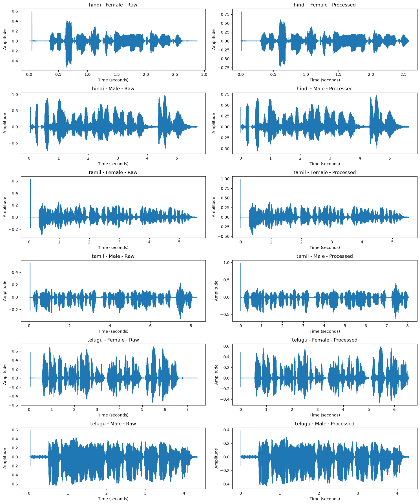
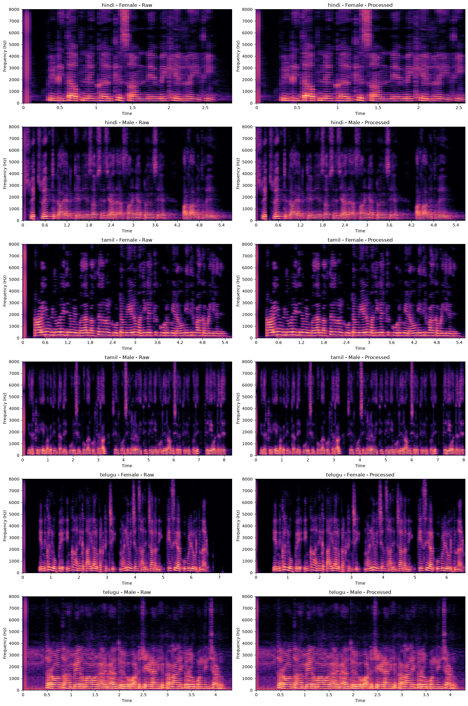
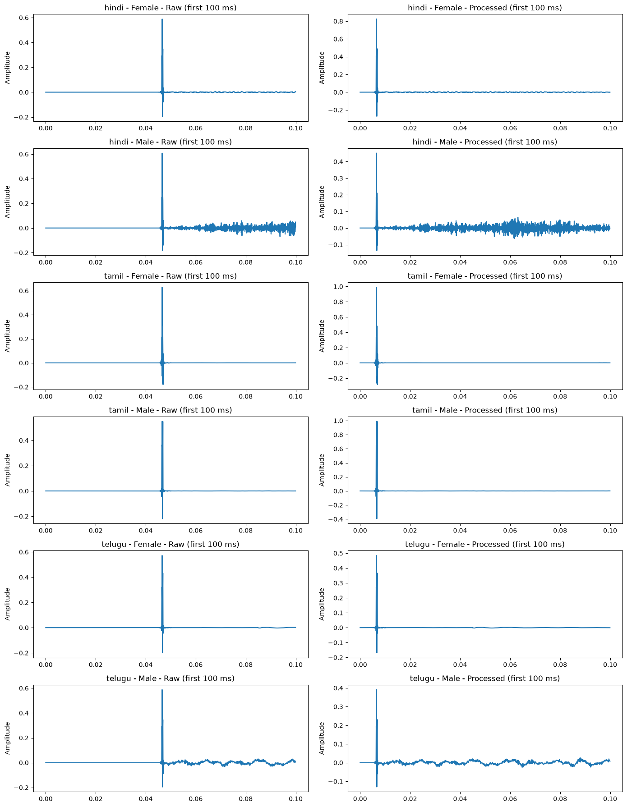

# Milestone 3 – Kathbath Audio Preprocessing Findings

## 1. Overview

The Kathbath audio preprocessing pipeline was evaluated using recordings from Hindi, Tamil and Telugu. The main objective was to check how the audio changes after preprocessing and whether the important speech information is retained.

The evaluation included raw and processed waveform comparisons, spectrogram analysis and an additional audit of the initial audio peak to understand the shift observed after silence trimming.

**Dataset Details**

- **Dataset:** Kathbath
- **Languages:** Hindi, Tamil and Telugu
- **Working sample:** 500 clips per language (1,500 clips in total)
- **Preprocessing:** Shared `preprocess.py` from Milestone 2
- **Output format:** 16 kHz, mono, 16-bit PCM WAV

All the following checks and observations are based on the 1,500-clip working sample, not the complete Kathbath dataset.

## 2. Raw vs. Processed Audio Comparison

One recording from each language and gender group was selected for comparison. Duration, RMS and peak amplitude were used to understand the changes after preprocessing.

| Language | Gender | Raw Duration (s) | Processed Duration (s) | Raw RMS | Processed RMS | Raw Peak | Processed Peak |
|---|---|---:|---:|---:|---:|---:|---:|
| Hindi | Female | 2.879 | 2.580 | 0.0676 | 0.1000 | 0.5891 | 0.8248 |
| Hindi | Male | 5.689 | 5.640 | 0.1341 | 0.1000 | 0.9727 | 0.7222 |
| Tamil | Female | 5.596 | 5.540 | 0.0481 | 0.0760 | 0.6294 | 0.9900 |
| Tamil | Male | 8.313 | 8.060 | 0.0472 | 0.0862 | 0.5502 | 0.9900 |
| Telugu | Female | 7.430 | 6.560 | 0.1109 | 0.1000 | 0.6965 | 0.5901 |
| Telugu | Male | 4.342 | 4.300 | 0.1496 | 0.1000 | 0.6504 | 0.4326 |

### Waveform Comparison

The following plots show the raw and processed waveforms for all six language and gender groups.

### Observations

- All raw recordings were already in 16 kHz and mono format, so no change was required in their sample rate or number of channels.
- The processed recordings are slightly shorter because low-energy portions at the beginning and end of the audio are removed during silence trimming.
- RMS is generally brought closer to the target level of -20 dBFS (approximately 0.1).
- In the two Tamil examples, the processed RMS is below 0.1 and the peak reaches 0.99. This happens because peak limiting scales down the audio when the normalized peak exceeds the allowed limit.

## 3. Spectrogram Comparison

Spectrograms were compared to understand whether preprocessing caused any major changes in the frequency patterns of the recordings.

### Observations

The overall speech-frequency patterns look broadly similar in the raw and processed recordings. No major loss of speech-frequency information was noticed in these examples.

## 4. Initial Peak (Transient) Check

During the waveform comparison, a shift was observed in the position of the largest peak within the first 100 ms after preprocessing.

To understand whether this shift was consistent across recordings, an additional audit was performed on 100 recordings from the existing 1,500-clip sample. The recordings were selected across all six language and gender groups.

The following plots show the first 100 ms of the raw and processed recordings.

### Audit Results

| Language | Gender | Recordings | Raw Mean Peak Time (ms) | Processed Mean Peak Time (ms) | Raw Median Peak Time (ms) | Processed Median Peak Time (ms) |
|---|---|---:|---:|---:|---:|---:|
| Hindi | Female | 17 | 46.71 | 6.71 | 46.56 | 6.56 |
| Hindi | Male | 17 | 46.65 | 11.34 | 46.56 | 6.56 |
| Tamil | Female | 17 | 46.64 | 6.64 | 46.56 | 6.56 |
| Tamil | Male | 17 | 46.62 | 11.89 | 46.56 | 6.56 |
| Telugu | Female | 16 | 46.60 | 6.60 | 46.56 | 6.56 |
| Telugu | Male | 16 | 46.64 | 6.64 | 46.56 | 6.56 |

### Observations

- In the raw recordings, the median position of the largest peak is around 46.56 ms across all groups.
- After preprocessing, the median peak position shifts to 6.56 ms across all groups.
- This represents a shift of approximately 40 ms.
- The shift is consistent with the frame-based silence-trimming step used in the preprocessing function.
- For Hindi Male and Tamil Male, the processed mean peak time is slightly higher than the median. This indicates that a few recordings have different peak positions, although the median remains at 6.56 ms.

## 5. Summary

The raw and processed Kathbath recordings were evaluated across Hindi, Tamil and Telugu using waveform comparisons, spectrograms and a 100-recording initial peak audit.

The results show broadly similar speech-frequency patterns after preprocessing. The median position of the initial peak shifts from 46.56 ms in the raw recordings to 6.56 ms in the processed recordings, which is consistent with the silence-trimming step.
